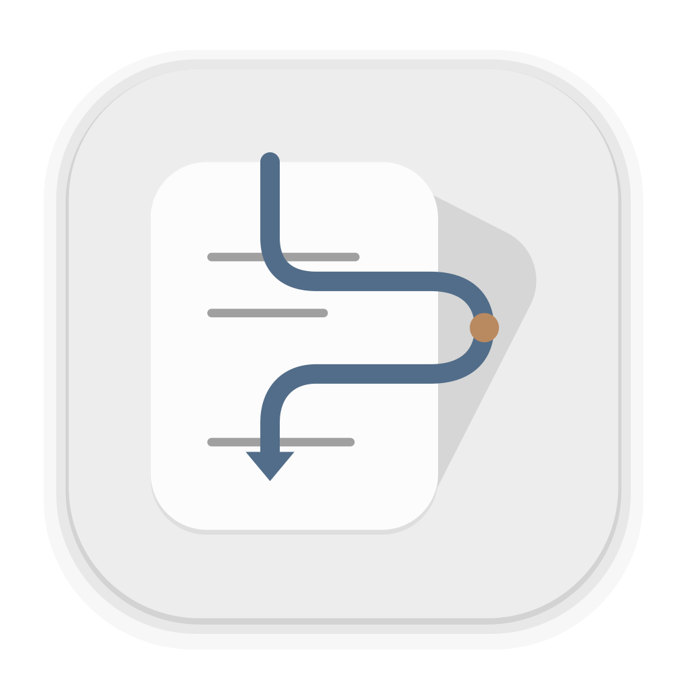

# Placekeeper

Placekeeper is a desktop PDF reader for reading and marking up papers, drafts, and other documents. Search the PDF, follow a citation in a separate References tab, and return to where you were reading. Highlight text, suggest corrections, or leave page notes, then save a reviewed copy you can open in another PDF reader.

## Install

[Download the latest desktop release](https://github.com/brad-ross/placekeeper/releases/latest). The current release, **0.3.1**, includes the installers below and a `SHA256SUMS` file. The installers bundle the runtime.

| Platform | Install |
| --- | --- |
| macOS, Apple Silicon or Intel | Open the DMG for your Mac, then run **Install Placekeeper.app** inside it. |
| Windows x64 | Run **Setup.exe**. |
| Ubuntu or Debian x64 | Install the `.deb` with your package manager, then launch Placekeeper as your normal user. |

The installers are unsigned. See the [installation guide](docs/installation.md) for OS approval, source builds, and uninstall instructions. If you are replacing an existing installation, see [Manual upgrades and recovery](docs/desktop-upgrades.md). To check for a newer release, choose **Help → Check for Updates**. You install updates manually.

To build from a checkout, install Node.js 24+, pnpm 11.16.0, and a native C compiler. Run `./install.sh` on macOS or Linux, or `./install.ps1` from Visual Studio Developer PowerShell on Windows. Both accept `--dry-run` to show the installation destination first.

## Read and review a PDF

Open Placekeeper and choose a local PDF. Click a citation or another internal PDF link to preview its destination, then open it in the main reader or in **References**. References tabs let you follow links while keeping your main reading position. Click or keyboard-activate an embedded web link to open it in your browser.

The default save creates a reviewed copy. **Replace Original** is a separate, explicit action. If another app rewrites an open PDF, Placekeeper waits for a valid file and refreshes the review. It waits until active annotation edits finish, then carries over your reading position and annotations where it can. If Placekeeper cannot confidently reattach an annotation, it leaves it available for manual reattachment. See [Privacy and recovery](docs/privacy-and-recovery.md) for what stays local and how to recover drafts.

In the current source tree, you can pan across pages and zoom in link previews. The References tray also detects when the original target scrolls out of view more reliably. Hover the tab or move keyboard focus into it to reveal **Return to reference**. The toolbar also has buttons for opening References and the Annotations Workspace. These changes landed after 0.3.1.

## Optional integrations

Set up integrations on first launch or later through **Help → Set Up Integrations**.

- **Chrome** can open eligible PDFs in Placekeeper while keeping the original tab and URL. This is experimental and requires Chrome 151 or later. After loading the extension, turn on **Open PDFs automatically** in its popup. [Chrome setup](docs/installation.md#open-chrome-pdfs-automatically-experimental)
- **Codex** can open a local PDF in a Placekeeper panel and use the current review as context in the chat that opened it. On hosts with the extension entry points, you can also open PDFs from a file menu or resume a review from **Recent Documents**. Availability depends on the installed build and host. [Plugin setup](docs/installation.md#optional-integrations) · [PDF review in chat](docs/guides/chatgpt-extension.md)
- **LaTeX editors** can use SyncTeX to jump between source and PDF. The VS Code extension opens Placekeeper in an editor panel. Placekeeper watches for a rebuilt PDF while your editor or build tool runs LaTeX. [Setup for VS Code, Zed, Neovim, Sublime Text, and Emacs](docs/guides/editor-synctex.md)

## Web beta

The web beta can open a local PDF or a compatible public HTTPS PDF and export a reviewed copy. It is available for local testing and has no public release. Export before closing or reloading the tab, because the beta has no autosave or recovery. Use non-confidential PDFs. [Web beta guide](docs/web-beta.md)

## Contribute

See [Contributing](CONTRIBUTING.md) for the repository map, build instructions, and tests. The [documentation index](docs/README.md) links to operating guides, design decisions, and lessons from past fixes. See [Support and diagnostics](docs/support.md) for troubleshooting.
