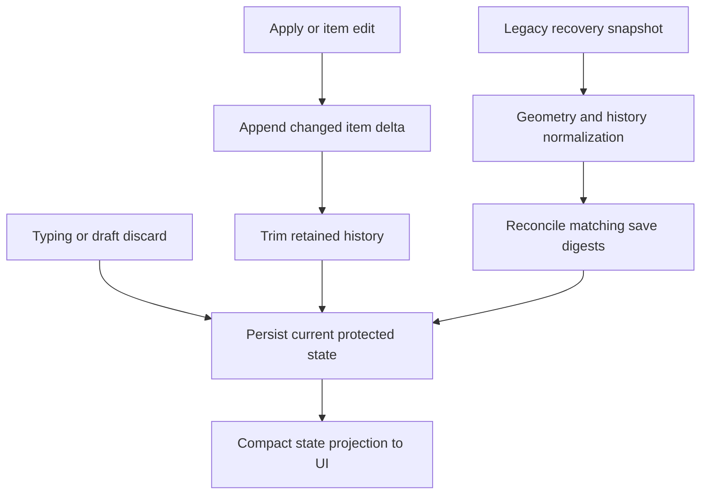

# Compact review history and separate draft recovery

## Goal Capsule

- Objective: Long annotation sessions remain responsive, recoverable, and easy to undo.
- Means: Separate draft durability from document undo, retain reversible changes to individual items, and bound retained history (KTD1–KTD4).
- Authority: The user authorized planning and implementation of the discussed improvement. The parent plans, orchestrates, and checks; GPT-6.1 Sol medium subagents author implementation.
- Execution: Continue the existing transport-fix branch and draft PR. Preserve current reviews and existing recovery files. Stop on any unresolved risk of annotation or protected-draft loss.
- Completion: Parent verifies integrated changes, reviews them, commits, and updates the draft PR.

---

## Product Contract

### Summary

Typing remains recoverable without creating document-level undo steps. Applying an annotation creates one meaningful undo step. History stores changed entities rather than copies of the whole review.

### Problem Frame

Every protected draft update currently appends before/after snapshots of all annotations, drafts, and audit records. JSON persistence duplicates shared objects. The transport fix prevents those snapshots from exceeding native response limits, but stored state remains unnecessarily large.

### Requirements

- R1. Every acknowledged draft update remains durable and advances the canonical revision, without adding an undo entry or truncating redo.
- R2. Apply creates one item-level undo action. Undo restores the previous item or removes the new item without reopening the consumed draft. Undo/redo preserves unrelated current pending drafts and draft-discard audit records.
- R3. New history contains only changed items and their positions, plus relevant item audit changes. Unchanged annotations must not be duplicated.
- R4. Retain at most 200 semantic entries and 4 MiB of serialized history. Trim oldest applied entries first, then farthest redo entries if necessary; keep current state intact even if a single entry exceeds the budget and cannot be retained.
- R5. Legacy recovery snapshots remain readable. Compact legacy history, remove draft-only steps, remap cursor and rebuild boundary, and preserve current items, pending drafts, audit, and applicable undo/redo behavior.
- R6. A document generation transition prunes history that can no longer be undone. Recovery migration must not falsely change PDF saved/dirty status solely because history bookkeeping changed.
- R7. Existing native textarea undo, disabled global undo during authoring, generation/owner fences, interaction receipts, and the compact transport projection remain intact.

### Scope Boundaries

No new history UI, database, event journal, compression dependency, or change to draft persistence frequency. Owner/adoption policy changes are outside scope: existing reconciliation adoption must keep working. No live private recovery records are rewritten by investigative scripts; migration is exercised on copies before any installed-app update.

---

## Planning Contract

### Key Technical Decisions

- KTD1. Draft protection and draft discard update current durable state only; document undo records applied item changes (session-settled: user-approved — chosen over retaining per-keystroke document snapshots: smaller state and meaningful undo while preserving recovery).
- KTD2. Use versioned entity deltas with complete before/after values only for changed items and positions. Preserve ordering and use item-audit identities rather than restoring the whole audit array. Keep legacy snapshot decoding at the migration boundary; avoid general JSON patch machinery.
- KTD3. History normalization removes legacy draft-only steps and handles a cursor in the middle of history. A helper must return remapped cursor and boundary. Normalization does not itself increment canonical revision. Geometry migration must preserve metadata and cover both sides of changed items.
- KTD4. Apply count and UTF-8 serialized-byte budgets. The current state is the checkpoint; no redundant checkpoint object is needed. Prune unreachable pre-generation history and rebase cursor/boundary. Avoid serializing entire review state merely to measure history.
- KTD5. Saved-state digests currently include workflow.historyBoundary. If migration changes it, reconcile a saved/desired digest only when it matched the pre-migration semantic state; never mark genuinely unsaved edits clean. Preserve revision and source identity fences.

### Assumptions

The 200-entry / 4 MiB policy is a conservative starting bound, not a promise of unlimited undo. Current items and unfinished drafts are never discarded to meet a history budget. New storage may not be readable by older app builds; legacy input compatibility and explicit version validation are required.

### Design

### Evidence

`packages/core/src/review-reducer.ts` appends snapshots at its shared command tail. `apps/web/src/review/use-authoring-session.ts` protects each changed draft value. `apps/service/src/recovery/draft-snapshot.ts` persists JSON with checksums; `recovered-review-preparation.ts` migrates native imports through snapshots. `packages/pdf-backends/src/embedpdf-adapter.ts` currently reconstructs geometry-migrated history from item arrays, losing other entry metadata. The existing recovery/autosave architecture in `docs/solutions/architecture-patterns/recoverable-editable-pdf-annotation-autosave.md` requires persistence before acknowledgment.

---

## Implementation Units

### U1. Compact history engine

- Goal: Add a small reusable core module for entity deltas, legacy conversion, replay, and retention without yet changing live reducer behavior.
- Requirements: R3–R5; KTD2–KTD4.
- Dependencies: None.
- Files: New `packages/core/src/review-history.ts` and focused `packages/core/test/review-history.test.ts`; types may live in the new module initially to keep the current tree compatible.
- Approach: Use stable item IDs with stored positions; compare legacy content structurally. Replay affects only represented entities. Audit deltas target item-discard records and preserve unrelated draft audit. Expose clear normalization/append/replay operations for U2, with no circular runtime imports.
- Test scenarios: Add/edit/remove ordering; multiple changed entities; unrelated current annotations survive replay; audit preservation; legacy duplicate snapshots become no-ops; mid-history cursor and boundary mapping; count and UTF-8 byte bounds; oversized entry; redo trimming; malformed versioned history rejected without weakening legacy compatibility.
- Verification: Focused helper tests pass with growth depending on changed entities, not total annotations. Record a synthetic before/after serialized size comparison.

### U2. Integrate semantic undo and draft separation

- Goal: Use compact history for all new commands and preserve current drafts through undo/redo.
- Requirements: R1–R3, R6–R7; KTD1–KTD4.
- Dependencies: U1.
- Files: `packages/core/src/review-model.ts`, `packages/core/src/review-reducer.ts`, core history helper if needed, `packages/core/test/review-commands.test.ts`, `packages/core/test/review-runtime-protocol.test.ts`; minimum union compatibility adaptations in `packages/pdf-backends/src/embedpdf-adapter.ts` and `apps/service/src/sessions/recovered-review-preparation.ts` plus owning tests if necessary.
- Approach: Maintain canonical revisions and existing validation. Draft-only commands bypass history and redo truncation. Apply creates item-only history. Generation transitions discard inaccessible history. Preserve legacy inputs until U3 normalizes recovery. Coordinate exports/schema with U1 before editing.
- Test scenarios: Hundreds of protected updates add zero history; Apply adds one; undo Apply does not recreate draft; undo preserves another current draft; draft updates and discard preserve redo; item-discard undo preserves later draft audit; branching after undo; rebuild clears history but preserves current items/drafts with their existing frozen state.
- Verification: Core and affected adapter tests pass and typecheck succeeds. Do not weaken security or receipt behavior to make tests pass.

### U3. Recovery compatibility and save identity

- Goal: Reopen existing reviews with compact history and correct saved/dirty state.
- Requirements: R5–R7; KTD3–KTD5.
- Dependencies: U2.
- Files: `apps/service/src/recovery/draft-snapshot.ts`, `apps/service/src/sessions/recovered-review-preparation.ts`, `apps/service/src/sessions/session-broker.ts` only where migration/save identity requires it, `packages/pdf-backends/src/embedpdf-adapter.ts`, `apps/service/test/recovery.test.ts`, `apps/service/test/live-document-replacement.test.ts`, `test/conformance/pdf-writer.conformance.test.ts` as applicable.
- Approach: Normalize legacy entries after required geometry migration, preserve metadata and newly imported native marks, reconcile matching save digests, and persist compact form through the normal recovery boundary. Validate new format before accepting it. Never blanket-reset saved status.
- Test scenarios: Legacy typing-heavy review resumes with latest protected text and small semantic history; clean stays clean and dirty stays dirty; mid-history redo survives; generation boundary mapping; nonzero-crop legacy geometry survives undo; native imports survive undo; compact snapshot checksum roundtrip; malformed history recovery fails safely.
- Verification: Recovery and replacement tests pass. Use synthetic fixtures; private files stay out of committed tests and public artifacts.

### U4. Authoring and end-to-end regression checks

- Goal: Prove UI undo behavior and native long-session recovery follow the new contract.
- Requirements: R1–R7.
- Dependencies: U2; independent of U3 writes, final verification waits for U3.
- Files: `apps/web/test/review-command-surface.test.ts`, `apps/web/test/review-shell-reference-authoring.test.tsx`, `apps/web/test/refresh-interaction-lifecycle.test.tsx`, `apps/service/test/macos-runtime.test.ts`; production web code only if a demonstrated contract failure requires it, reported before editing.
- Approach: Preserve native editable undo routing. Use existing authoring/runtime entrypoints and service persistence rather than mocks that supply the expected history. Update obsolete assertions to the new semantic contract.
- Test scenarios: Global undo unavailable while typing; editable Cmd-Z stays local; Apply produces one undo; latest draft survives restart; subsequent edit/undo/redo still works through compact transport; long session remains within history budget.
- Verification: Focused UI/runtime suites pass and no changes to visual layout are needed.

---

## Verification Contract

Use test-first evidence for each behavior-bearing unit. Parent runs authoritative integrated checks after inspecting worker changes. Run targeted Vitest files with `--exclude '**/.claude/**'`, repository typecheck, relevant service/PDF conformance tests, then the full suite once. Separate any unchanged baseline failures from regressions. Build the native app and run packaged smoke checks after integrated tests pass; no installation while reviews are active.

Record serialized history bytes for a synthetic sequence with many annotations and many draft updates against the old snapshot representation. Required outcomes: draft typing adds zero history; retained history never exceeds 200 entries or 4 MiB; compact per-item edits avoid copying unchanged items. Validate legacy migration on disposable recovery copies before installation.

## Definition of Done

All four units are implemented and their behavioral tests pass. Current annotations and protected drafts survive migration, undo/redo, and restart. Clean/dirty save classification remains correct. Parent inspects actual diff, resolves review findings through workers, removes abandoned implementations, and records verification limitations honestly in the draft PR. No private PDF content or recovery files are committed.
