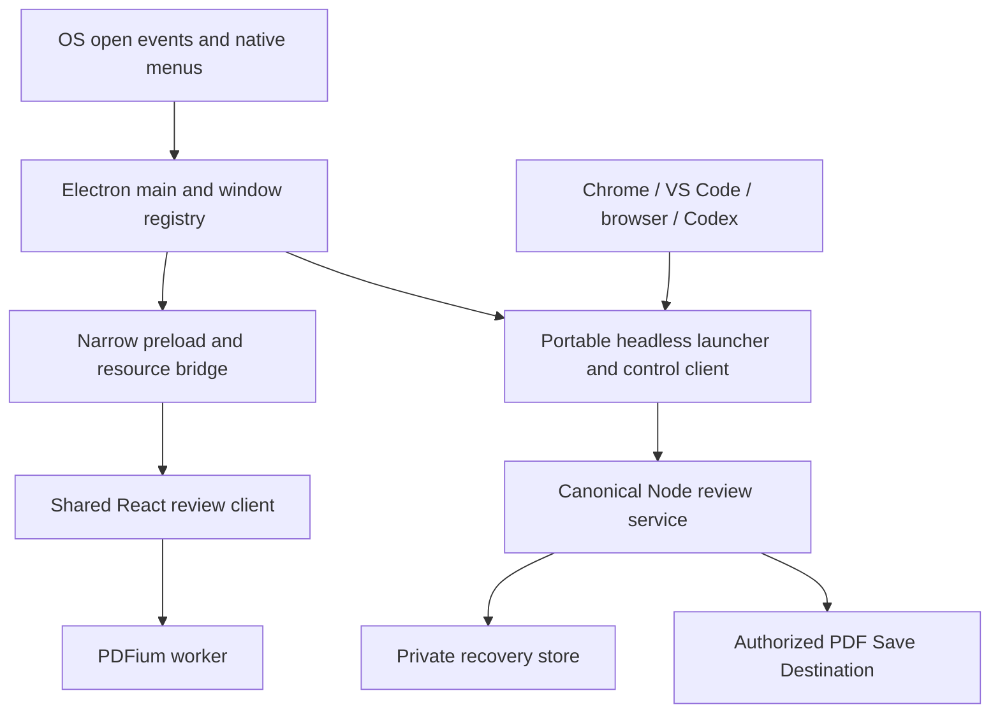
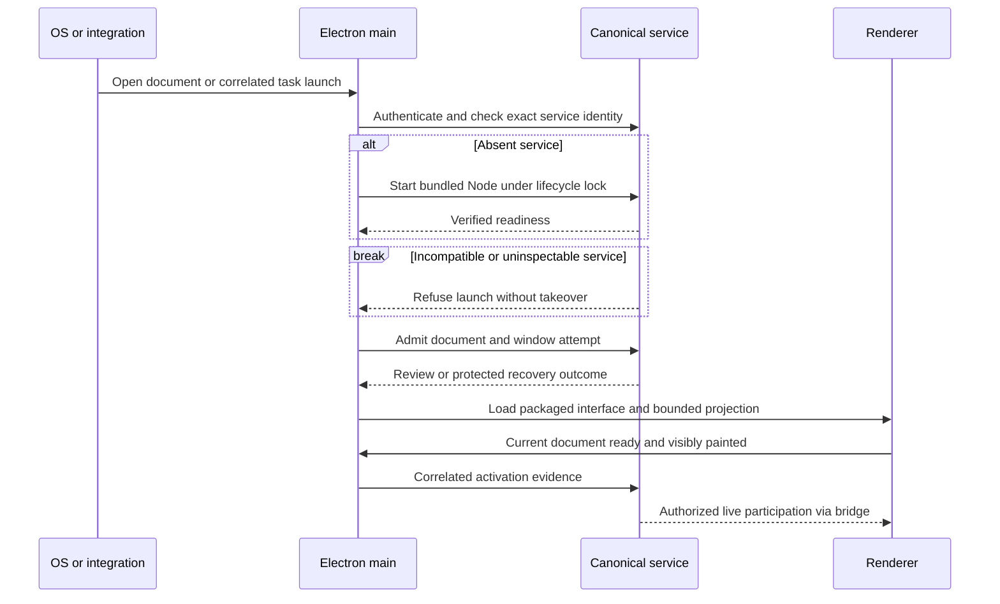
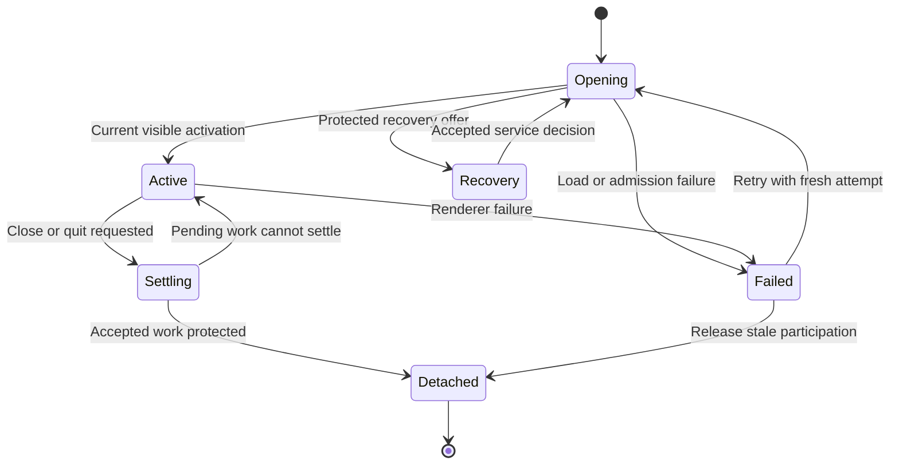
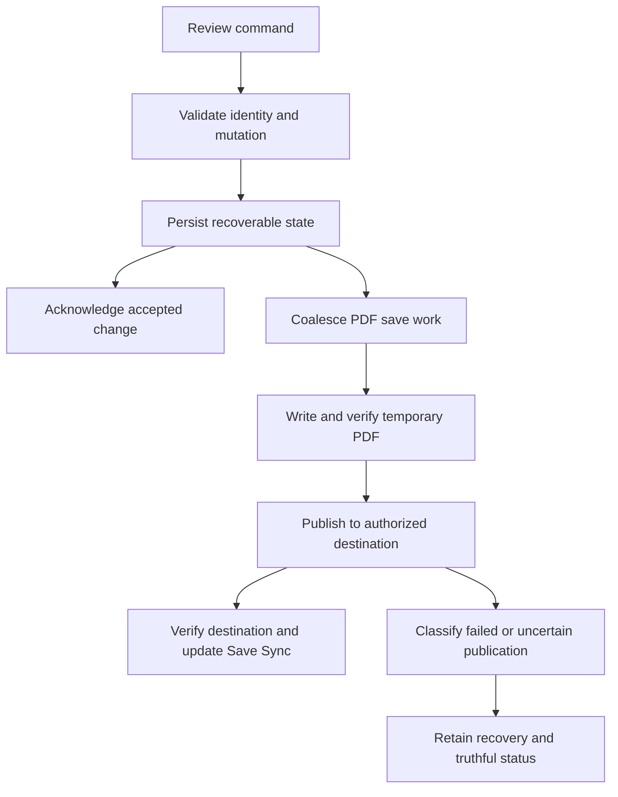
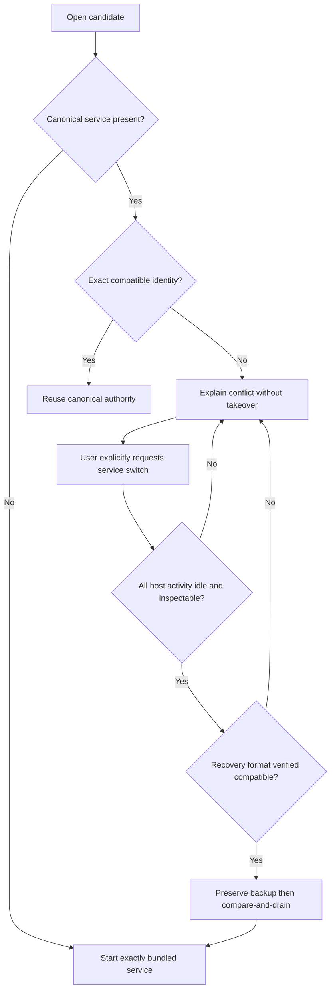

# Cross-Platform Electron Desktop Migration - Plan

## Goal Capsule

- **Objective:** Review and annotate local PDFs in Placekeeper on macOS, Windows, and Linux with the familiar desktop experience.
- **Means:** An Electron desktop host for the existing shared review client and service (KTD1).
- **Authority:** Product requirements below govern behavior; technical decisions govern implementation. Historical AppKit-only plans remain evidence, but their prohibition on Electron is superseded for this migration.
- **Execution profile:** Establish packaged runtime and platform correctness early, preserve existing host contracts, then qualify visual fidelity and responsiveness. This document authorizes no implementation by itself.
- **Stop conditions:** Do not replace a busy or unidentified daemon, discard recovery to make startup work, weaken file authorization, or call an untested platform qualified. Report unavailable OS runners as qualification gaps while completing independent work.
- **Delivery ownership:** The implementer delivers installable personal-test artifacts and their evidence. Public release, automatic installation over the user's Mac app, and retirement of AppKit require later direction.

---

## Product Contract

### Summary

Build a self-contained Electron desktop application for macOS, Windows, and Linux. Preserve the shared interface and existing review workflows while allowing native OS fonts, window controls, and dialogs. Deliver personal test builds alongside the existing Mac app.

### Problem Frame

The current standalone desktop host requires macOS. The review interface and PDF engine already run in multiple web-based hosts, but desktop launching, file access, lifecycle, and packaging contain Mac-specific assumptions. Users on other operating systems cannot obtain the equivalent standalone experience.

### Requirements

**Platform and appearance**

- R1. Deliver locally installable personal-test builds for all three OS families with bundled runtime dependencies and no requirement for a preinstalled Mac app or system Node.
- R2. Preserve the current product layout, colors, icons, toolbar composition, annotation presentation, and interactions; OS fonts, native window controls, dialogs, and platform shortcut modifiers may differ.
- R3. Keep the current AppKit application installed and usable during evaluation; candidate installation must not silently change default PDF handlers, canonical URL registration, or existing integration configuration.

**Review and lifecycle parity**

- R4. Preserve PDF navigation, selection/copy, search, outlines, Reference Tabs, annotations, undo/redo, automatic source refresh, Save Destination, Save Sync, and portable export semantics.
- R5. Support concurrent document windows, duplicate-open focus within the Electron app, window restoration, and independent recovery from a renderer failure.
- R6. Preserve acknowledged Protected Drafts and accepted review changes across close, quit, crash, restart, and service switching; unacknowledged input must never be labeled protected or saved.
- R7. Preserve service-owned Review Session, Document Generation, Review Revision, Interaction Hold, Task Binding, and activation semantics across desktop and existing hosts.

**Local authority and persistence**

- R8. A local user has one canonical service authority for normal use; incompatible service startup must fail visibly without killing the incumbent or starting an independent writer against the same PDFs.
- R9. Preserve renderer isolation, per-window authorization, private control access, and generation/revision fencing on every supported OS.
- R10. Failed or ambiguous file publication must retain recovery and truthful save status; no platform workaround may delete the original before its replacement is safely published.

**Integration and qualification**

- R11. Preserve existing browser, Chrome, VS Code, CLI, and Codex/MCP contracts, and make their launcher/discovery paths work with the candidate on supported host platforms.
- R12. Remain responsive during reading and annotation, accepting a modest startup/memory cost for cross-platform compatibility; qualify against the explicit measurement contract below rather than promising AppKit-equivalent resource use.
- R13. Provide reproducible personal-build instructions, deliberate candidate selection, safe service-switch/rollback instructions, and an evidence report distinguishing passed, failed, and untested combinations.

### Key Decisions

- **Electron replaces the standalone host.** (session-settled: user-directed — chosen over retaining a Mac-only host: cross-platform compatibility justifies some performance cost.) Governs R1, R12.
- **All three OS families are in the first delivery.** (session-settled: user-directed — chosen over staged OS delivery: personal builds should cover macOS, Windows, and Linux.) Governs R1, R13.
- **Native OS details are allowed.** (session-settled: user-directed — chosen over uniform fonts and custom window controls everywhere: retain the current product appearance with platform conventions.) Governs R2.
- **Personal builds precede public distribution.** (session-settled: user-directed — chosen over public release work: signing and publication are deferred.) Governs R1, R3, R13.
- **Preserve the existing experience and fallback.** (session-settled: user-approved — chosen over a reduced-feature replacement or immediate AppKit removal: evaluate safely without losing established workflows.) Governs R3–R11.

### Acceptance Examples

- AE1. Given two different PDFs, opening each creates its own window; reopening either focuses that window without resetting its reading position. Covers R4, R5.
- AE2. Given an acknowledged Protected Draft, killing its renderer and reopening offers the existing recovery choices; another document window remains usable. Covers R5, R6.
- AE3. Given a Windows PDF held open with replacement denied, saving preserves its original bytes and recoverable edits, shows failed Save Sync, and succeeds after release/retry or an authorized save-copy. Covers R4, R10.
- AE4. Given an incompatible running service with an active Chrome review or Task Binding, launching Electron reports the conflict and leaves that work untouched. Covers R7, R8, R11.
- AE5. Given compatible AppKit and Electron shells viewing the same PDF, both observe one canonical review; closing either detaches only its participation. Covers R5–R8.
- AE6. Given a native launch associated with a task, Task Binding becomes current only after correlated visible activation; stale callbacks or a failed window do not authorize live PDF context. Covers R7, R9, R11.

### Scope Boundaries

This plan covers personal installation, migration readiness, and local evaluation. It preserves the current PDF engine and review model. No cloud account, sync service, UI redesign, or change to PDF annotation format is included.

**Deferred to Follow-Up Work:** Public publishers, Developer ID/Windows signing and notarization, auto-update, general public installation support, and removal of AppKit after acceptance. Windows/Linux ARM builds and additional Linux distribution packages follow the initial qualification matrix in KTD8.

**Considered and not built:** A replacement review database, an Electron-owned recovery engine, a bundled native PDF renderer, automatic retries of all failed saves, and a new agent tool surface. Existing service contracts cover those needs; add such mechanisms only if a demonstrated migration failure cannot be fixed at the host/platform boundary.

---

## Planning Contract

### Key Technical Decisions

- KTD1. **Add a dedicated desktop host, retaining one shared React tree.** Create `apps/electron` and an Electron `HostRuntime` adapter. Reuse production review components and PDFium worker/WASM. Keep `apps/electron-spike` as historical feasibility evidence, not a production dependency. This implements R1, R2, R4 and the settled Electron direction without a second product UI.
- KTD2. **Keep service control platform-specific behind one client contract.** Retain private Unix-domain sockets on macOS/Linux. Use a loopback-only, authenticated control transport on Windows because Node's Unix permission model does not establish named-pipe privacy. Its per-user discovery/credential file must be protected and verified with Windows ACLs. Authenticate the server before sending privileged requests; bind client authorization and subsequent frames to a fresh connection challenge and daemon epoch, reject replay, and retain existing bounded framing/schema checks. Implement with standard Node cryptographic primitives and independently review the protocol before shipping the Windows candidate. No new public network endpoint is allowed. This preserves R8, R9 without a platform-native pipe-server dependency. Sources: [Node IPC](https://nodejs.org/download/release/latest-v24.x/docs/api/net.html), [Windows pipe security](https://learn.microsoft.com/en-us/windows/win32/ipc/named-pipe-security-and-access-rights). The named-pipe alternative remains viable but is not selected because secure DACL control would require another runtime boundary.
- KTD3. **Package an independent Node service runtime and headless launcher.** Desktop main calls the same launcher/control client as integrations. It must not use Electron's executable as a substitute for Node or make daemon lifetime a child of the last window. Extract portable resource-location metadata from current Mac packaging. Service identity continues to cover the exact service and served assets; desktop artifact identity is separate. Governs implementation of R1, R7, R8, R11. Sources: `apps/service/src/host/service-daemon.ts`, [Electron fuses](https://www.electronjs.org/docs/latest/tutorial/fuses).
- KTD4. **Use canonical data for normal operation and isolated copies only in test harnesses.** Preserve the existing Mac application-support/recovery root; use per-user local application data on Windows and XDG application state on Linux. Keep Electron window preferences separately namespaced. Reuse only an exactly compatible service. An explicit service switch uses existing compare-and-drain/lifecycle-lock machinery, verifies all host activity is idle, preserves a recovery backup, and requires candidate readiness. Rollback requires proven candidate-daemon retirement and recovery-format compatibility; closing its GUI alone is insufficient. No persisted review-format change is planned. Automated side-by-side tests use private roots, ports, and copied PDFs. Governs R3, R6, R8, R13. Follow `docs/solutions/architecture-patterns/upgrade-safe-shared-per-user-daemon-lifecycle.md`.
- KTD5. **Preserve the native host contract through a narrow Electron bridge.** Reuse host-neutral review/runtime projections and factor Mac-specific presentation away from reusable service lifecycle semantics. Add an explicit Electron host identity rather than impersonating `macos` or `finder`. Sandboxed renderers get typed operations, bounded document resources, and semantic commands through preload; no arbitrary filesystem paths, raw IPC object, shell execution, or broad localhost proxy. Main validates sender frame, window/attempt ownership, and request schema. Packaged assets load through an allowlisted custom protocol with strict CSP; PDF resources remain capability-scoped. Preserve visible-ready activation, stale-attempt retirement, request idempotency, and all generation/revision fences. Sources: `apps/web/src/host/runtime.ts`, `apps/macos/Sources/PlacekeeperMac/ReviewBridge.swift`, [Electron security](https://www.electronjs.org/docs/latest/tutorial/security).
- KTD6. **Reuse persistence transactions, adapting platform operations.** Keep the accepted-mutation → durable recovery → asynchronous PDF-save sequence. Isolate path identity, private storage permissions, process environment, and file publication operations where OS semantics differ. A Windows publication failure remains a save failure with recovery, not permission to use delete-then-rename. Cover post-publication uncertainty and ACL preservation explicitly. Governs R4, R6, R10. Sources: `docs/solutions/architecture-patterns/recoverable-editable-pdf-annotation-autosave.md`, [Windows sharing rules](https://learn.microsoft.com/en-us/windows/win32/api/fileapi/nf-fileapi-createfilea), [Node chmod limits](https://nodejs.org/api/fs.html#fschmodpath-mode-callback).
- KTD7. **Port desktop presentation, not domain behavior.** Use Electron native menus/dialogs and OS window controls around existing toolbar CSS. Derive toolbar safe insets and drag regions from platform window geometry; exclude controls, popovers, and text selection. Maintain app zoom separately from PDF zoom. Menu enablement and dispatch use the existing review semantic-command surface, including focused text-editor undo. Copy uses supported asynchronous clipboard APIs for the selected Electron release. Governs R2, R4, R5. Sources: `apps/macos/Sources/PlacekeeperMac/MenuCoordinator.swift`, `docs/plans/2026-09-05-neutral-soft-design-contract.md`, [custom title bars](https://www.electronjs.org/docs/latest/tutorial/custom-title-bar).
- KTD8. **Use Electron Forge with the existing Vite build and native build hosts.** Pin a supported Electron patch at implementation start and record embedded Chromium/Node plus the separate Node 24 daemon version. Do not inherit the spike's old patch blindly. Build macOS arm64/x64 ZIP applications, Windows 11 x64 per-user Setup.exe, and Ubuntu 24.04 x64 `.deb` packages. Qualify macOS 13 plus a current available macOS; examine Ubuntu X11 and Wayland. Use explicit Forge build hooks, not its experimental Vite plugin. Include Node/service assets outside ASAR where execution requires filesystem paths. Candidate identifiers and registration are separate from the installed Mac app. Signing beyond local packaging necessities is deferred per R13. Sources: [Forge import](https://www.electronforge.io/import-existing-project), [Squirrel maker](https://www.electronforge.io/config/makers/squirrel.windows), [Vite plugin](https://www.electronforge.io/config/plugins/vite).
- KTD9. **Preserve integration ownership through explicit selection.** Centralize installation/launcher discovery, provide a deliberate candidate desktop selection, and retain structured headless responses. Candidate setup is opt-in and records only changes it owns for reversal; uninstall never removes another installation's registration or review data. Chrome native messaging, VS Code launcher settings, and Codex/MCP service discovery must resolve the same canonical service. Do not change Task Binding semantics or add tools. Unsupported third-party host/OS combinations are named in the report rather than represented as passes. Governs R3, R7, R11, R13.

### High-Level Technical Design

Component and authority boundaries:

Open and activation protocol:

Window and recovery lifecycle:

Save data flow, retaining the service's independent revision and destination fences:

Startup/service-switch decisions:

### System-Wide Impact and Risks

The service is shared infrastructure. Portability changes reach launcher discovery, Chrome native messaging, VS Code processes, Codex/MCP context, source refresh, saves, and daemon management. Preserve existing Mac entry points while extracting reusable pieces; do not rename the entire Mac service tree merely for naming consistency.

The highest risks are false idleness during service switching, Windows file-identity/publication differences, and a bridge that acknowledges edits without preserving save scheduling. U2, U3, U4, and U6 own those risks. Runtime measurements and actual OS filesystem behavior remain implementation-time evidence, not facts established by this plan.

The current repository's Electron spike is a feasibility probe: its September 3 result records a 275 MB bundle and approximately 474–551 MB aggregate Electron working set excluding the daemon. Its 143 MB comparison bundle predates the present native-shell work. These are not a current AppKit baseline and do not qualify Windows/Linux. Source: `apps/electron-spike/RESULTS.md`.

### Sequencing and Output Structure

U1 establishes the platform/runtime contracts. U2 and U3 can follow independently. U4 follows U1/U2; U5 follows U4. U6 follows U2/U4/U5. U7 assembles the resulting platform builds; its minimal package smoke should begin with U4 so bundled-runtime failures are found early. U8 qualifies the integrated result.

New desktop files live under `apps/electron/src`, desktop tests under `apps/electron/test`, and portable package assembly under `packaging/desktop`. Shared UI stays under `apps/web`; platform service code stays under `apps/service/src/platform`. Proposed test and evidence paths below are additions unless explicitly called existing.

---

## Implementation Units

### U1. Portable locations and packaged runtime contract

- **Goal:** Give every host the same platform-aware service and installation locations.
- **Requirements:** R1, R3, R8, R11, R13. **Dependencies:** None.
- **Files:** New `apps/service/src/platform/locations.ts`, `apps/service/src/platform/runtime-layout.ts`, `apps/service/test/platform-locations.test.ts`; existing `apps/service/src/host/service-daemon.ts`, `apps/service/src/synctex/query.ts`, `apps/service/test/synctex.test.ts`, `packaging/macos/backend-runtime-manifest.json` as the manifest pattern.
- **Approach:** Implement KTD3/KTD4 location resolution without Electron imports in the service. Replace POSIX-only absolute-path and PATH parsing. Preserve required Windows environment variables while retaining argument-based process launch. Describe runtime/asset paths and versions in an installation manifest shared by launcher and packager.
- **Patterns:** Existing `DaemonPaths`, packaged identity checks, and explicit development isolation.
- **Test scenarios:**
  1. A normal Mac install resolves its existing recovery directory unchanged.
  2. Windows drive/Unicode/spaced paths and Linux XDG overrides resolve consistently for CLI and GUI.
  3. Missing or mismatched packaged Node/service assets fail before daemon startup; system Node is not substituted.
  4. SyncTeX resolves platform PATH separators and reports missing tools without affecting PDF review.
- **Verification:** All consumers agree on canonical paths and runtime metadata; existing Mac location tests remain valid.

### U2. Portable control transport and safe daemon participation

- **Goal:** Admit desktop and external hosts through authenticated platform control with correct shared-service lifetime.
- **Requirements:** R7–R9, R11, R13; AE4, AE5. **Dependencies:** U1.
- **Files:** New `apps/service/src/platform/control-transport.ts`, `apps/service/src/platform/private-storage.ts`, `apps/service/test/platform-control.test.ts`, `apps/service/test/desktop-daemon-lifecycle.test.ts`; existing `apps/service/src/host/launch-control.ts`, `control-protocol.ts`, `lifecycle-lock.ts`, `upgrade-coordinator.ts`, `service-daemon.ts`, `apps/service/src/cli/daemon-command.ts`, `apps/service/src/host/placekeeper-host.ts`.
- **Approach:** Implement KTD2 and register Electron app/window activity alongside current hosts. Preserve exact/incompatible/uninspectable classification. Add candidate service switching through existing compare-and-drain behavior per KTD4, with recovery-format compatibility checks and backup verification. Keep current Mac socket clients compatible.
- **Execution note:** Characterize existing daemon startup/retirement races before changing transport or activity accounting.
- **Patterns:** Existing management status, readiness tokens, lifecycle lock, Mac app-control registration and tombstones.
- **Test scenarios:**
  1. Concurrent GUI and headless startup produce one canonical daemon.
  2. Covers AE4. A busy incompatible daemon remains running and its state unchanged.
  3. Covers AE5. Closing Electron leaves an AppKit/Chrome participant active; a zero-window resident app is accounted for.
  4. Wrong-user credentials, spoofed servers, stale epochs, replayed frames, and unauthorized clients cannot invoke privileged control operations.
  5. Stale Unix sockets and abandoned Windows discovery records recover without removing live successor endpoints.
  6. An explicit idle switch preserves recovery, confirms readiness, and can retire the candidate before rollback; failed readiness never leaves two writers.
- **Verification:** Real Windows access-control tests supplement unit tests; all transport cases preserve existing lifecycle decisions.

### U3. Cross-platform save and recovery correctness

- **Goal:** Preserve authorized PDF writes and durable recovery on each filesystem platform.
- **Requirements:** R4, R6, R9, R10; AE2, AE3. **Dependencies:** U1.
- **Files:** New `apps/service/src/platform/file-publication.ts`, `apps/service/test/platform-file-publication.test.ts`, `test/acceptance/windows-save-lock.spec.ts`; existing `apps/service/src/files/file-capabilities.ts`, `apps/service/src/saving/pdf-save-coordinator.ts`, `apps/service/src/export/export-coordinator.ts`, `apps/service/src/recovery/draft-snapshot.ts`, `source-snapshot.ts`, and tests `pdf-save-coordinator.test.ts`, `replace-original.test.ts`, `export-transaction.test.ts`, `recovery.test.ts`.
- **Approach:** Apply KTD6 to the current transaction instead of replacing the coordinator. Audit inode/device assumptions, case aliases, junctions/symlinks, destination-volume staging, permissions, and post-rename classification. Keep persisted review/recovery format compatible with the retained Mac build.
- **Patterns:** Existing save fences, publication uncertainty handling, protected snapshots and foreign-annotation conformance tests.
- **Test scenarios:**
  1. Covers AE3. A genuine Windows sharing violation preserves original bytes and recovery, then a retry succeeds.
  2. External replacement or a newer edit during an older save cannot produce a false Saved state.
  3. Read-only directories, canceled save-copy, missing originals, and ambiguous post-publication failures preserve the appropriate recovery outcome.
  4. Case aliases and junctions cannot bypass source/destination identity checks.
  5. Crash/restart at snapshot and publication boundaries reopens acknowledged work, including long legacy undo history.
  6. Exported annotations reopen correctly in a second PDF reader and preserve foreign annotations.
- **Verification:** Installed platform tests establish publication behavior; mocked `process.platform` is not evidence of Windows semantics.

### U4. Electron runtime, resources, and review bridge

- **Goal:** Load the real review interface in a sandboxed packaged renderer with service-owned authority.
- **Requirements:** R1, R4, R6, R7, R9; AE6. **Dependencies:** U1, U2.
- **Files:** New `apps/electron/package.json`, `apps/electron/src/main.ts`, `preload.ts`, `review-bridge.ts`, `resource-protocol.ts`, `apps/electron/test/review-bridge.test.ts`, `resource-protocol.test.ts`, `apps/web/src/host/electron-runtime.ts`, `apps/web/src/electron-entry.tsx`, `apps/web/electron.html`, `apps/web/vite.electron.config.ts`, `apps/web/test/electron-runtime.test.ts`, `test/acceptance/electron-runtime.spec.ts`; existing `apps/web/src/host/runtime.ts`, `apps/web/src/pdf/embedpdf-viewer.ts`, service host/lifecycle adapters and shared protocol validators.
- **Approach:** Implement KTD1/KTD5. Extract reusable native runtime semantics without deleting Mac adapters. Extend explicit host unions, resource policies, and exhaustive validators throughout the repo. Reuse the existing service backend's mutation/save effect and bounded review projection. Package PDFium assets through the existing build helpers.
- **Patterns:** Mac runtime bootstrap and retry fencing; current browser/Codex runtime tests; `packages/core/src/review-runtime-protocol.ts` projections.
- **Test scenarios:**
  1. Packaged PDFium worker/WASM and a real document load without a development server or network download.
  2. Covers AE6. Activation requires current visible paint and cannot be forged by another frame/window.
  3. Out-of-order bootstrap, stale attempts, repeated idempotency keys, and newer revision responses obey existing fences.
  4. Cross-window resources, path traversal, arbitrary navigation, popups, permission requests, and broad IPC calls are rejected.
  5. An accepted annotation persists recovery and schedules PDF saving; save-only invalidations reach the renderer.
  6. A long recovered review projects bounded current state without serializing private undo entries to the renderer.
- **Verification:** Packaged runtime acceptance and contract/security tests pass; no browser-only spike shortcut remains on the production path.

### U5. Desktop windows, menus, recovery, and visual parity

- **Goal:** Reproduce the current desktop experience with platform-native details.
- **Requirements:** R2, R4–R7; AE1, AE2, AE5. **Dependencies:** U4.
- **Files:** New `apps/electron/src/window-registry.ts`, `window-lifecycle.ts`, `menus.ts`, `dialogs.ts`, `window-state.ts`, `apps/electron/test/window-lifecycle.test.ts`, `menus.test.ts`, `test/acceptance/electron-lifecycle.spec.ts`, `electron-interface.spec.ts`; existing `apps/web/src/app/review-shell-chrome.css`, review tokens, shared recovery UI, `test/acceptance/review-visual.spec.ts`, `authoring-lifecycle-regressions.spec.ts`.
- **Approach:** Apply KTD7, using AppKit behavior as the reference. Persist opening intent and geometry, never capabilities or live leases. Route OS opens and second invocations through the document registry. Integrate existing recovery outcomes and close settlement. Mac can retain a zero-window app; Windows/Linux may exit after their last window without stopping other hosts' service activity.
- **Patterns:** `DocumentWindowRegistry.swift`, `WindowRestoration.swift`, `MenuCoordinator.swift`, current measured-toolbar design and temporal UI stability tests.
- **Test scenarios:**
  1. Covers AE1. Duplicate-open and two-document routing preserve window-local selection, zoom, and menu state.
  2. Covers AE2. Renderer failure retires only its attempt; retry restores acknowledged work.
  3. Close/quit during pending authoring waits for settlement or surfaces failure; forced termination promises only acknowledged work.
  4. Search, all annotation types, Reference Tabs, undo/redo, copy, save-copy cancellation, and source refresh match current semantics.
  5. Toolbar controls remain clickable across narrow/wide windows, zoom, fullscreen, display changes, and Windows scaling.
  6. Keyboard focus and screen-reader announcements work through menus, dialogs, recovery, and restored windows on each OS.
- **Verification:** Geometry/interaction assertions and OS-specific visual baselines satisfy R2; native fonts and controls are not masked as product-layout differences.

### U6. Portable launchers and existing-host integration

- **Goal:** Let existing entry points deliberately use Electron without hijacking installed host configuration.
- **Requirements:** R3, R7, R8, R11, R13; AE4, AE6. **Dependencies:** U2, U4, U5.
- **Files:** New `packaging/desktop/launcher.mjs`, `integration-registration.ts`, `packaging/desktop/integration-registration.test.ts`, `apps/service/test/desktop-launch.test.ts`, `test/acceptance/electron-host-integration.spec.ts`; existing `apps/service/src/cli/open-command.ts`, `hook-command.ts`, `chrome-registration-command.ts`, `apps/vscode/src/local-workspace.ts`, `apps/codex-mcp/src/server.ts`, Mac launcher/setup scripts and existing hook/launch/Chrome/Codex tests.
- **Approach:** Implement KTD9. Retain headless service access when the GUI is closed. Supply platform-native launcher entry points for CLI/native messaging and explicit candidate selection for desktop presentation. Adapt installation discovery and registries without changing the external semantic protocol.
- **Patterns:** Existing structured launcher outcomes, opt-in integration setup, exact installed-payload freshness checks.
- **Test scenarios:**
  1. Candidate-selected opens from CLI, VS Code, Chrome and Codex use the same canonical service and intended window.
  2. Covers AE6. Candidate activation preserves Task Binding; stale or canceled launches do not expose live context.
  3. Missing candidate, incompatible service, and launch cancellation return explicit outcomes rather than silently opening another host.
  4. Registration in disposable host profiles resolves actual packaged assets; uninstall restores only candidate-owned settings.
  5. Ordinary browser/static workflows and current Mac integration defaults remain functional.
- **Verification:** Installed integration checks run on supported host/OS pairs; unavailable external host apps are explicitly recorded rather than mocked into passes.

### U7. Self-contained personal installers

- **Goal:** Produce installable artifacts that run without a development checkout or system Node.
- **Requirements:** R1, R3, R8, R13. **Dependencies:** U1–U6; begin minimal package smoke during U4.
- **Files:** New `apps/electron/forge.config.ts`, `packaging/desktop/build.ts`, `runtime-manifest.json`, `packaging/desktop/packaging.test.ts`, `.github/workflows/desktop-candidate.yml`, `docs/testing/electron-personal-builds.md`; existing root `package.json`, `pnpm-workspace.yaml`, lockfile, build helpers, and app icon source.
- **Approach:** Implement KTD8 and bundle the U3-qualified writer runtime. Handle Windows installer lifecycle events before normal app startup. Preserve Mac app symlinks through a supported packager. Use manual artifact-only CI matching the repository's current manual CI posture; do not publish releases. Document OS prompts expected from unsigned personal builds without globally disabling OS protections.
- **Execution note:** Prefer real clean-user install/open/uninstall smoke checks over tests that only inspect packaging config.
- **Patterns:** Existing runtime manifest hashes, source/install evidence, Mac candidate isolation.
- **Test scenarios:**
  1. Each artifact launches with Node removed from PATH and with no existing Placekeeper installation.
  2. Installer events do not open document windows or start a daemon accidentally.
  3. Packaged resource hashes/versions match the artifact and worker/WASM resolve correctly.
  4. Installing/uninstalling a candidate preserves the old Mac app, recovery data, and unrelated associations.
  5. Opt-in file/URL registration and paths containing spaces/Unicode launch the expected candidate.
- **Verification:** Every matrix artifact has recorded build identity, installation procedure, runtime dependency inventory, and successful clean-user smoke evidence.

### U8. Cross-platform acceptance and replacement decision evidence

- **Goal:** Demonstrate behavioral parity and acceptable responsiveness before local cutover.
- **Requirements:** R1–R13; AE1–AE6. **Dependencies:** U3, U5–U7.
- **Files:** New `test/acceptance/electron-performance-budget.json`, `electron-performance.spec.ts`, `electron-installed.spec.ts`, `docs/testing/electron-migration-qualification.md`; existing `scripts/testing/suites.ts`, `run-suite.ts`, root `package.json`, PDF fixtures and conformance suites.
- **Approach:** Add canonical portable service, Electron runtime, installed, and performance suites. Record artifact hashes, OS/architecture, hardware, fixture hashes, daemon state, scale, and metric definitions. Compare current Mac and candidate builds using the same machine/corpus. Exercise explicit service switching and rollback only on disposable recovery copies before personal use.
- **Patterns:** Existing installed-host evidence and performance-budget manifests, with separate Electron entries rather than relabeling Mac results.
- **Test scenarios:**
  1. Execute AE1–AE6 in installed artifacts where the relevant hosts exist.
  2. Exercise cold daemon/cold app, warm daemon/new window, two and four PDFs, and 12 close/reopen/crash-recovery cycles.
  3. Verify source refresh during editing/saving and long legacy recovery independently of simple fresh-document tests.
  4. Measure first visible shell, first usable page, input latency, scroll/zoom frames, idle CPU, total process footprint and post-close retention.
  5. Restore the retained Mac app after a quiescent service switch and reopen compatible acknowledged recovery without data loss.
- **Verification:** The following contract is met or deviations are presented explicitly; incomplete platform qualification is not called full migration completion.

---

## Verification Contract

### Correctness and compatibility

| Check | Existing command or planned suite | Evidence |
|---|---|---|
| Types and shared behavior | `pnpm typecheck`, `pnpm test:service`, `pnpm test:security` | No regression in touched contracts |
| Persistence and source workflow | `pnpm test:save-export`, `pnpm test:reviewed-pdf`, `pnpm test:source-rebuild` | Save/recovery/portable output correctness |
| Existing integrations | `pnpm test:host-integration`, `pnpm test:upgrade-lifecycle`, `pnpm test:chrome-runtime`, `pnpm test:codex-native` | Existing host contracts retained |
| Shared appearance | `pnpm test:visual` plus proposed `pnpm test:electron` | Current UI and Electron-specific geometry |
| Platform service behavior | Proposed `pnpm test:desktop-platform` | Real OS IPC, permissions, identity and save checks |
| Installed artifacts | Proposed `pnpm test:desktop-installed` | Clean-user launch and integrations |
| Responsiveness | Proposed `pnpm test:desktop-performance` | Measurements below and paired Mac report |

Proposed commands are created in U8 and registered in `scripts/testing/suites.ts`; they do not exist yet. Existing aggregate suites may contain Mac-only or shell-specific stages: keep their current coverage and add portable selections rather than pretending every existing command already runs unchanged on Windows. No `release:validate` script exists in the root manifest; do not invent it as an executable prerequisite. Public-release checks are outside this contract.

### Performance and fidelity acceptance

These are initial engineering targets for R12, not measured properties or claims about the current Mac app. Use release builds and a fixed corpus with small text, long text, scanned/image-heavy, annotated, and long-recovery documents. Record sample counts; use at least 20 launches per cold/warm condition and consistent measurement methods.

| Metric | Candidate acceptance target |
|---|---|
| First visible shell | p95 at most 1.5 seconds |
| First usable page | p95 at most 6 seconds for text fixtures and 12 seconds for image-heavy fixtures |
| Reading/annotation response | p95 visible input response at most 100 ms; investigate any repeatable main-thread stall above 250 ms |
| Steady scroll/zoom | p95 frame interval at most 33 ms on a 60 Hz qualification display |
| Idle CPU | Combined app/service average below 2% of one CPU core over 60 seconds after work settles |
| Memory lifecycle | After 12 close/reopen cycles and a fixed settling interval, post-close footprint stays within 15% of the first stabilized cycle; no live document workers/resources retained after disposal |

Report total Electron process-tree and daemon memory separately and together, using the same OS accounting method for paired comparisons. Absolute memory and installed size are reported tradeoffs, not an unsupported promise to match AppKit. A target miss requires a measured cause and an explicit disposition before replacement acceptance; do not silently relax the target. File safety and recovery remain mandatory regardless of performance.

For R2, compare shared toolbar/page/workspace geometry, control visibility, interaction states, zoom, and screenshots at representative sizes and DPI settings. Maintain per-OS baselines for allowed native differences. Mac screenshots must be compared against the current AppKit app, not the old spike. Include temporal stability during initial load, source replacement, recovery, and window resize.

### Required qualification matrix

| Platform | Required evidence |
|---|---|
| macOS arm64 and x64 | Packaged launch, file access, menus, windows, VoiceOver, integration compatibility; macOS 13 and a current OS recorded explicitly |
| Windows 11 x64 | Real private-control authentication, file locks/ACLs, installer/native messaging, DPI changes, Narrator and packaged review flows |
| Ubuntu 24.04 x64 | `.deb` install, XDG paths, local IPC, review flows, accessibility; X11 and Wayland differences documented |
| External host not available on a target OS | Existing supported combinations pass; unavailable combinations have an explicit applicability note and are not counted as tested |

Access to these environments is an execution dependency. Builds or simulated platform values are not substitutes for installed-host evidence. The implementer may complete other units while arranging missing qualification environments.

---

## Definition of Done

- U1–U8 meet their verification outcomes, with each R-ID and AE covered in the qualification report.
- Installable personal artifacts exist for the KTD8 matrix and run the real PDF review workflow without a development checkout or system Node.
- Shared UI parity, acknowledged-work recovery, failed-save behavior, native activation, multiwindow behavior, and existing integrations are qualified.
- The report records performance, footprint tradeoffs, artifact identities, tested combinations, and any remaining qualification gaps without turning a deferral into a pass.
- The current Mac app remains available, candidate selection is explicit, and a tested quiescent service rollback preserves compatible recovery.
- New dependencies carry required licenses/notices; no abandoned experimental implementation, broad privileged bridge, or unused temporary mechanism ships in the candidate.
- Build and evaluation documentation is complete. Public publishing, automatic updates, and deleting AppKit remain outside this delivery.
