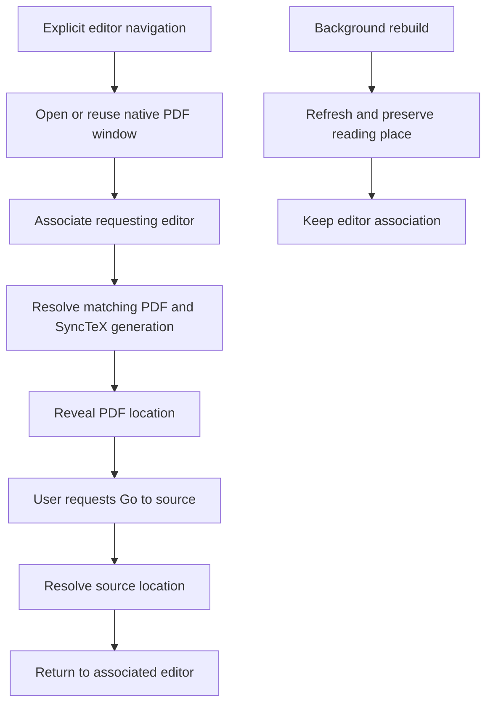
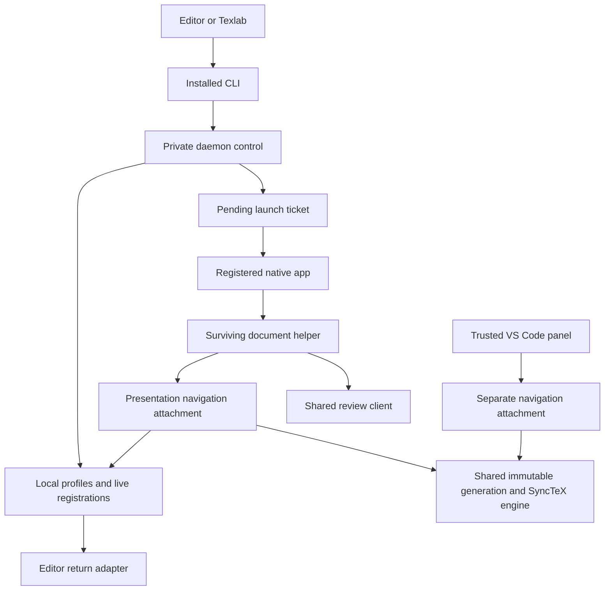
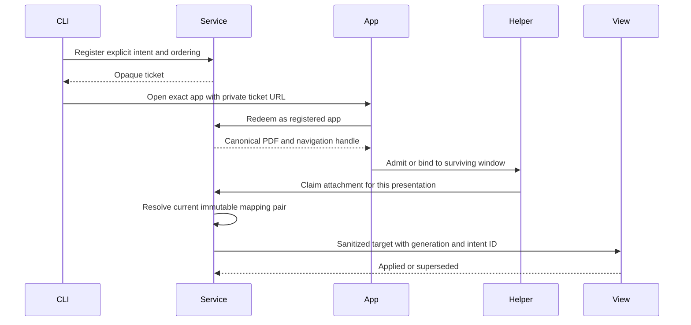
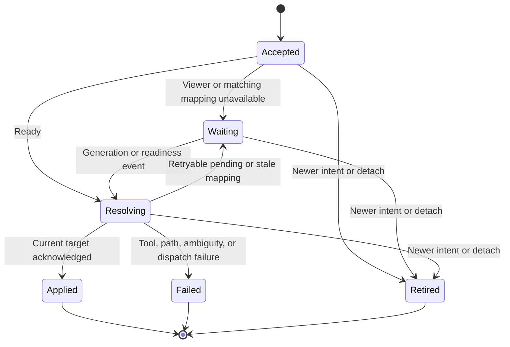
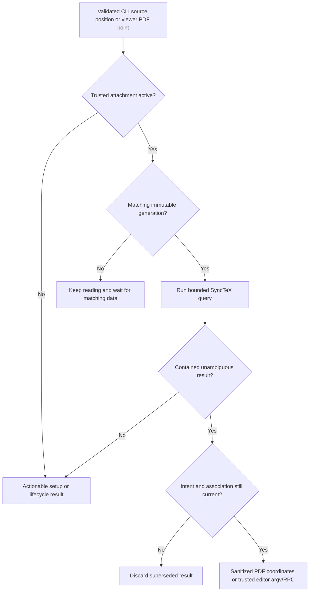

# Editor-independent SyncTeX navigation

## Goal Capsule

- **Objective:** LaTeX authors can move between source and PDF in Placekeeper while using their preferred local editor.
- **Means:** Installed command interface, presentation-scoped navigation, and editor adapters (KTD1–KTD8).
- **Product authority:** The Product Contract below records the scope confirmed on November 2, 2026.
- **Open blockers:** None for implementation. Personal editor acceptance remains an execution gate.
- **Execution profile:** Three dependency-ordered PRs, grouped below; no production implementation is authorized by this planning artifact alone.
- **Authority and ownership:** Product Contract governs scope; Planning Contract governs implementation choices. The implementing agent completes code and automated verification; the agent performs VS Code acceptance through Computer; Zed acceptance proceeds through Computer with the installed editor. Shipping follows the subsequently authorized execution workflow.
- **Stop conditions:** Return for a product decision if implementation would require broader viewer destinations, remote filesystem routing, or weaker generation/source containment.

---

## Product Contract

### Summary

Extend Placekeeper's SyncTeX navigation to local editors through the native Mac app while preserving the embedded VS Code experience. Share the reusable navigation behavior and expose a general command interface that works with Texlab and other editor integrations. Return PDF-to-source requests to the originating editor.

### Problem Frame

Placekeeper's current supported source/PDF navigation is centered on VS Code, although its service already performs the underlying SyncTeX queries. Authors using another editor need the same round trip without changing editors or losing Placekeeper's reading and annotation workflow. Skim's configurable editor commands provide the motivating interoperability model.

### Key Decisions

- **General interface with optional Texlab integration.** Governs R1, R2, R16. A Texlab-only interface would exclude existing standalone Placekeeper and LaTeX Workshop workflows.
- **Native Mac plus embedded VS Code.** Governs R3. (session-settled: user-approved — chosen over routing into every host: avoid simultaneous browser and Codex destination choices in the first release.)
- **Two required acceptance editors.** Governs R17, R18. (User revision, November 2, 2026: the agent tests VS Code through Computer; Zed is installed and tested through Computer. Neovim is not installed and is removed from required hands-on acceptance. Its adapter and automated coverage remain; its recipe is unverified, like Sublime Text and Emacs.)
- **Follow the launching editor.** Governs R6, R7. (session-settled: user-directed — chosen over a global default or project preference: reverse search should return to the editor that initiated the workflow.)
- **Reuse the native window.** Governs R4, R8. (session-settled: user-directed — chosen over separate windows per editor: the latest explicit editor navigation request sets the return destination.)
- **Refresh and navigation are separate.** Governs R9, R10. (session-settled: user-approved — chosen over jumping after every rebuild: preserve reading position unless navigation is requested or following is enabled.)
- **Use matching mapping data.** Governs R11, R12. (session-settled: user-approved — chosen over using an older sidecar: PDF navigation must correspond to the displayed build.)

### Actors

- A1. A LaTeX author reviewing a local compiled PDF while editing its source.
- A2. A local editor or editor integration that submits source navigation requests and receives reverse-search requests.
- A3. Placekeeper, presenting the PDF and resolving positions through SyncTeX.

### Requirements

**Editor access and viewer destinations**

- R1. Provide a documented, installed command interface for opening a PDF and requesting source-to-PDF navigation without a dedicated Placekeeper extension for each editor.
- R2. Source-to-PDF requests identify the output PDF, source file, and line, with optional column support where the integration supplies it.
- R3. New external-editor integrations target the native Mac app; the existing embedded VS Code viewer remains a supported destination.
- R4. Repeated requests for the same native PDF reuse its Placekeeper window, including requests from different editors.
- R5. Navigation supports included source files and separate build directories without assuming that the source and PDF share a filename or directory.

**Reverse search and editor ownership**

- R6. Reverse search from a PDF point opens the resolved source location in the editor associated with that viewer, reusing the originating editor session where the editor supports it.
- R7. A directly opened PDF with no editor association asks for an editor on its first reverse-search request and retains that choice for the open viewer until an explicit editor request replaces it.
- R8. The latest explicit editor navigation request determines the native window's return editor; refresh, optional automatic following, and late completions of older requests must not change that association.

**Refresh and mapping correctness**

- R9. Automatic refresh preserves each view's reading location and zoom when possible, using the existing reconciliation and fallback behavior rather than inventing source navigation.
- R10. Follow-after-build is an optional behavior that is off by default, including in Placekeeper's VS Code integration and supplied editor configurations.
- R11. Forward and reverse navigation use SyncTeX data bound to the PDF generation being navigated, never a predecessor's mapping for a refreshed PDF.
- R12. A forward request awaiting matching build data can complete when that data and the viewer are ready, unless superseded; missing or invalid mapping data leaves reading available with an actionable explanation.
- R13. Newer explicit navigation takes precedence over older pending requests and refresh restoration.
- R14. Preserve existing annotation protection and reconciliation during rebuilds, including unresolved attachments when their new position cannot be established confidently.

**Shared behavior and VS Code compatibility**

- R15. Native and embedded navigation share reusable SyncTeX behavior, while the VS Code adapter retains cursor capture, workspace trust, source editor-group reuse, and transient source highlighting.
- R16. Supported Placekeeper VS Code commands remain independent of Texlab, and optional LaTeX Workshop compatibility retains its separate best-effort support boundary.

**Setup, coverage, and failures**

- R17. Provide repeatable hands-on acceptance workflows for VS Code and Zed covering both navigation directions, rebuilds, and return-editor routing.
- R18. Supply Sublime Text and Emacs configuration recipes through the general interface or Texlab, identifying them as unverified until actual editor testing establishes otherwise.
- R19. Setup documentation covers SyncTeX-enabled compilation, tool discovery, source-root association, forward invocation, and the editor command or connection used for reverse search.
- R20. Editor launch failures and unavailable sessions produce an actionable failure rather than silently routing to a different editor.
- R21. General editor access preserves existing source-path containment and trusted-host boundaries, and treats source paths and coordinates as data rather than executable command text.

### Key Flows

- F1. **Source to PDF.** A2 submits an explicit request for A1's source position. A3 opens or reuses the destination, associates the initiating editor, resolves the matching generation, and reveals the target with a temporary location indication. **Covers R1–R5, R8, R11–R13.**
- F2. **PDF to source.** A1 invokes reverse search at a PDF point. A3 resolves the source against the current generation and returns it to A2; a directly opened document obtains its editor choice first. **Covers R6, R7, R11, R20, R21.**
- F3. **Rebuild while reading.** A2 or a separate build command replaces the output. A3 applies its existing safe-refresh behavior; only an explicit pending navigation or enabled following changes the source-related location. **Covers R8–R14.**
- F4. **Switch editing applications.** After Zed establishes a native return destination, a VS Code CLI profile explicitly navigates into the same PDF. A3 reuses that native window and subsequent reverse search returns through the VS Code CLI profile. **Covers R4, R6, R8.**

The routing distinction in F4 is local to the native viewer; the embedded VS Code viewer retains its own host association under R3 and R6.



### Acceptance Examples

- AE1. **Covers R1–R6, R17.** With a local multi-file project compiled with SyncTeX, navigating from an included chapter in Zed or VS Code opens the PDF from its separate build directory at the corresponding passage; reverse search returns to that editor and source line.
- AE2. **Covers R4, R8, R13.** Zed requests one location, then VS Code requests another before the first completes. One native window remains; VS Code's newer request wins and receives subsequent reverse search.
- AE3. **Covers R8–R10, R14.** While the author reads elsewhere in the document, a background rebuild refreshes the PDF without following the source cursor or changing the return editor. Existing review work is reconciled rather than discarded.
- AE4. **Covers R10, R12, R13.** With follow-after-build enabled for the active editor association, saving and rebuilding can follow its captured position after matching output becomes available. A newer explicit navigation supersedes that pending follow.
- AE5. **Covers R11, R12.** A replacement PDF arrives before its SyncTeX sidecar. Reading remains available, and a pending forward request never navigates using the old sidecar; it can complete when the matching pair becomes available.
- AE6. **Covers R7, R20.** A PDF opened from Finder asks for an editor on the first reverse-search attempt. Cancelling leaves the PDF usable; selecting an editor establishes the destination for that open viewer. An unavailable editor produces an explanation without choosing another application.
- AE7. **Covers R3, R6, R15, R16.** Placekeeper's embedded VS Code commands work without Texlab. Reverse search reuses the existing source group, preserves the source/PDF arrangement, and highlights the returned location. Native editor activity does not redirect this embedded viewer's reverse search.
- AE8. **Covers R11, R12, R20, R21.** Missing tools, stale mappings, ambiguous source results, or out-of-root paths leave review available and do not open an arbitrary source file or execute text from mapping data.
- AE9. **Covers R17–R19.** The delivered setup guide separates tested editor/version combinations from unverified recipes. It contains reproducible round-trip checks for the two required hands-on targets and configurations for the additional unverified editors.

### Scope Boundaries

- Navigation destinations are limited by R3; browser and Codex navigation are deferred.
- Remote editors, SSH workspaces, container filesystem translation, and cross-machine editor routing are deferred.
- Placekeeper does not become a LaTeX compiler, build orchestrator, or language server.
- Native Windows and Linux viewer support is outside this release.
- Automatic modification of unrelated editor settings and a separate Placekeeper extension for every editor are not required.
- Universal compatibility with every editor version is not claimed; coverage follows R17 and R18.

### Dependencies and Assumptions

A local TeX toolchain supplies SyncTeX mapping data and a usable SyncTeX executable. Editors expose a command or connection that can open a file at a line; exact session reuse depends on their capabilities. Texlab is an optional integration route, not a prerequisite for the general interface.

Current VS Code behavior already follows saved cursors after rebuild. R10 therefore changes its default policy as well as adding a requirement for new integrations; planning must account for that existing behavior rather than assuming following is new.

### Outstanding Questions

**Resolve Before Planning:** None.

**Resolved in Planning Contract:** KTD2–KTD8 choose command syntax, trusted registrations, native delivery, packaged invocation, editor routing, and explicit/follow distinction. U7 records actual editor versions during acceptance rather than claiming compatibility from documentation alone.

### Sources and Research

- `apps/service/src/synctex/query.ts:377` and `:443`: existing forward/reverse queries; `apps/service/src/synctex/generation-binding.ts:102`: current-generation binding checks.
- `apps/service/src/sessions/session-broker.ts:2677` and `apps/web/src/app/ProductionReviewApp.tsx:1623`: interaction-aware refresh and reading-location restoration with fallback.
- `apps/vscode/src/source-navigation.ts:45`, `apps/vscode/src/extension.ts:195`, `:270`, and `:451`: source group reuse, cursor capture, highlighting, and saved-source navigation.
- `apps/macos/Sources/PlacekeeperMac/LaunchCoordinator.swift:3`: existing native document/link launch intents to extend for source-position requests.
- `README.md:39` and `:43`: supported VS Code commands and the separate LaTeX Workshop compatibility boundary.
- `docs/solutions/architecture-patterns/generation-bound-bidirectional-synctex-across-embedded-vscode-reviews.md`: existing generation, containment, and navigation-ordering rules.
- [Skim synchronization interface](https://sourceforge.net/p/skim-app/wiki/TeX_and_PDF_Synchronization/): motivating command-based integration model.
- [Texlab previewing](https://github.com/latex-lsp/texlab/wiki/Previewing): configurable forward executable and conditional inverse-search support through the editor's LSP capabilities.
- [Zed LaTeX preview integration](https://github.com/rzukic/zed-latex/wiki/Preview): documented external-viewer configuration and editor-command fallback.
- [Sublime LSP-TexLab](https://github.com/sublimelsp/LSP-TexLab) and [Emacs lsp-mode Texlab](https://emacs-lsp.github.io/lsp-mode/page/lsp-latex/): starting points for additional recipes, not evidence of tested Placekeeper compatibility.

---

## Planning Contract

### Key Technical Decisions

- KTD1. **Bind navigation authority to a presentation.** (session-settled: user-approved — chosen over session-wide editor routing: native and embedded viewers must not redirect each other.) Add a transient navigation attachment owned by the trusted native helper or authenticated VS Code presentation. It owns its approved source root, operation token, pending intent, and editor association epoch. Keep immutable PDF/sidecar generations shared. Existing review-wide source context remains available to its other consumers; navigation must not overwrite it. This addresses R6, R8, R11, R15, R21. Current session-wide fields in `apps/service/src/sessions/session-internal-types.ts` and root replacement in `session-broker.ts` make isolation necessary.
- KTD2. **Use the installed launcher and private daemon control channel.** Add `forward-search` and `editor` subcommands to the bundled `Contents/MacOS/placekeeper`, with no system Node requirement. Resolve relative paths against the invoking cwd before handoff. Public document links carry neither editor commands nor editor-registration authority. This meets R1, R2, R5, R21 using `packaging/macos/launcher.mjs` and `apps/service/src/host/launch-control.ts`.
- KTD3. **Deliver native requests through one-use launch tickets.** Store the validated request in the service and invoke `/usr/bin/open` with separate arguments selecting the exact installed app and a new private ticket URL scheme. The app redeems the ticket after lifecycle registration, then admits the PDF through its existing launch coordinator. Bind the request to the surviving helper when canonical review identity finds an existing window. Process arguments alone do not reach a running app; a command-file transport would add persistent cleanup. Tickets expire, consume once, and validate app/service installation identity. R4 and R21 require these lifecycle and trust checks; the public `placekeeper:///` grammar stays unchanged.
- KTD4. **Keep editor configuration in trusted local state.** Named profiles contain an absolute executable plus an argument-template array, or a typed Neovim socket adapter. Permit only `{file}`, `{line}`, and `{column}` substitutions into individual arguments; no shell interpretation, recursive expansion, or command strings. A local CLI registration establishes a transient session handle for a profile and approved source root. Native setup can select that profile/root through trusted AppKit UI. Persist profile definitions, but never restore executable authority or session handles from review/window state. This implements R7, R19–R21.
- KTD5. **Order intents before asynchronous work.** A service-assigned sequence orders accepted explicit requests per native PDF destination, including during cold admission; transfer that order to the eventual presentation. Each explicit request advances the association epoch. Follow requests must name the current registration/epoch and cannot retarget the editor. Reverse search captures its attachment and epoch and rechecks both before dispatch; an intervening explicit request cancels the old reverse action. This enforces R8 and R13 without relying on completion order.
- KTD6. **Reuse generation binding and refresh publication.** Extend `synctex/generation-binding.ts` to use KTD1's source root and operation identity while retaining existing PDF digest, sidecar identity, containment, and before/after query checks. The existing observer publishes generations; navigation waits on generation/readiness changes and does not become a second rebuild watcher. Preserve existing query budgets and ambiguity handling. This meets R9, R11–R14.
- KTD7. **Separate automatic follow from explicit navigation.** Add `placekeeper.followAfterBuild`, default false, to VS Code; gate its existing save-cursor capture/drain logic. The general CLI has a separate `follow` intent requiring the active session handle. Supplied Texlab recipes keep `build.forwardSearchAfter` false because its documented argv placeholders cannot distinguish manual requests from automatic builds. Opt-in following uses an editor adapter that supplies that distinction. This carries R10 through both native and embedded paths.
- KTD8. **Use editor-specific return adapters.** (session-settled: user-approved — chosen over promising identical window targeting across editors: Neovim exposes a session endpoint whereas Zed's documented CLI does not.) Neovim uses MessagePack RPC to the registered socket, passing source data as structured arguments to fixed adapter logic, never interpolated Lua, Ex, or key sequences. Zed uses its configured CLI with an absolute file location and no `--reuse` default; Zed chooses the window. Embedded VS Code retains extension-owned group selection and highlighting. Generic VS Code CLI profiles may reuse the last active window but must not claim embedded session precision. This satisfies R6 and R20 within each editor's capabilities.

### High-Level Technical Design

**Components and authority (KTD1–KTD4).**



**Warm/cold delivery sequence (KTD3, KTD5).**



**Intent state and lifecycle (KTD5, KTD6).**



A helper restart retires its attachment and pending callbacks. Reopening a restored window requires fresh admission and source/editor association. Expired or unclaimed tickets are removed; active tickets and queries participate in existing daemon activity accounting.

**Navigation gates and data transformation.**



**Command surface.** The grammar below is the implementation target; option spelling may be refined before release if all recipes, tests, and help change together. Lines are one-based; absent columns use the engine's existing default and are translated at editor boundaries.

```text
placekeeper editor add --name NAME --executable ABSOLUTE_PATH --args-json ARRAY
placekeeper editor add --name NAME --adapter neovim
placekeeper editor register --profile NAME --source-root PATH [--socket PATH]
    -> session handle on stdout
placekeeper forward-search --pdf PATH --source PATH --line INTEGER
    [--column INTEGER] --session HANDLE [--intent explicit|follow]
    [--association TOKEN] [--synctex-directory PATH]
    -> explicit acceptance returns an opaque association token
```

Registration supplies the source root independently of the output directory. An editor-specific wrapper can register once and place the returned handle in Texlab's static argv configuration. The command defaults to explicit intent. Explicit acceptance returns an opaque association token on stdout, bound to the destination and its new epoch. An opt-in editor helper captures this token when scheduling build-follow work and supplies it through `--association` when that work completes. Follow requires both the registration handle and the captured token; missing or superseded tokens are rejected. Never substitute the current token at completion time. Texlab manual-only recipes may ignore this output. `editor add` rejects unknown template variables and invalid executables/configuration before storing the profile. Registration validates the adapter's required endpoint. Profile changes do not mutate a live registration's captured command; re-register to adopt them.

A successful forward command exit means the native request was accepted for delivery, not that matching mapping was already available. Invalid input, registration, or launch failures return nonzero with a useful diagnostic. Pending mapping, terminal query failures, and application acknowledgements appear in the native viewer; asynchronous failure must not disappear after CLI success. Do not add a general job/status subsystem for this release.

**Intent policy matrix.**

| Trigger | Replaces return editor | Can move PDF | Supersedes pending explicit request |
|---|---|---|---|
| Explicit CLI navigation | Yes, on acceptance | Yes | Yes |
| Explicit embedded command | Its own host only | Yes | Within its presentation |
| Follow from current session | No | When enabled and no newer explicit intent wins | No |
| Background rebuild | No | Existing restoration only | No |
| Ordinary PDF/location open | No | Existing location-link behavior | Follow existing link/navigation precedence |
| Finder first reverse search | Establishes chosen profile/root | No | No |

### System-Wide Impact and Constraints

The service, Swift helper protocol, shared web runtime, VS Code adapter, and packaged launcher change together. Mac-specific allowlists must be enabled at every layer; Chrome, browser, static, and Codex remain denied. The webview never receives editor executable/argv, socket endpoints, or unrestricted source paths. No new Codex tool or context injection is required by R3's destination scope.

Canonical annotations and review identity remain shared. Navigation attachments are transient host authority, not durable review records. Preserve source-root behavior for existing non-navigation consumers. Do not change annotation reconciliation or build orchestration to accommodate the new command.

The main implementation risk is cross-view interference while migrating the session-global token/root. U1 therefore includes coexistence tests before native entry points become reachable. Warm launch delivery and installed bundle closure require real candidate smoke checks, not only mocks. Editor CLI location grammars may reject otherwise valid filenames; report those limitations rather than claiming argv separation makes every editor grammar universal.

### Resolved Choices and Deferred Details

Command syntax, trusted registrations, ticket delivery, and packaged absolute-path invocation are resolved above. Exact helper method names, RPC client dependency selection, and the installed editor versions are implementation details. For Neovim, use a maintained MessagePack RPC client or a bounded adapter with explicit dependency review; validate API compatibility against the actual installed version. Acceptance records must name actual versions, not infer them from rolling documentation.

Considered and not built: a Skim `displayline` compatibility shim, automatic terminal activation for Neovim, durable editor-session recovery, and a public editor-control HTTP API. The general interface already supplies the requested round trip; these additions do not close a requirement gap. Reconsider only with a concrete integration that cannot use the supplied interface.

### Technical Sources

- `docs/solutions/architecture-patterns/generation-bound-bidirectional-synctex-across-embedded-vscode-reviews.md`: immutable mapping pairs, containment, retry states, and output budgets underpin KTD6.
- `docs/solutions/architecture-patterns/shared-production-review-client-host-runtime-boundaries.md`: transport-specific authority and canonical window reuse underpin KTD1 and KTD3.
- `docs/solutions/architecture-patterns/atomic-generation-transitions-for-rebuilt-pdf-reviews.md`: observer-owned publication and interaction holds underpin KTD6.
- `docs/solutions/architecture-patterns/upgrade-safe-shared-per-user-daemon-lifecycle.md`: existing daemon lifecycle and activity accounting apply to KTD2–KTD3.
- `docs/solutions/integration-issues/refresh-independent-vscode-payload-after-app-install.md`: U7 must verify the extension payload actually loaded by the editor.
- [Texlab configuration](https://github.com/latex-lsp/texlab/wiki/Configuration): `%f`, `%p`, `%l`, and `build.forwardSearchAfter` constrain KTD7; no documented origin/session placeholder.
- [Zed CLI](https://zed.dev/docs/reference/cli) and [extension preview guidance](https://github.com/rzukic/zed-latex/wiki/Preview): location arguments and window-routing limits inform KTD8.
- [Neovim API documentation](https://neovim.io/doc/user/api/) and [remote interface](https://neovim.io/doc/user/remote/): structured RPC and socket targeting inform KTD8. Research used v0.11.5 API source as a baseline, not a minimum supported version claim.

---

## Implementation Units

### PR1: Isolate shared navigation authority

Waits on: none. This refactor preserves current entry points and ships without exposing native editor control.

### U1. Presentation-scoped bindings and ordered intents

**Goal:** Native and embedded navigation can share a PDF generation without sharing cancellation or source-root authority.

**Requirements:** R8, R11–R15, R21; F1–F4; KTD1, KTD5, KTD6.

**Dependencies:** None.

**Files:** `apps/service/src/sessions/session-internal-types.ts`, `apps/service/src/sessions/session-broker.ts`, `apps/service/src/synctex/generation-binding.ts`, new `apps/service/src/synctex/navigation-attachments.ts`, `apps/service/src/server/http-server.ts`, `apps/vscode/src/webview-bridge.ts`, `apps/service/test/synctex.test.ts`, new `apps/service/test/navigation-attachments.test.ts`.

**Approach:**

1. Introduce the attachment owner and derive its identity from authenticated presentation credentials, retaining shared generation artifacts.
2. Move navigation token/root lookup into that attachment; keep other review-wide source-context consumers intact.
3. Implement admission ordering, epoch checks, readiness-driven pending intents, and detach retirement under KTD5–KTD6.

**Patterns to follow:** Existing binding currentness checks and VS Code trusted cursor substitution. Add characterization coverage before changing shared broker behavior.

**Test scenarios:**

- Two presentations query the same PDF using different approved roots; neither cancels or expands the other's authority.
- Covers AE2: a newer accepted request wins even if an older query completes last.
- Covers AE5 and AE8: a replacement PDF with a delayed sidecar stays pending; old mapping, ambiguous reverse results, and escaping paths never dispatch.
- Detach during a query retires its result; a new incarnation cannot inherit the old token.

**Verification:** Existing rich SyncTeX fixtures and new attachment tests prove isolation. Service tests exercise real binding logic but do not prove native window delivery.

### PR2: Deliver native editor round trips

Waits on: PR1, merge order only. U2–U4 land together so native entry points never ship ahead of their authority checks and receiving UI.

### U2. Local profiles, registrations, and editor dispatch

**Goal:** Trusted local configuration can return a resolved source location to the associated editor.

**Requirements:** R6–R8, R19–R21; F2, F4; KTD4, KTD5, KTD8.

**Dependencies:** U1.

**Files:** New `packages/core/src/editor-navigation-protocol.ts`, new `apps/service/src/synctex/editor-profiles.ts`, new `apps/service/src/synctex/editor-dispatch.ts`, new `apps/service/test/editor-navigation.test.ts`, new `packages/core/test/editor-navigation-protocol.test.ts`.

**Approach:**

1. Define closed profile/registration/intent payloads and validation in the core protocol; this unit owns those shared definitions.
2. Store named profiles in the existing per-user support location with atomic writes; capture immutable executable/argv/root/session configuration in live registrations.
3. Add shell-free process dispatch and Neovim RPC, including bounded response handling and actionable unavailable-session outcomes.

**Test scenarios:**

- Automated Neovim adapter coverage: the registered RPC endpoint receives the resolved file and line; a second fixture endpoint receives nothing. Live Neovim qualification is optional.
- Literal spaces, quotes, Unicode, dollar signs, backticks, newlines, and leading-dash filenames remain data in captured argv/RPC; unsupported editor location grammar reports failure.
- Covers AE8: malformed templates, missing executables, removed sockets, denied access, and nonzero editor exits preserve reading and report the failing destination.
- A reverse query begun under one epoch cannot dispatch after another explicit editor request replaces it.

**Verification:** Fixture processes capture actual argv and an RPC fixture verifies structured requests. These prove dispatch safety and routing, not actual editor UI placement; U7 supplies that proof.

### U3. Installed CLI and native launch handoff

**Goal:** Explicit editor navigation reaches either a cold or running native app and binds to its surviving window.

**Requirements:** R1–R5, R8, R12, R13, R21; F1, F4; KTD2, KTD3, KTD5.

**Dependencies:** U1, U2.

**Files:** New `apps/service/src/cli/editor-command.ts`, `apps/service/src/cli/open-command.ts`, `apps/service/src/host/control-protocol.ts`, `apps/service/src/host/launch-control.ts`, `apps/service/src/host/placekeeper-host.ts`, `apps/service/src/macos/app-lifecycle.ts`, `apps/macos/Sources/PlacekeeperMac/LaunchCoordinator.swift`, `apps/macos/Sources/PlacekeeperMac/PlacekeeperMac.swift`, `packaging/macos/launcher.mjs`, `packaging/macos/build-app.ts`, new `apps/service/test/editor-command.test.ts`, `apps/service/test/macos-daemon-runtime.test.ts`, `apps/macos/Tests/PlacekeeperMacTests/MacPoliciesTests.swift`.

**Approach:**

1. Route the new command through existing compatible-daemon startup and private control validation.
2. Create/redeem tickets under registered app identity and retain the service admission sequence across unresolved native launches.
3. Extend launch intents with an opaque navigation handle and transfer it to the canonical surviving helper before releasing a provisional helper.
4. Register the private scheme in bundle metadata and expose honest CLI acceptance/error semantics from the command design.

**Test scenarios:**

- Covers AE1 and AE2: cold and warm launches with two rapid editor requests produce one window and retain the newer destination.
- A PDF in a separate build directory resolves correctly from an unrelated caller cwd.
- Expired, replayed, guessed, wrong-installation, and detached-app tickets cannot claim navigation or launch an editor.
- Ordinary public links and Finder URLs cannot supply profiles, argv, roots, or return-editor epochs.
- Launch failure returns nonzero; accepted-but-pending navigation remains visibly pending in the viewer.

**Verification:** Private control/helper integration tests and Swift queue tests prove ownership transfer. Installed warm/cold delivery remains a U7 gate.

### U4. Native forward/reverse UI and direct-open setup

**Goal:** The native viewer reveals source targets and offers Go to source, including setup for Finder-opened PDFs.

**Requirements:** R6, R7, R9, R11–R15, R20, R21; F1–F3; KTD1, KTD3–KTD6.

**Dependencies:** U1–U3.

**Files:** `packages/core/src/review-runtime-protocol.ts`, `packages/core/src/macos-helper-protocol.ts`, `apps/service/src/macos/macos-runtime.ts`, `apps/service/src/runtime/local-review-backend.ts`, `apps/service/src/browser/chrome-runtime-backend.ts`, `apps/macos/Sources/PlacekeeperMac/ReviewBridge.swift`, `apps/macos/Sources/PlacekeeperMac/ReviewHelper.swift`, `apps/web/src/host/macos-runtime.ts`, `apps/web/src/host/use-host-synctex.ts`, `apps/web/src/host/synctex-navigation.ts`, `packages/core/test/review-runtime-protocol.test.ts`, `packages/core/test/macos-helper-protocol.test.ts`, `apps/service/test/macos-runtime.test.ts`, `apps/web/test/host-runtime.test.ts`, `apps/macos/Tests/PlacekeeperMacTests/ReviewBridgeLifecycleTests.swift`.

**Approach:**

1. Enable the Mac-specific runtime and helper operations end to end, deriving the attachment from the trusted runtime record.
2. Reuse shared coordinate navigation, transient target indication, and generation readiness; acknowledge applied/superseded targets.
3. Add a native editor/profile and source-root chooser on first reverse search; cancellation leaves no partial association. Setup errors offer a retry path.
4. Keep background restoration subordinate to newer explicit navigation and preserve existing annotation reconciliation.

**Test scenarios:**

- Covers AE6: Finder reverse search opens setup, cancellation leaves reading available, and selection establishes only this viewer's association.
- Covers AE3 and AE5: refresh preserves page/zoom and review work while a pending target waits for its matching sidecar and readiness.
- Covers AE7: native and embedded viewers remain independently routable.
- Chrome/Codex/static methods remain denied, and rendered payloads contain no executable, socket, or unrestricted source-open capability.
- Helper loss during resolution retires callbacks; recovery does not revive an old registration.

**Verification:** Cross-layer helper/runtime tests exercise real frames and sanitization. Browser tests cover shared navigation ordering; Swift tests cover lifecycle/setup decisions. U7 verifies the visible native interaction.

### PR3: Editor integrations and installed qualification

Waits on: PR2, merge order only. U5–U7 complete the public integration and documentation before the feature is advertised as supported.

### U5. Shared intent coordination and default-off following

**Goal:** Preserve embedded VS Code behavior while making following an explicit opt-in across supported integrations.

**Requirements:** R8–R10, R12, R13, R15, R16; F3; KTD5–KTD7.

**Dependencies:** U1, U4.

**Files:** `apps/vscode/src/rebuild-navigation.ts`, `apps/vscode/src/extension.ts`, `apps/vscode/src/source-navigation.ts`, `apps/vscode/package.json`, `apps/vscode/test/rebuild-navigation.test.ts`, `apps/vscode/test/extension.test.ts`, `apps/vscode/test/latex-workshop-bridge.test.ts`, `apps/web/src/host/synctex-navigation.ts`, new shared intent module only where both hosts use it.

**Approach:** Extract only the reusable pending-intent state transitions from existing rebuild coordination. Leave cursor capture, workspace trust, editor groups, and highlighting in VS Code. Add the setting gate and prevent older follow events from replacing explicit pending navigation. Preserve the separate LaTeX Workshop launcher contract.

**Test scenarios:**

- Covers AE3: default settings allow rebuild refresh without cursor following.
- Covers AE4: opt-in following applies after matching output, but an intervening explicit request wins.
- Covers AE7: manual commands work without Texlab, reuse the source group, and retain transient highlighting.
- An old editor's automatic follow after a new editor takeover cannot move the native PDF or reclaim its association.
- A delayed build-follow from the same registration cannot override a newer explicit request; its captured association token is stale.
- An A-to-B-to-A takeover rejects follow work captured under the first A association even though A is current again.

**Verification:** VS Code extension tests and shared coordinator tests cover the policy change; real editor tests confirm layout and cursor behavior.

### U6. Setup recipes and integration helpers

**Goal:** Authors can configure the general interface without implementing a Placekeeper extension for each editor.

**Requirements:** R1, R5–R7, R10, R16–R20; F1–F4; KTD2, KTD4, KTD7, KTD8.

**Dependencies:** U2–U5.

**Files:** `README.md`, new `docs/guides/editor-synctex.md`, new `integrations/editors/` resources for Texlab argv configuration and Neovim registration/follow helpers, new `packaging/macos/editor-integrations.test.ts`.

**Approach:** Document absolute installed invocation, SyncTeX tool discovery, explicit roots, split output/sidecar directories, registration renewal, manual commands, direct-open setup, and failure recovery. Supply VS Code, Zed, Neovim, Sublime Text, and Emacs recipes. Use current Texlab PDF-directory settings rather than deprecated `auxDirectory`. Clearly separate generic CLI routing from embedded VS Code session precision and label untested recipes.

**Test scenarios:**

- Covers AE9: supplied argv arrays pass the same parser and placeholder checks as real CLI requests.
- A multi-file project with spaces and a separate build directory uses explicit source/PDF/root values throughout the recipe.
- The Neovim helper distinguishes explicit requests from opt-in build-follow requests; Texlab examples retain default-off following.

**Verification:** Fixture-driven recipe validation catches configuration drift but does not establish editor compatibility. U7's recorded hands-on results govern tested labels.

### U7. Packaged application and editor acceptance

**Goal:** The shipped launcher, native app, daemon, and extension perform the documented round trip outside the checkout.

**Requirements:** R1, R3–R21; AE1–AE9.

**Dependencies:** U3–U6.

**Files:** `packaging/macos/build-native-candidate.ts`, `packaging/macos/validate-manifest.ts`, `packaging/macos/smoke-installed.ts`, `packaging/macos/packaging.test.ts`, `scripts/testing/suites.ts`, `test/acceptance/installed-hosts.md`, new `test/acceptance/editor-synctex.md`.

**Approach:** Add integration resources to the candidate manifest, explicitly register new test files in suite lists, and extend installed qualification. Run the candidate's contained binaries with private state, a relocated bundle, and unrelated cwd. Verify the actual VSIX payload loaded by a fresh/reloaded editor window. Provide repeatable acceptance steps for VS Code and Zed, with exact versions and evidence fields.

**Test scenarios:**

- Covers AE1–AE9: execute the product examples against the installed candidate, including editor takeover, delayed sidecars, direct Finder setup, rebuild preservation, and failures.
- Exercise Zed with multiple windows and projects; record which window its CLI chooses without promising exact targeting.
- Optional Neovim qualification, if installed later: two live sockets, an unavailable socket, and a modified buffer; never discard edits to satisfy navigation. This is not a required gate.
- An active multi-PDF session survives a compatible launcher invocation; mismatched daemon/install identity follows existing upgrade policy.

**Verification:** Packaging checks prove bundle contents; installed smoke and editor acceptance prove actual process delivery and return behavior. Sublime/Emacs remain unverified unless separately exercised. Record failures or unavailable environments explicitly; documentation is not a passing result.

---

## Verification Contract

Implementation, not planning, runs these checks. Add new test files to `scripts/testing/suites.ts` before relying on aggregate suites.

| Gate | Applies to | Required outcome |
|---|---|---|
| `pnpm typecheck` | All code units | Shared protocol and host adapters agree |
| `pnpm test:service` and `pnpm test:security` | U1–U4 | Generation, containment, control, and presentation authority remain enforced |
| `pnpm test:source-rebuild` | U1, U4, U5 | Existing refresh/reconciliation and new follow policy pass; include the coordinator test explicitly if absent from this suite |
| `pnpm test:web` | U4, U5 | Target readiness, supersession, and reading restoration pass |
| `pnpm test:macos:native` and `pnpm test:macos:gate` | U3, U4, U7 | Swift lifecycle and native transport agree with service behavior |
| `pnpm validate:distribution` | U3, U6, U7 | Built assets and manifest include the installed command/resources |
| `pnpm package:macos:native-candidate` then `pnpm run:macos:native-candidate` | U7 | Relocated candidate uses its contained assets and private qualification state |
| `pnpm smoke:installed` with documented fixture/configuration | U7 | Actual installed launcher/app delivery succeeds outside the repo |
| `test/acceptance/editor-synctex.md` | U7 | Actual VS Code and Zed results cover applicable AE1–AE9 with versions recorded; Neovim live testing is optional |

Use fixture processes and structured RPC captures to test argument safety, then real editors to prove placement and session behavior. Preserve existing tests for overlay/multiple forward rectangles, reverse ambiguity, output budgets, delayed mapping, interaction holds, and annotation reconciliation. No `release:validate` script exists in the inspected package; distribution and native-candidate gates above are the applicable equivalents. Public release publication is outside this planning request.

### Acceptance Ownership

The implementing agent completes automated and available installed-candidate checks and prepares the repeatable acceptance record. The agent performs VS Code checks through Computer. Zed is now installed; the agent records its Computer-driven checks in the acceptance record. At the user’s request, Neovim live testing is no longer a required gate and remains unverified. An unavailable required editor is an outstanding gate, not permission to mark it tested. Each result records app/extension/editor/tool versions, fixture paths, actions, observed destination, and pass/failure evidence. U7 remains incomplete until those checks are resolved.

---

## Definition of Done

- U1–U7 satisfy their verification outcomes and R1–R21 are traced through automated or recorded hands-on evidence.
- A source/PDF round trip works through the installed native app for the acceptance editors, with the routing limitations in KTD8 stated accurately.
- Native and embedded coexistence, latest-explicit ownership, matching-generation navigation, and refresh preservation pass the relevant AE cases.
- Trusted local editor configuration is never accepted from a PDF, SyncTeX text, renderer payload, or public document link.
- The documented follow default is off in code and supplied configurations; explicit commands remain available without Texlab.
- Packaging and independently installed VS Code payload checks pass. Sublime/Emacs claims match actual evidence.
- Documentation and CONCEPTS terminology match the implemented contract; abandoned experiments and dead code are removed.
- Any remaining manual gate or environment limitation is reported as incomplete, with its exact next verification step.
