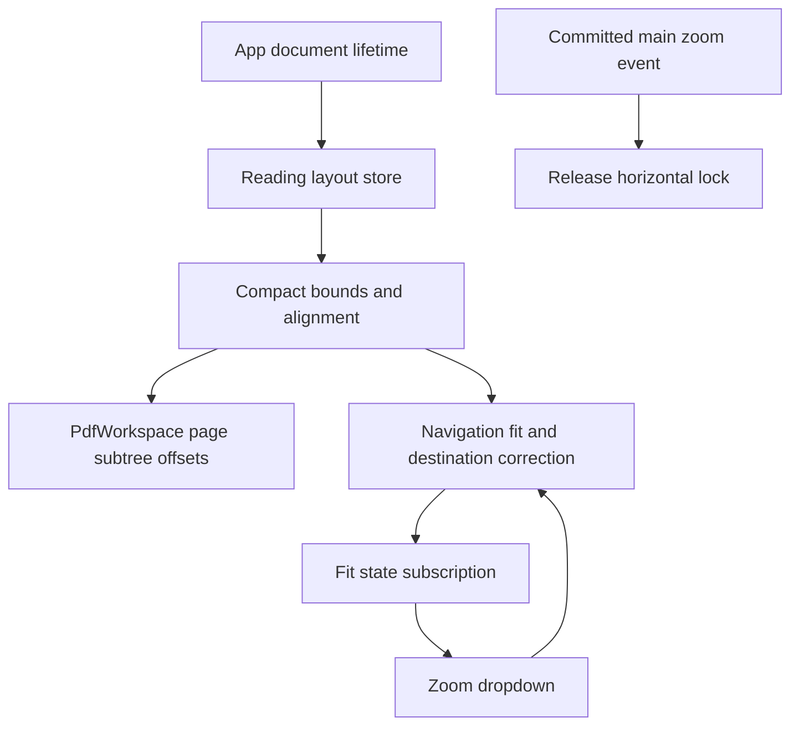
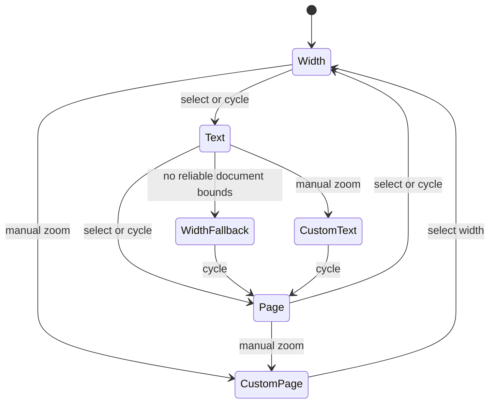
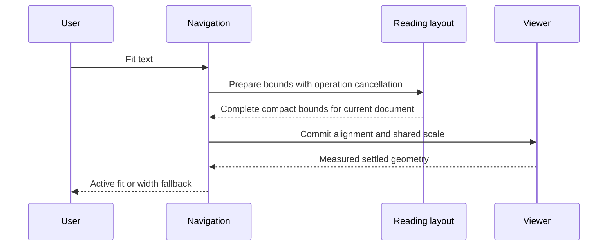

# PDF Fit Modes and Text-Centered Reading - Plan

## Goal Capsule

**Objective:** Readers can fill the PDF viewport with readable text and scroll through alternating book margins without repeated zoom or horizontal-position adjustments.

**Means:** Three fit modes and per-page reading-area alignment in the continuous scroll stack.

**Product authority:** The Product Contract below records the confirmed user decisions. Column-by-column reading is separate future work.

**Authority:** Product requirements govern behavior; the Planning Contract governs mechanism within those constraints.

**Execution profile:** One pull request; native implementation with bounded parallel units, integrated and verified by the host agent. The autonomous pipeline owns review, commits, push, and CI; merging remains with the user.

**Stop conditions:** Stop if a settled product decision proves infeasible or verification cannot establish consistent page and interaction geometry.

---

## Product Contract

### Summary

Add Fit page, Fit width, and Fit text to the existing zoom dropdown. Fit text aligns each page's reading block at a shared zoom, while the other modes expose the original page composition. Zoom changes automatically release horizontal scroll lock.

### Problem Frame

Large page margins waste reading space, and alternating book margins require repeated horizontal adjustments. A horizontal scroll lock that remains enabled after zooming also gets in the way of repositioning the view.

### Key Decisions

- **Hover and cycle inside the zoom dropdown.** Governs R1–R3. (session-settled: user-directed — chosen over a split button or click-only menu: retain compact hover-based controls; touch redesign can wait.)
- **Fit page as the third mode.** Governs R1, R4. (session-settled: user-approved — chosen over a 100% reset: a whole-page overview has a predictable purpose, while numeric zoom already allows 100%.)
- **Align individual reading blocks.** Governs R6–R8. (session-settled: user-directed — chosen over fitting only the current page: establish the full text-centered scroll-stack foundation.)
- **Stable reading size.** Governs R7, R9. (session-settled: user-directed — chosen over zooming out for every wide figure or table: avoid disruptive size changes while reading.)
- **Keep alignment after manual zoom.** Governs R10. (session-settled: user-approved — chosen over restoring page centering: a small zoom adjustment should not bring alternating margins back.)
- **Conservative fallback.** Governs R11–R12. (session-settled: user-approved — chosen over automatic page-by-page refitting: maintain zoom continuity through uncertain pages.)
- **Reset on open.** Governs R14. (session-settled: user-directed — chosen over per-document persistence: minimize saved application state.)
- **Release horizontal scroll lock on zoom changes.** Governs R15. The user explicitly requested this because a lock that remains on after zooming is frustrating.

### Requirements

**Fit controls**

- R1. Provide Fit page, Fit width, and Fit text in that cycle order within the existing zoom dropdown.
- R2. Clicking the fit button advances to the next mode; hovering exposes a vertical list whose rows select a mode directly.
- R3. Keep the dropdown open while the pointer moves into the fit list, and support keyboard selection without requiring hover.
- R4. Fit page shows the entire current page within the usable viewport and uses page-centered alignment.
- R5. Fit width fits the current page's full width to the usable viewport and uses page-centered alignment.

**Text framing**

- R6. Fit text fills the usable viewport width with the overall body-text block plus a small screen-space margin, including both columns and their gutter on multi-column pages.
- R7. Fit text uses a shared zoom across the scroll stack rather than resizing text as each page becomes current.
- R8. Individually align each page's detected reading-area center with the viewport center, so adjacent visible pages with alternating margins align simultaneously.
- R9. Wide figures, tables, and substantive marginal content may extend offscreen at that zoom but must remain reachable through horizontal panning or Fit width.
- R10. Manual zoom changes the percentage to a custom value while retaining the current alignment policy; selecting Fit page or Fit width restores page-centered alignment.
- R11. A page without reliable text bounds retains the shared zoom and uses geometric page centering when the document otherwise supports Fit text.
- R12. If the document has no reliable text bounds, a Fit text request falls back to Fit width and communicates the effective fallback without falsely indicating successful text fitting.

**Continuity and state**

- R13. Fit-mode changes preserve the vertical reading position as far as the chosen framing permits, and active fit modes recalculate for changes to usable viewport dimensions.
- R14. Reset the new fit-mode and alignment state on document open, retaining the existing initial-sizing behavior and adding no persisted per-document preferences.
- R15. Any actual zoom change automatically disables horizontal scroll lock and updates its displayed state, whether caused by manual zoom, a fit command, navigation, or automatic fit recalculation.
- R16. Per-page alignment must keep PDF rendering, text selection, annotations, hit targets, and navigation destinations in agreement.
- R17. The fit control must distinguish an active fit from a custom zoom; from custom zoom, cycling continues after the last explicitly selected fit mode, using the existing initial Fit width behavior as the starting mode after open.

### Key Flows

- F1. **Choose framing.** Open the zoom dropdown, then cycle the fit button or hover and select a row. Apply the selected framing while preserving reading position. **Covers R1–R5, R13, R17.**
- F2. **Read a book.** Select Fit text and scroll through successive pages. Text blocks stay centered at the shared zoom even when their page margins alternate. **Covers R6–R8, R16.**
- F3. **Adjust reading size.** Manually zoom after Fit text. Keep text alignment, show custom zoom, and release horizontal scroll lock if the zoom changes. **Covers R10, R15, R17.**

### Acceptance Examples

- AE1. **Covers R1–R3.** Given Fit width is selected, clicking the fit button selects Fit text; hovering and selecting Fit page goes directly to Fit page without closing the parent dropdown during pointer travel.
- AE2. **Covers R4–R8.** Given two consecutive book pages with equal text widths and different left margins, Fit text aligns their text simultaneously at one scale; switching to Fit page restores page centering and shows the whole current page.
- AE3. **Covers R6–R9.** Given a two-column article with one unusually wide table, Fit text includes both columns in its reading block and preserves the shared zoom when scrolling to the table; horizontal panning reveals the overflow.
- AE4. **Covers R10, R17.** Given Fit text followed by manual zoom, the percentage becomes custom while text alignment remains; cycling next selects Fit page.
- AE5. **Covers R7, R11.** Given an isolated scanned figure or blank page among detectable text pages, entering that page does not change the zoom and the page is geometrically centered.
- AE6. **Covers R12.** Given a scan with no reliable text geometry, selecting Fit text produces a usable Fit width view and indicates the fallback.
- AE7. **Covers R13, R15.** Given an active fit and locked horizontal scrolling, resizing the usable viewport recalculates the fit; if the zoom changes, the lock becomes off in both behavior and display.
- AE8. **Covers R15.** Given horizontal scroll lock is on, a changed percentage from zoom buttons, numeric entry, gestures, fit selection, or navigation releases the lock; a failed or no-op zoom request does not count as a zoom change.
- AE9. **Covers R14.** Given a document closed after custom zoom with text alignment, reopening uses the existing initial-sizing behavior rather than restoring the new mode or alignment preference.
- AE10. **Covers R16.** Given a horizontally shifted page, selecting text, placing an annotation, and following a PDF destination all target the same visible PDF locations.

### Scope Boundaries

- Column-by-column reading is deferred to [issue #139](https://github.com/brad-ross/placekeeper/issues/139); this feature does not change reading order or jump between columns.
- Touch-specific redesign of the fit control is deferred.
- OCR or image-based content detection is deferred; uncertain documents use R12.
- This work changes view framing, not PDF page boxes, file contents, or exported annotation coordinates.
- Automatic initial sizing is preserved per R14; no new persisted fit preference is introduced.

### Dependencies and Assumptions

- Detection must identify the body reading area conservatively rather than treating every header or page number as a body-text boundary.
- The layout mechanism must support per-page offsets throughout the viewer's interaction geometry; shifting only the painted canvas cannot satisfy R16.
- A small margin of roughly 24 screen pixels per side is a starting point to validate during implementation, not a fixed user-selected threshold.

---

## Planning Contract

**Product Contract preservation:** Product Contract unchanged; its technical questions are resolved below.

### Key Technical Decisions

- KTD1. **Document-lifetime reading-layout store.** Add a small observable store owned by App and shared with main navigation and PdfWorkspace. It holds compact natural-coordinate bounds and the alignment policy, keyed to the PDF object and generation, and is cleared on replacement/disposal. This implements R8, R10–R14 without persisted state.
- KTD2. **Prepare all page bounds before activating text fit.** Scan with bounded concurrency, retain only bounds, and discard glyph arrays after each page. A complete scan avoids misclassifying front matter as a textless document and avoids visible late shifts or changing scroll extents. Cache completed bounds for the document lifetime; abort/stale requests cannot apply framing or trigger fallback. This implements R7, R11–R12.
- KTD3. **Conservative body-block detection.** Reuse sparse-safe glyph-line merging, aggregate horizontal runs into visual rows, and use repeated body-size/line evidence to exclude isolated header/footer outliers. Reject sparse or implausible blocks. Preserve both columns in the row envelope. Use a robust representative width across confident pages for one activation, with a 24 CSS-pixel minimum horizontal margin and existing larger viewport margins respected. Rotate bounds with the same combined rotation as pages. This implements R6–R9; thresholds are fixture-calibrated implementation details.
- KTD4. **Host offsets around the existing Scroller.** Translate the entire PagePointerProvider subtree by rotated page-center minus reading-center, scaled by committed zoom. Add symmetric horizontal padding to the zoom-content wrapper of at least the maximum absolute document offset; keep viewport padding and tray runway semantics unchanged. Correct logical unmounted navigation by subtracting the measured page's offset and adding the destination's offset. Mounted DOM remains final authority. This implements R8, R9, R16 without replacing virtualization or patching dependencies.
- KTD5. **Generalize the existing fit transaction.** Keep cancellation, document identity, settlement, rollback, and live geometry checks from fitToWidth. Add explicit selected mode, effective fit, fallback, and active/custom state; expose subscriptions to the shell. Retain fitToWidth compatibility for explicit width commands and reference behavior. Fit page prioritizes whole-page visibility over exact vertical anchor retention. This implements R1, R4–R5, R10–R13, R17.
- KTD6. **Separate fit intent from numeric scale.** Explicit manual zoom clears active fit even when the requested number is unchanged; destination-driven numeric changes clear active fit. Own fit commits do not clear themselves. Custom cycling follows the last selected mode; text fallback keeps text as the cycle entry but reports effective width. Refit uses the effective active mode and both usable viewport dimensions. This implements R10, R12–R13, R17.
- KTD7. **Unlock from raw main-document zoom commits.** Carry old/new numeric zoom through the viewer interaction event and subscribe from ReviewShell. Compare raw scale, not rounded percentage; clear the existing lock state on a difference. Reference-only zoom is separate. This implements R15 and preserves no-op behavior.
- KTD8. **Contained hover expansion.** Render the vertical fit list within the existing zoom menu's DOM/dismissal boundary, with keyboard opening and Escape handling. Do not add a second portal or a separate toolbar control. This implements R1–R3.

### High-Level Technical Design

### Assumptions and Risks

- Preparation may take longer for large books; expose pending state and allow another viewer action to supersede it rather than silently limiting document coverage.
- Per-page offsets affect first-paint destination calibration, not only final centering; frame-sampled browser checks must cover distant targets.
- Fit controls target the main reader. Reference Tab framing keeps its separate existing policy.
- Horizontal panning intentionally moves the shared reading center; only explicit fit/refit recenters it.
- No new OCR, image detector, per-page zoom, or persistent preference is required.

### Sources

- `apps/web/src/pdf/viewer-navigation-adapter.ts`: fit transaction, mounted page geometry, logical destination calibration.
- `apps/web/src/pdf/PdfWorkspace.tsx`: complete page interaction/render subtree and existing runway.
- `apps/web/src/pdf/glyph-lines.ts`: sparse-safe glyph line geometry.
- `apps/web/src/pdf/viewer-controls.ts`: main-only raw zoom subscription before percentage rounding.
- `docs/solutions/ui-bugs/calibrate-virtualized-pdf-navigation-before-first-paint.md` and `docs/solutions/ui-bugs/pointer-anchored-zoom-across-custom-viewer-geometry.md`: navigation and gesture constraints.
- `docs/solutions/ui-bugs/align-host-raster-rotation-and-selection-paint.md`: crop/rotation/selection consistency.
- Installed EmbedPDF 2.14.4 source confirms complete page providers use DOM-relative pointer conversion, Scroller owns vertical virtualization, and zoom-content wrapper accepts padding. No library upgrade is planned.

---

## Implementation Units

### U1. Detect and retain document reading bounds

**Goal:** Produce cancellable, compact reading bounds and a shared alignment model.

**Requirements:** R6–R8, R11–R12, R14, R16; KTD1–KTD3.

**Dependencies:** None.

**Files:** New `apps/web/src/pdf/text-fit-layout.ts` and `apps/web/test/text-fit-layout.test.ts`; reuse `apps/web/src/pdf/glyph-lines.ts`; register tests in `scripts/testing/suites.ts`.

**Approach:** Implement pure detector/rotation/offset helpers and an observable document-lifetime model. Read page glyphs through the existing PdfTask abort pattern; bound concurrency and release raw data. Complete a scan before returning a successful prepared snapshot.

**Patterns:** PDF search reader cancellation and glyph line merging.

**Test scenarios:**
1. Covers AE2, AE3. Equal-width alternating margins, two columns, and an isolated wide outlier produce body bounds and stable representative width.
2. Covers AE5, AE6. Blank/scanned/sparse pages return null; a book with blank front matter and later body text remains detectable.
3. Sparse glyph holes, crop-relative coordinates, intrinsic/document rotation, mixed page dimensions, and malformed geometry do not produce invalid offsets.
4. Aborted/stale preparation never publishes to a replacement document; completed snapshots retain only bounds.

**Verification:** Pure tests establish detection and offset math; actual PDFium geometry is checked in U4.

### U2. Integrate fit transactions and page layout

**Goal:** Apply text/page/width framing consistently across the scroll stack and navigation.

**Requirements:** R4–R14, R16–R17; KTD1, KTD4–KTD6.

**Dependencies:** U1.

**Files:** `apps/web/src/pdf/viewer-navigation.ts`, `apps/web/src/pdf/viewer-navigation-adapter.ts`, `apps/web/src/pdf/PdfWorkspace.tsx`, `apps/web/src/app/App.tsx`, `apps/web/src/app/ReviewShell.tsx`, `apps/web/src/app/ProductionReviewApp.tsx`; tests in `apps/web/test/viewer-navigation.test.ts`.

**Approach:** Share the model between navigation and a React subscription outside render callbacks. Extend fit transaction state and subscriptions, preserve width compatibility, and correct destination offsets before first paint. Generalize shell/workspace refits to active mode and both dimensions. Keep reference policy unchanged.

**Test scenarios:**
1. Covers AE2, AE5. Per-page offset and full-document padding stay stable with virtualization; blank pages use zero offset.
2. Covers AE4. Manual same-scale intent clears active fit but retains alignment; custom cycling follows last selected fit.
3. Covers AE6. Successful no-text preparation commits an indicated width fallback; aborted preparation does not.
4. Covers AE7. Height-only and bottom-dock changes refit Fit page, while custom zoom stays fixed.
5. Covers AE9. New document/generation clears cached bounds and alignment; stale fit completion cannot affect it.
6. Failed fit restores prior alignment/state; distant unmounted targets use their own offset rather than the visible page's offset.

**Verification:** Adapter tests catch transactions/state/math; U4 proves native scroll extents and interaction geometry.

### U3. Add cycling controls and zoom-triggered unlocking

**Goal:** Expose the agreed fit interaction and release lock on every real main zoom change.

**Requirements:** R1–R3, R12, R15, R17; KTD7–KTD8.

**Dependencies:** Fit-state interface from U2; UI work can proceed against that interface.

**Files:** `apps/web/src/review/ReviewChrome.tsx`, `apps/web/src/review/ReviewIcon.tsx`, `apps/web/src/review/menu-focus.ts`, `apps/web/src/app/neutral-controls.css`, `apps/web/src/pdf/viewer-controls.ts`, `apps/web/src/pdf/viewer-interaction-events.ts`, `apps/web/src/app/ReviewShell.tsx`; tests in `apps/web/test/viewer-controls.test.ts`, `apps/web/test/neutral-chrome-contract.test.tsx`, `test/acceptance/review-workflow.spec.ts` and its harness.

**Approach:** Reuse existing action preparation/blur suppression and menu focus behavior. Keep fit cycling enabled while currently fitted; show pending, custom, and fallback states. Subscribe to precise main zoom events to clear the one shell lock state.

**Test scenarios:**
1. Covers AE1. Hover-to-list travel retains parent menu; direct selection, cycling, keyboard access, and Escape work.
2. Numeric input blur plus fit click applies only the intended action.
3. Covers AE8. Raw sub-percent zoom releases lock; no-op/failed requests and reference-only zoom do not.
4. Lock state updates both actual horizontal scrolling and the displayed checkbox/icon when fit controls alter overflow.

**Verification:** Unit tests protect raw event semantics; browser tests prove focus and hover behavior.

### U4. Verify real PDF framing and regression boundaries

**Goal:** Demonstrate the feature works with actual rendering and PDF interactions.

**Requirements:** R1–R17; AE1–AE10.

**Dependencies:** U1–U3.

**Files:** New fixture/acceptance coverage in `test/fixtures/pdfs/generate.ts` and `test/acceptance/pdf-fit-modes.spec.ts`; production-flow fixture/harness additions as needed; `scripts/testing/suites.ts`.

**Approach:** Generate a deterministic alternating-margin book with a two-column page, wide content, blank/scanned page, and rotated/cropped cases. Exercise the production viewer in Chromium and WebKit. Reuse existing fixture loading, coordinate selection, and frame-sampling helpers.

**Test scenarios:**
1. Covers AE2, AE3, AE5. Two simultaneously visible pages share reading center and scale; tables and blank pages do not alter scale.
2. Covers AE10. Selection/copy, annotation placement, and a distant destination stay attached to shifted PDF coordinates.
3. Pan to both page edges; neither extreme is lost behind the native scroll origin.
4. Covers AE7–AE9. Resize/right and bottom docks, gestures, explicit fit, no-op zoom, and reopen satisfy state/lock contracts.
5. Pointer-anchored zoom and reference navigation retain existing behavior; no transient incorrect destination frame is exposed.

**Verification:** Behavior and geometry assertions plus screenshots establish browser evidence; installed-host transport is outside this UI-only change.

---

## Verification Contract

- Run `pnpm typecheck` and `pnpm build:web`.
- Run targeted Vitest tests for `text-fit-layout`, `viewer-navigation`, `viewer-controls`, `viewer-framing`, and `neutral-chrome-contract`.
- Generate fixtures with `pnpm fixtures:pdf`; run new `pdf-fit-modes.spec.ts` and affected `review-workflow.spec.ts` tests with `scripts/testing/config/playwright.config.ts` and `scripts/testing/config/playwright.webkit.config.ts`.
- Run relevant existing `host-interface.spec.ts`, `static-web.spec.ts`, and `host-raster-rotation.spec.ts` zoom/framing/selection cases for regression coverage.
- Browser automation must use the approved browser-control surface where required by the host; record any unavailable verification method accurately.
- Pass `git diff --check`; independent code review must resolve eligible findings before shipping.

---

## Definition of Done

- U1 detects and caches conservative reading bounds with cancellation and replacement protection.
- U2 applies all fit modes and per-page alignment without breaking page geometry or reference navigation.
- U3 delivers hover/cycling/keyboard controls and accurate zoom-triggered horizontal unlocking.
- U4 supplies passing real-PDF geometry/interaction evidence in both browser engines.
- Every product requirement is covered by implementation and verification; no abandoned experimental code remains.
- The reviewed change is committed and pushed as an open PR with CI decided; merge is not authorized.
