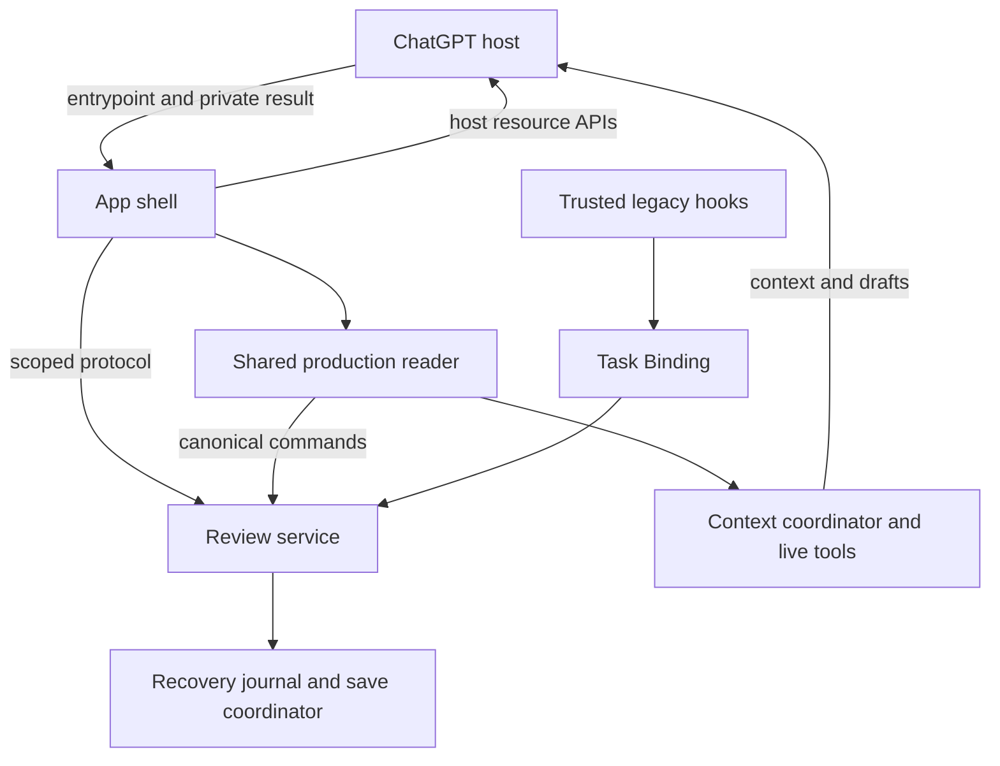
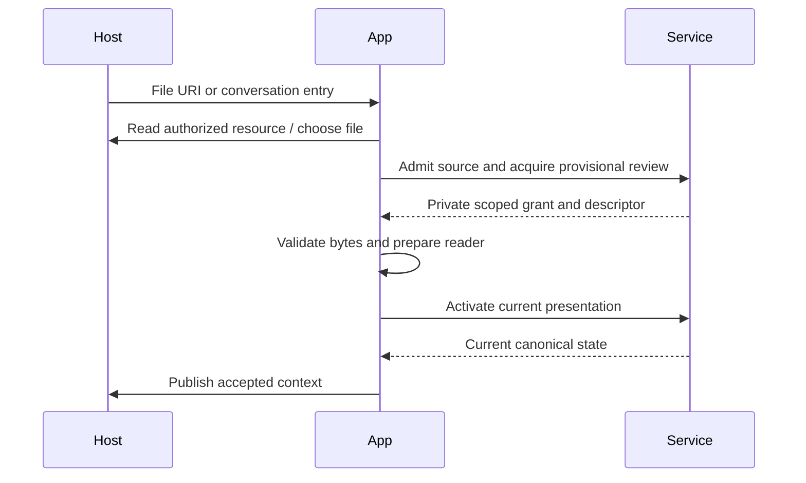
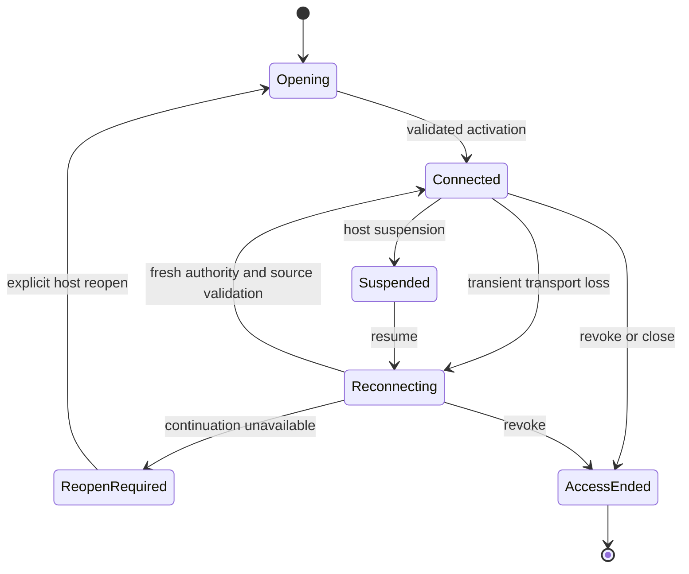
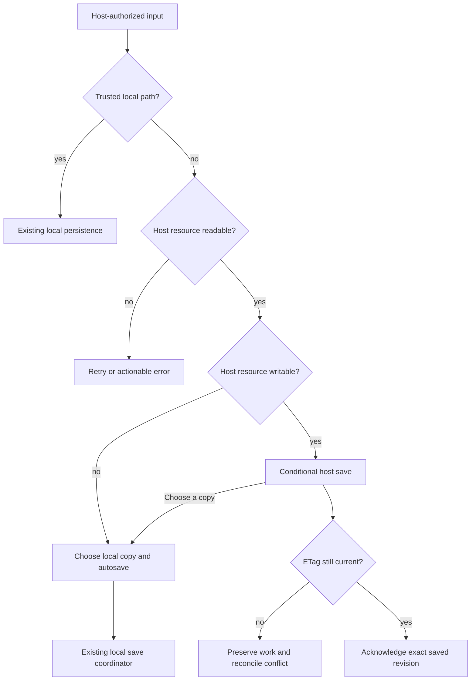
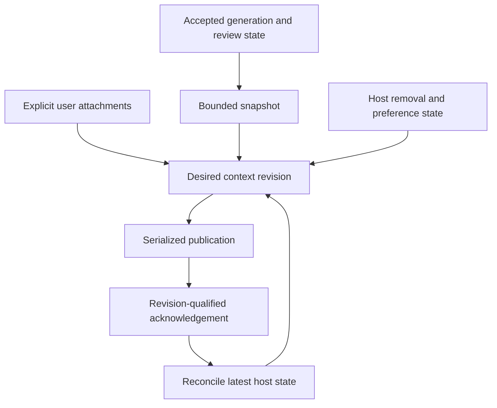

# Seamless Placekeeper ChatGPT extension experience

## Goal Capsule

**Objective:** Users can open a PDF directly in ChatGPT, keep reviewing through ordinary interruptions, and ask the chat about the document and navigate it reliably.

**Means:** Extend the existing production reader and canonical review backend with host entrypoints, scoped app authority, resource persistence, and context coordination (KTD1–KTD6).

**Authority:** The user's accepted proposals and annotations govern scope. This plan supplies implementation choices. Existing review durability and isolation contracts remain constraints. Published extension APIs and installed-host evidence govern host claims.

**Execution profile:** One coordinated feature branch and PR, implemented in dependency-ordered units. U1 is an early compatibility gate; do not build dependent host behavior on an unproven recovery mechanism. The implementation owner completes verification, cleanup, review, and a reviewable diff; publishing follows the user's shipping instructions.

**Stop conditions:** Stop the affected unit if the installed host cannot deliver the required authority or resources, or if implementation would require weakening ownership, silent overwrite, or sending messages without user action. Preserve independent progress and report the exact missing host capability. This plan does not claim the host behaviors are already qualified.

---

## Product Contract

### Summary and problem frame

Placekeeper should behave as a persistent PDF review app in the conversation panel. The current path relies on a model-triggered display and trusted hooks; a 30-second panel lease and immediate teardown on transport errors make interruptions disruptive. Context primarily arrives at prompt time, and the app does not yet expose the complete new entrypoint and interaction surfaces.

### Key Decisions

- **Include all proposed interactions now**, including composer mentions and native preferences (session-settled: user-directed — chosen over deferring the richer interactions: the user explicitly requested every addition). Governs R7, R8, R9.
- **Provide document search and reader navigation to chat** (session-settled: user-directed — chosen over relying only on generic PDF tools: the user requested search and scrolling within the open review). Governs R6.

- **Offer desktop-style autosave to a chosen local copy in the extension**, including opaque host resources (session-settled: user-directed — November 5: use Placekeeper’s local save machinery rather than requiring a Codex download). Choose the destination once; later accepted edits autosave to that copy. Governs R4.

### Requirements

**Opening and continuity**

- R1. A `.pdf` file entrypoint opens the selected PDF without sending a chat message. A separate conversation entrypoint opens the current review or an empty chooser. Canceling a picker preserves the existing view. Both trusted local-path inputs and opaque host resource URIs are supported.
- R2. Transient disconnects, collapse, sleep/wake, and remount preserve accepted annotations and Protected Drafts. The app recovers automatically when valid authority can be reacquired; otherwise it offers an explicit reopen/reconnect action without requiring a manufactured chat message. Revocation and explicit close end participation. Stale panels cannot continue mutating.
- R3. The reader prefers fullscreen conversation-panel presentation, honors theme and safe areas, and has understandable collapsed behavior. If the host renders inline despite the requested mode, show a compact document/status/open-reader view rather than squeezed editing controls.

**Document and context correctness**

- R4. Host resource changes refresh the reader through document-generation reconciliation. Writable resources can save conditionally to their host source and expose conflicts. Both writable and read-only sources offer desktop-style autosave to a user-chosen local copy. A destination is selected once through Placekeeper’s native picker and subsequent accepted edits save there without a Codex download. Cancel preserves the current destination and accepted work. Download/export is optional when the host supports it, not a prerequisite for core persistence. Accepted review work is protected before acknowledgement, and Protected versus Saved status remains truthful.
- R5. Publish bounded current document/page/selection/review context without sending a message or starting an agent turn. Keep explicit attachments distinct from background state. Respect host removal, including racing updates and remount. Clearing the whole app context pauses background sharing until explicitly re-enabled. Distinguish context available to chat from context actually observed by an agent turn.
- R6. Chat can inspect the current view and selection, search the PDF, and navigate to a page, search result, or annotation. Results identify document generation, coverage, and truncation. Stale results cannot target newer bytes. A collapsed/unmounted reader must never report successful scrolling; the supported workflow reopens/expands the app before live navigation and search tools are used. If that host interaction is unavailable, return an actionable unavailable result, not guessed content.

**Richer interactions**

- R7. “Ask about this selection” and “Discuss these annotations” capture the chosen material at click time, attach readable page-referenced context, and prepare an editable composer draft. They never auto-submit. Annotation discussions use named context groups and survive background context replacement until removed.
- R8. Composer mentions discover intentionally catalogued documents and annotations, with generation/revision labels. Catalog opt-in is explicit because mentions can be used in another conversation. Disabling mentions removes retrieval as well as search visibility. Mention resources contain bounded snapshots, not authority to resume another review.
- R9. Native settings control background context, selection sharing, and mention catalog participation, with an in-app equivalent when the native settings surface is unsupported. Global preferences set defaults; per-app removals remain local intent. Capability detection gives each unsupported interaction a clear fallback.

**Compatibility and isolation**

- R10. Existing skill/hook launches continue to work. App-owned review authority does not impersonate a trusted Task Binding. Two chats cannot steal the same review or acquire each other's credentials; opening an already-owned PDF gives an explicit conflict/fork choice. No credentials enter model context, public resources, URLs, or diagnostics.

### Acceptance Examples

| ID | Action and expected outcome | Covers |
|---|---|---|
| AE1 | Open a host PDF from its file menu, annotate, collapse, reopen: same accepted work, no chat message needed. | R1–R3 |
| AE2 | Sleep beyond the panel lease, then wake: current bytes revalidate, work returns, and retired presentation writes fail. | R2, R4, R10 |
| AE3 | Remove an annotation context group while a publish is pending: subsequent navigation and remount do not reattach it. | R5, R7 |
| AE4 | Search generation N, rebuild to N+1, then select the old result: report stale and offer a fresh search; never jump using old geometry. | R4, R6 |
| AE5 | Change a writable host resource before save: conditional write conflicts, local work remains protected, and the newer source is not overwritten. | R4 |
| AE6 | Ask chat to scroll while collapsed: reopen the reader through the supported host path, then acknowledge only after the destination is reached; unavailable hosts report that limitation. | R3, R6 |
| AE7 | Prepare a selection draft while another PDF opens: draft retains the original explicit selection and reference, with no automatic send. | R7 |
| AE8 | Disable mentions, then read a previously known mention URI: return unavailable rather than its old content. | R8, R9 |
| AE10 | Open an opaque PDF, choose Save to a new copy and a local folder, annotate twice: the chosen copy updates automatically, the source remains unchanged, and reopening preserves the destination. Canceling the picker changes nothing. | R4, R10 |
| AE9 | Open the same PDF in a second chat: ownership is not transferred silently; a chosen independent fork does not become an unchecked competing writer. | R10 |

### Scope boundaries

All six original proposals and the search/scroll additions are included. This work does not add OCR, semantic/vector search infrastructure, blanket agent PDF mutation tools, a global filesystem catalog, or a broad MCP SDK2 migration. Existing supported editing workflows remain available. Unsupported host features must be reported, not described as implemented via a mock.

---

## Planning Contract

### Key Technical Decisions

- KTD1. **Reuse the shared production reader and canonical backend.** Put host differences behind `ReviewHostRuntime` and transport adapters. Preserve SessionBroker, operation journaling, Protected Drafts, generation transitions, and save scheduling. The static runtime's in-memory/export-only behavior is insufficient for the host-resource route. Sources: `apps/web/src/host/runtime.ts`, `apps/web/src/host/static-runtime.ts`, `apps/service/src/sessions/session-broker.ts`, and `docs/solutions/architecture-patterns/shared-production-review-client-host-runtime-boundaries.md`.
- KTD2. **Separate app-session continuation from presentation leases and Task Bindings.** Admit file authority from host-provided metadata/resource APIs, never synthetic chat IDs or a URI parsed as a path. A private app grant scopes access to one admitted review; it does not prove chat identity. Use short-lived presentation incarnations and serialized resume with rotation, bounded idempotent retry, and stale-incarnation rejection. Store protected work independently of these credentials. Legacy panels need a new explicitly authorized continuation path; the existing restart reconnect ticket still requires a trusted prompt. U1 must establish a private host channel for continuation before relying on it. Sources: `apps/service/src/codex/codex-runtime.ts`, `apps/service/src/context/restart-reconnect-store.ts`, `apps/codex-mcp/src/server.ts`.
- KTD3. **Use SDK1-compatible metadata and the extension app APIs.** Keep the existing MCP SDK1 server and ext-apps integration. Pin the chosen extension package after compatibility verification; use shared schemas/metadata instead of importing SDK2-only server helpers. Declare separate file and conversation entrypoints, `.pdf` with its leading dot, preferred fullscreen, and supported modes. Capability-detect resources, context, editable drafts, settings, and WebMCP. Source: [extension specification](https://github.com/openai/mcp-extensions/blob/main/docs/spec.md) and [TypeScript guide](https://github.com/openai/mcp-extensions/blob/main/typescript/README.md).
- KTD4. **One save authority per admitted source.** Trusted local files keep the local save coordinator. Opaque host sources use a host-resource adapter backed by private recovery state in the service; the app brokers host reads/writes. Reuse PDF serialization and canonical save obligations, but commit host saves with writable metadata and conditional ETags. A service-side save intent identifies exact generation/revision/digest; receipt acknowledges that intent only after the host confirms it. Persist before acknowledging accepted work. On remount reconcile the current host digest/ETag before replaying uncertain saves; never blindly repeat an ambiguous write. Opaque sources may transition explicitly to a selected local copy through the existing native destination picker and PdfSaveCoordinator. Preserve source identity separately from destination authority; never derive a filesystem path from a host URI or use the private transfer directory as a default output folder. Stop/drain conditional host writes before activating the copy, reject stale host save receipts after the switch, and retain the local destination across refresh and recovery. Preserve accepted work and cancellation behavior; reuse existing collision/overwrite confirmation and save-status semantics. Read-only sources use this same copy workflow. Host download remains optional. Sources: `docs/solutions/architecture-patterns/recoverable-editable-pdf-annotation-autosave.md` and [resource APIs](https://github.com/openai/mcp-extensions/blob/main/typescript/README.md#file-extension-handlers).
- KTD5. **A serialized context coordinator owns publication.** Separate background snapshot, explicit attachment membership, and host removal state. Reconcile initial/remount host context before publishing; serialize desired revisions with update IDs, coalesce navigation, and apply removals to pending publications. A stale acknowledgement cannot restore removed content. Publish only accepted document generations and bounded text. Preserve the existing hook context route for legacy Task Bindings without falsely labeling app publication as agent observation. Sources: `apps/web/src/host/context-projection.ts`, `use-codex-context.ts`, and [context notifications](https://github.com/openai/mcp-extensions/blob/main/docs/spec.md#context-changed-notifications).
- KTD6. **Use live reader tools for exact search and navigation.** Reuse `PdfSearchController` and the navigation coordinator behind a disposable app bridge. Tool responses include review/generation and stable result handles scoped to that generation; bound count and snippet size. Expose inspect, search, and navigation through WebMCP where supported. The host contract makes these expanded-app tools; qualify the reopen/expand workflow rather than adding a second unscoped server search service. Inspection returns snapshots, and navigation resolves only after the actual reader moves. This implements R6's user-directed decision. Sources: `apps/web/src/pdf/pdf-search-controller.ts`, `apps/web/src/review/navigation-coordinator.ts`, [interaction patterns](https://github.com/openai/mcp-extensions/blob/main/docs/patterns.md).
- KTD7. **Explicit drafts, bounded mention snapshots, and durable preferences.** Reuse selection/review-item state for R7; never use an auto-send fallback. Use host-supported settings plus a versioned service preference store. Catalog only explicit opt-ins, authorize every read against current membership, and invalidate entries when opted out. Settings and mentions implement the user-directed R7–R9 decision. Source: [extension changelog](https://github.com/openai/mcp-extensions/blob/main/CHANGELOG.md).

### High-Level Technical Design

Component and authority relationships:

Admission and activation sequence:

Presentation lifecycle:

Source decision flow:

Context data flow:

Tool API sketch (semantic contract; final schema belongs with the bridge):

| Tool | Input | Result |
|---|---|---|
| inspect_review | current authorized app | identity, generation, page, selection, bounded review summary |
| search_document | query, bounded limit | generation, matches, coverage, truncation, result handles |
| navigate_page | page, expected generation | reached page or typed error |
| reveal_search_result | result handle | reached match or stale/unavailable |
| reveal_annotation | annotation ID, expected generation | reached item or stale/missing/unavailable |

Capability behavior:

| Surface | Supported | Unsupported |
|---|---|---|
| File resource reads | Open via host URI | Actionable read failure, never treat URI as path |
| Resource subscription | Subscribe and reconcile | Revalidate on activation and explicit refresh |
| Writable resources | ETag-conditional source save or chosen local copy | Chosen local copy via native picker; protected work until selected |
| Host downloads | Optional reviewed-copy download | Core autosave-to-copy remains available through Placekeeper |
| Editable drafts | Prepare composer draft | Copyable draft and explicit attachment fallback |
| WebMCP | Live inspect/search/navigation | Explain how to open supported panel; do not claim tool completion |
| Native settings | Host settings surface | Equivalent in-app controls |

### Risks and constraints

The spec does not guarantee replay of arbitrary private tool results on every remount, nor provide a trusted chat ID for arbitrary app calls. U1 must qualify continuation delivery and old-instance behavior. If that cannot be established, fall back to explicit host reopen, preserving work; do not persist bearer authority in ordinary browser storage to simulate continuity.

The same PDF can already have a canonical owner. App admission must use existing ownership/recovery offers and an explicit fork decision; matching paths do not establish conversation authority. Host-managed resources require bounded transfers, digest validation, cancellation, and attempt fencing; completed verified bytes may be reused, but pending old-authority reads must not be reused across mounts.

Suspend-aware deadline handling must distinguish a delayed timer after system sleep from an ordinary expired lease. A transport error alone cannot revoke authority; explicit service rejection can. Source changes during bootstrap need a fresh validation epoch rather than waiting for a focus event.

### Existing partial work

Implementation began before the user requested this plan and was stopped. These uncommitted edits are candidates, not an approved implementation or passing baseline: `apps/codex-mcp/src/shell.ts`, new `panel-liveness.ts` and its test; `apps/web/src/codex-entry.tsx`, `production-entry.tsx`, `pdf/use-pdf-search.ts`, new `host/review-agent-bridge.ts` and its test; new `apps/service/test/extension-runtime.test.ts`; `package.json` and `pnpm-lock.yaml` adding `@openai/mcp-extensions@0.2.1`. Reassess each against the contracts before retaining it. No tests were run as part of this planning pass.

---

## Implementation Units

### U1. Establish the host contract and compatibility gate

- **Goal / requirements:** Establish the actual supported entrypoint, private continuation, expansion, and resource flows for R1, R2, R3, R6, R10 before dependent implementation.
- **Files:** `apps/codex-mcp/src/server.ts`, `resources.ts`, `shell.ts`; `integrations/codex-plugin/`; a new `docs/testing/chatgpt-extension-qualification.md` and focused adapter tests.
- **Approach:** Audit the partial edits; use KTD2–KTD3 to build the smallest installable vertical slice. Record host/package versions and exact capability shapes. Verify local-path and opaque-resource entry separately. Define grant/lease/revoke/continue protocol and missing-capability behavior before the service implementation.
- **Test scenarios:** Direct file open without a model turn; conversation chooser cancel; unsupported host; private result remount; duplicate continuation after a dropped response; two simultaneous old/new instances; collapsed tool availability and supported expansion.
- **Verification:** Focused MCP metadata tests, `pnpm build:codex-mcp`, and installed-host evidence. A mock alone cannot pass this gate. Failure blocks the affected dependent flow and records the fallback; never silently drops opaque resources or R6.

### U2. Implement scoped admission and recoverable connection lifecycle

- **Dependencies:** U1.
- **Goal / requirements:** R1, R2, R10.
- **Files:** `apps/service/src/codex/`, `apps/service/src/sessions/session-broker.ts`, `packages/core/src/codex-mcp-protocol.ts`, `apps/codex-mcp/src/shell.ts`, `apps/web/src/host/codex-runtime.ts` and corresponding tests.
- **Approach:** Implement KTD2 with provisional acquisition then activation, private continuation, fresh presentation incarnations, bounded backoff/jitter, and visibility/resume-triggered retry. Preserve the mounted reader during recoverable interruption; gate mutation until authoritative reconnection. Add an authorized legacy continuation path without changing trusted-prompt ownership. Handle daemon restart separately from transport retry.
- **Test scenarios:** Dropped renew/state responses; sleep past lease; normal expiry; stale incarnation writes; revoked access; remount source change; daemon restart with protected work; same-PDF two-chat conflict; replay after lost activation response; canceled provisional acquisition.
- **Verification:** `pnpm test:codex-native`, `pnpm test:service`, `pnpm test:security`; installed sleep/remount/close checks.

### U3. Complete host-resource persistence and generation refresh

- **Dependencies:** U2.
- **Goal / requirements:** R1, R4, R10.
- **Files:** New host-resource runtime adapter under `apps/web/src/host/`; resource/save protocol in `packages/core/src/`; service recovery/save integration; `apps/web/src/production-entry.tsx`; relevant service and web tests.
- **Approach:** Implement KTD1 and KTD4. Import authorized host bytes into canonical review/recovery storage, preserve source identity and ETag, subscribe where available, and reconcile through existing generation machinery. Fence transfers by attempt. Local and host writes remain mutually exclusive. Persist exact save intents/receipts and handle unknown write outcomes by rereading source identity.
- **Test scenarios:** Opaque URI with no path; read-only source saved to a chosen local copy; successful conditional save; concurrent remote edit; pending save interrupted by remount; draft cancellation without PDF rewrite; duplicate mutation without duplicate save; same-revision Save Sync update; corrupt/empty bytes; old read fails after newer activation; generation change while interaction is held.
- **Verification:** `pnpm test:save-export`, `pnpm test:source-rebuild`, `pnpm test:service`, `pnpm test:web`, plus real host read/change/write/conflict cases.

### U3a. Reuse desktop save options for host-managed PDFs

- **Dependencies:** U3.
- **Goal / requirements:** R4 and R10; implement the November 5 user-directed autosave-to-copy decision without depending on Codex download support.
- **Files:** `apps/service/src/codex/codex-runtime-backend.ts`, `host-resource-persistence.ts`, `extension-runtime.ts`; existing save coordinator and session recovery integration as needed; `apps/codex-mcp/src/extension-shell.ts`, `host-resource-adapter.ts`; shared save controls under `apps/web/src/`; focused service, shell, and reader tests.
- **Approach:** Reuse the shared save-destination dialog, native folder picker, validated folder selection, and local save coordinator. For an opaque source, require an explicit folder and suggest a readable annotated-copy filename. Expose current host-source saving and the local-copy choice truthfully. Coordinate the destination switch with pending host writes, and make the persisted local destination authoritative after the switch. Source refresh must not reset it or resume host writes. Preserve existing local-path behavior, copy collision confirmation, annotation identities, protected drafts, and source-generation checks. Do not add a second PDF serializer, arbitrary path API, or a separate export-only storage mechanism. Capability-gate the optional host-download action.
- **Test scenarios:** Read-only and writable opaque sources each save two successive edits to a chosen copy while source bytes stay unchanged; cancel folder/destination selection; filename collision; stale picker result after source replacement; pending host save at switch; stale host receipt after switch; refresh/remount/service recovery retains destination and continues saving; local save failure remains protected and retryable; existing local-path original/copy behavior stays intact.
- **Verification:** Start with failing behavior tests through the existing runtime/save boundary; run the relevant service, saving, shell and reader suites, typecheck and production builds. Qualify a real native picker plus two persisted annotation edits, close/reopen and another edit; inspect the actual destination and unchanged source. Missing Codex download support is not a failure of this flow.

### U4. Build panel presentation and context synchronization

- **Dependencies:** U2–U3.
- **Goal / requirements:** R3, R5, R9.
- **Files:** `apps/codex-mcp/src/resources.ts`, `shell.ts`; `apps/web/src/host/context-projection.ts`, `use-codex-context.ts`, new context coordinator; shared review status components and tests.
- **Approach:** Apply fullscreen metadata, theme/safe areas, compact fallback, and clear reconnect/suspended/access-ended statuses. Implement KTD5, including host initial context, update IDs, attachment removal, bounded publications, and global versus per-app preferences. Reuse truthful status terminology.
- **Test scenarios:** Host removal before an in-flight acknowledgement; remount after removal; clear-all pauses background sharing; rapid navigation coalesces; document replacement publishes only accepted generation; old update acknowledgement cannot regress context; unsupported context capability; compact view has no cramped editing controls.
- **Verification:** `pnpm test:codex-native`, `pnpm test:web`, relevant browser scenarios; installed context/remove/remount checks.

### U5. Expose exact document search and navigation to chat

- **Dependencies:** U1, U2, U4.
- **Goal / requirements:** R6, R10; implements the user-directed search/scroll decision.
- **Files:** `apps/web/src/host/review-agent-bridge.ts`, `apps/web/src/pdf/use-pdf-search.ts`, `pdf-search-controller.ts`, `apps/web/src/review/navigation-coordinator.ts`, reader integration and tests.
- **Approach:** Implement KTD6, binding one bridge to the active review and disposing it on replacement. Use exact viewer search semantics and partial-coverage reporting. Bound responses and reject stale handles. Register only supported tools; qualify expansion before live operations.
- **Test scenarios:** Text/formula/symbol queries supported by current search; zero matches versus incomplete coverage; out-of-range page; missing annotation; stale generation; interrupted search; navigation under interaction hold; detached reader; collapsed request followed by actual reopen and completed navigation.
- **Verification:** `pnpm test:web`, `pnpm test:pdf-viewer`, installed agent search and scroll with visible destination confirmation.

### U6. Add selection drafts, annotation groups, mentions, and settings

- **Dependencies:** U3–U5.
- **Goal / requirements:** R7–R9, R10; implements the user-directed full interaction scope.
- **Files:** Shared selection and annotation action UI; extension app adapter; `apps/codex-mcp/src/server.ts`; new settings/catalog storage in service; protocol and corresponding tests.
- **Approach:** Implement KTD7. Capture source-qualified content at click time. Add named groups without losing prior attachments. Implement editable drafts and copy fallback. Catalog only opted-in snapshots, enforce membership on every read, and expose preference scope clearly in native and in-app settings.
- **Test scenarios:** Selection changes during draft preparation; annotation deleted/revised; partial group removal; no auto-send on unsupported hosts; mention opt-out invalidates known URIs; old generation labeled as snapshot; new conversation mention does not resume old authority; settings change races with publication.
- **Verification:** `pnpm test:codex-native`, `pnpm test:service`, `pnpm test:web`, `pnpm test:security`; installed draft/group/mention/settings checks.

### U7. Qualify the complete experience and clean up

- **Dependencies:** U1–U6, including U3a.
- **Goal / requirements:** Demonstrate R1–R10 together and preserve existing supported hosts.
- **Files:** Qualification record, integration tests, user/plugin documentation, release/build metadata only as required by repository conventions.
- **Approach:** Run the entire lifecycle on one semantic review/item, include a peer chat, and inspect both transient UI and canonical saved state. Record exact package/build and host capabilities. Remove abandoned partial approaches, duplicate runtime paths, unused dependencies, and temporary probes.
- **Test scenarios:** Direct open → select/draft → annotate/save → collapse → sleep → resume → ask/search/scroll → external PDF update → remove context → remount; repeat for host-resource and local-path sources. Exercise existing hook launch and explicit revoke, read-only autosave to a chosen local copy, and two-chat ownership. A separate host download is optional and qualified only on hosts advertising it.
- **Verification:** Verification Contract below; no broad success claim while installed-host cases remain unverified.

---

## Verification Contract

During implementation, add focused behavior tests to the repository's existing suite catalog. Run suites relevant to each unit after its changes; run the combined release checks once after integration rather than repeatedly executing everything.

| Command / evidence | Purpose |
|---|---|
| `pnpm test:codex-native` | Entrypoint metadata, shell, native protocol and legacy path |
| `pnpm test:service` and `pnpm test:security` | Admission, lifecycle, recovery, isolation and catalog authority |
| `pnpm test:web` and `pnpm test:pdf-viewer` | Context races, reader bridge, search and navigation |
| `pnpm test:save-export` and `pnpm test:source-rebuild` | Durability, conflicts, generation transitions |
| `pnpm test:host-integration` | Shared host-runtime compatibility |
| `pnpm build:service` and `pnpm build:codex-mcp` | Production bundle and SDK import compatibility |
| `pnpm test:source-release` | Source/plugin packaging when shipping metadata or plugin assets change |
| Installed-host qualification record | Exact packaged artifact, host/version, capability support, actions, observed outcome, logs/screenshots where useful |

Inspect current package scripts at execution time for repository-required lint/type checks and release commands; do not invent `release:validate` if absent. Any failing check must be fixed or identified with evidence as pre-existing. Browser mocks establish adapter behavior only. Real host evidence is required for direct entry, remount/private delivery, collapse/expand, sleep/wake, resources, drafts, mentions, and settings.

Use the existing temporal UI test approach: observe from before the transition through a bounded settled tail, preserving session/item identity. Logs may include attempt, generation, revision, capability, and error class; redact credentials and document text unless an explicit test fixture requires it.

---

## Definition of Done

- Every R-ID and AE-ID is implemented and covered by the unit tests and host evidence appropriate to it.
- Each unit passes its listed verification and satisfies its dependencies; unsupported host cases have tested truthful fallbacks.
- Desktop-style autosave to a chosen copy works for opaque resources without a Codex download; destination selection, cancellation, refresh, and recovery are verified.
- Direct entry works for opaque resources as well as trusted local paths, with durable accepted work and exact save/conflict status.
- Automatic recovery is demonstrated where supported; explicit reopen preserves work elsewhere. Stale authority and cross-chat ownership tests pass.
- Context removal, generation changes, search, navigation, drafts, groups, mentions, and settings work together without automatic message submission.
- Legacy hook launches and shared runtime behavior remain verified.
- Partial edits are either reconciled into the final design or removed. No abandoned probes or duplicated save/search implementations remain.
- The implementation report distinguishes automated coverage from installed-host evidence and states any remaining blocker plainly.

---

## Appendix

### Research sources

Official references checked during planning: [extension overview](https://developers.openai.com/plugins/build/extensions), [formal specification](https://github.com/openai/mcp-extensions/blob/main/docs/spec.md), [patterns](https://github.com/openai/mcp-extensions/blob/main/docs/patterns.md), [SDK guide](https://github.com/openai/mcp-extensions/blob/main/typescript/README.md), and [changelog](https://github.com/openai/mcp-extensions/blob/main/CHANGELOG.md). These are moving upstream documents; U1 verifies against the pinned dependency and installed host.

Repository precedents: `docs/solutions/architecture-patterns/task-scoped-prompt-refreshed-live-pdf-context.md`, `docs/solutions/design-patterns/truthful-compact-agent-context-status.md`, `docs/solutions/architecture-patterns/reloadable-local-review-url-authority-boundaries.md`, `docs/solutions/architecture-patterns/atomic-generation-transitions-for-rebuilt-pdf-reviews.md`, `docs/solutions/ui-bugs/revalidate-restored-pdf-before-bootstrap.md`, and `docs/solutions/workflow-issues/prove-temporal-ui-stability-across-stateful-lifecycle-seams.md`.

### Considered and not built

A longer lease alone does not fix teardown or remount. A synthetic chat identity violates admission boundaries. A static-only imported PDF loses the required persistence/refresh behavior. A second global server search index adds authority and parity problems before live reader tools are qualified. SDK2 server migration is unnecessary for the app APIs. Global automatic document cataloguing broadens disclosure beyond the requested interaction.
