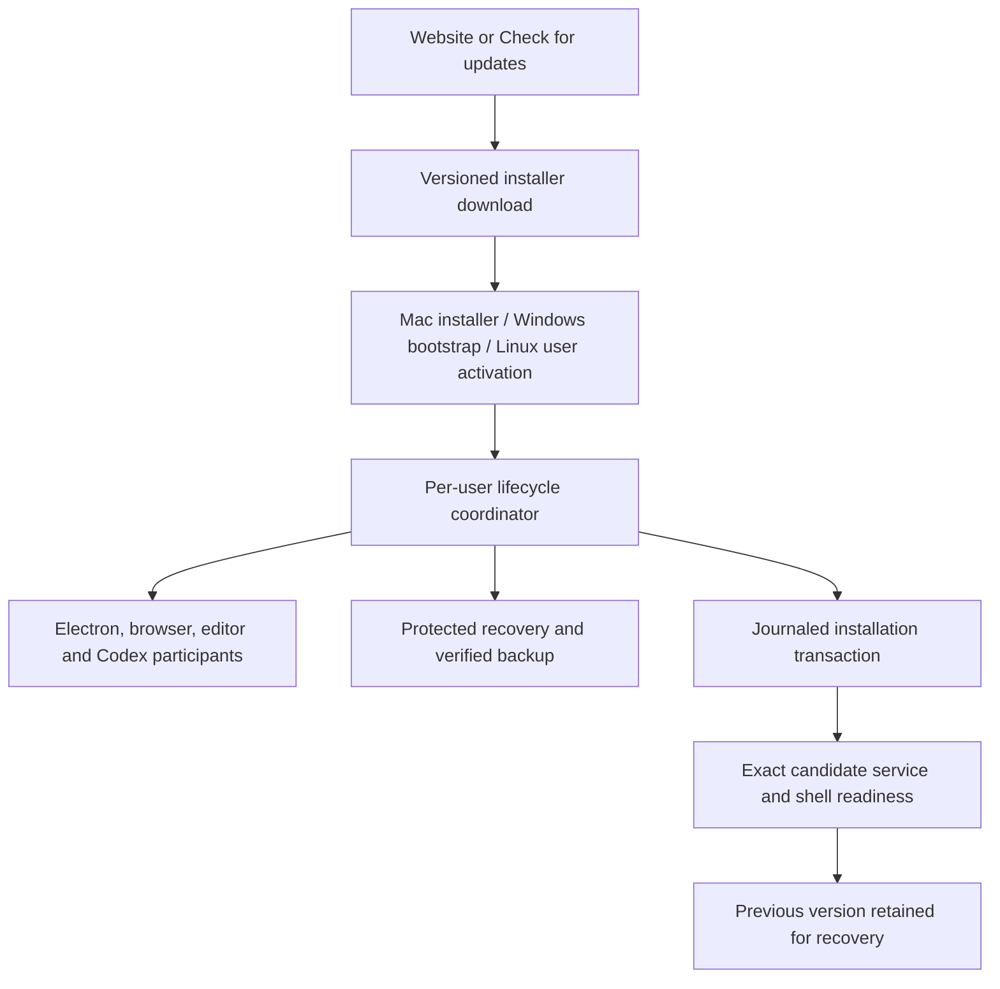
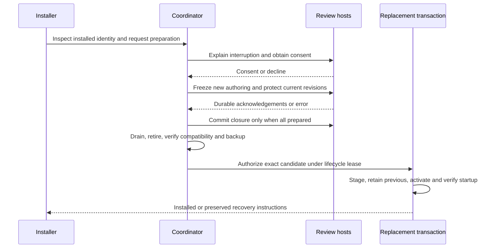
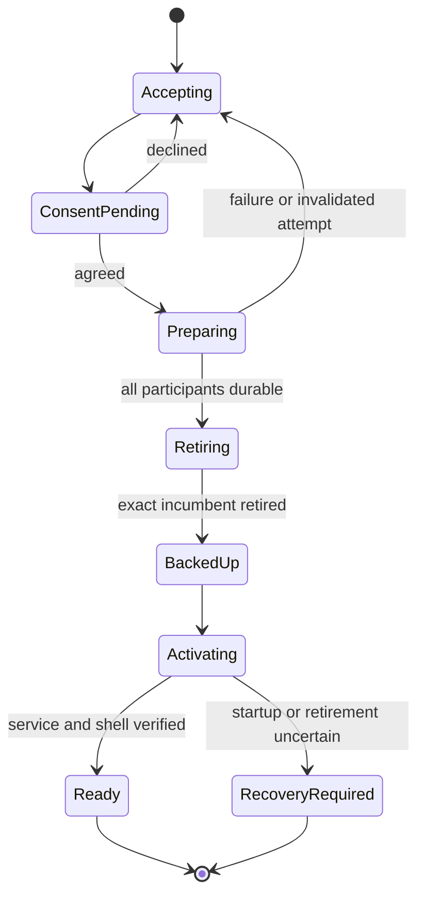
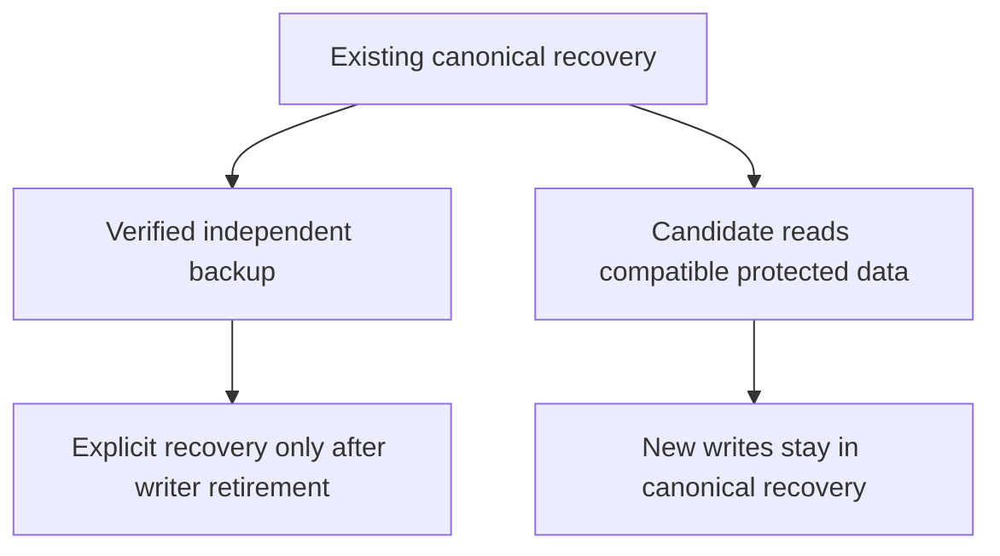
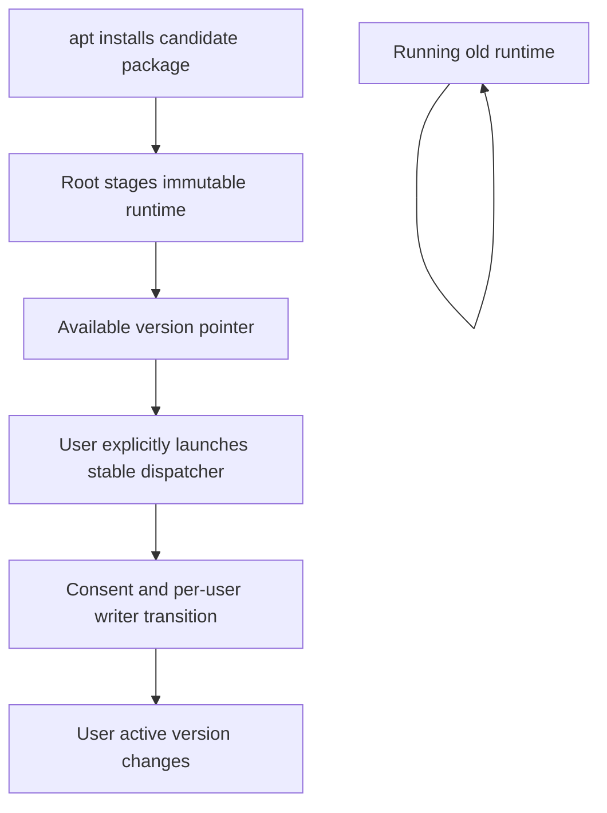

# Desktop Downloads and Manual Upgrades - Plan

## Goal Capsule

**Objective:** People can install Placekeeper without a development toolchain and move to newer releases without losing their review work.

**Product authority:** The Product Contract below records the scope confirmed on November 3, 2026. It covers prebuilt distribution, source-install fallback, optional integrations, update discovery, and safe manual upgrades. It does not authorize publishing a release or merging a PR.

**Means:** Guarded manual installation and per-user activation, with retained prior versions and exact-artifact release qualification (KTD2–KTD5, KTD9).

**Execution profile:** One integrated change to the existing Electron migration PR. Implementation may proceed in dependency-bounded units; the orchestrator integrates, verifies, reviews, and publishes the PR changes. Release publication and merging remain outside this authorization.

**Stop conditions:** Do not weaken the Product Contract to make an installer pass. A route that cannot protect work blocks that route; missing qualification blocks release publication. No unresolved product decision blocks implementation. Actual downloaded OS approval and public 0.2.4 migration remain evidence gates, not existing accomplishments.

---

## Product Contract

### Summary

Provide unsigned desktop downloads with platform-specific installation guidance and retain source installation as an alternative. Include optional integration setup and a manual update check that directs users to the appropriate download. Protect active review work during manual upgrades.

### Problem Frame

Source installation asks users to install build tools before they can read a document. Existing package builds do not yet establish a complete public download, approval, installation, and upgrade experience. The primary audience uses personal computers; managed-device users may use whichever supported route their policies permit.

### Key Decisions

- **Unsigned distribution.** Governs R3–R4. (session-settled: user-directed — chosen over obtaining signing/notarization credentials: this is a hobby project and credentials are not planned.)
- **One installation and manual-upgrade experience.** Governs R1, R8–R13. (session-settled: user-approved — chosen over installers alone or automatic replacement now: users need a complete supported manual path.)
- **Keep source installation.** Governs R4. (session-settled: user-directed — chosen over prebuilt-only distribution: retain an alternative where local builds are permitted.)
- **Optional integration setup.** Governs R6–R7. (session-settled: user-approved — chosen over entirely separate setup: offer integrations while installing.)
- **Ask before closing reviews.** Governs R10–R11. (session-settled: user-approved — chosen over requiring manual closure or waiting indefinitely: coordinate a safe, user-approved upgrade.)
- **Leave default PDF handling alone.** Governs R5. (session-settled: user-directed — chosen over a setup offer: users can change it through OS settings.)
- **Manual update discovery.** Governs R8–R9. The user confirmed the synthesis with this default; periodic notifications and automatic installation are deferred.

### Requirements

**Downloads and installation**

- R1. Publish prebuilt Windows x64 Setup.exe, macOS Apple Silicon and Intel DMGs, and Ubuntu/Debian x64 deb packages that do not require Node, pnpm, or compilers on the user's computer.
- R2. The website must prominently offer the appropriate supported download and make all platform downloads, release notes, checksums, and source-install instructions accessible.
- R3. Unsigned downloads must have tested platform-specific instructions for normal OS approval prompts, without disabling system protections or silently stripping download-security metadata.
- R4. Retain the macOS/Linux shell and Windows PowerShell source-install routes, explaining their prerequisites and policy limits; when neither desktop route is permitted, offer the web reader with its existing limitations.
- R5. Installation must neither change the default PDF reader nor prompt the user to change it.

**Integrations**

- R6. Installation must offer opt-in VS Code, Chrome, and Codex setup and make those setup actions available again afterward.
- R7. Integration setup must distinguish completed setup from remaining host trust, permission, installation, or restart steps; skipping or failing an integration must not prevent ordinary desktop reading.

**Update discovery and replacement**

- R8. A manually invoked Check for updates action must compare the installed version with the latest published stable release and present release notes and the appropriate download when newer.
- R9. Update checks must clearly distinguish current, newer-release, and unavailable-check outcomes, without downloading installers, replacing the app, or making background update requests automatically.
- R10. An upgrade encountering active reviews must explain the interruption and obtain agreement before closing them; declining must leave the current installation usable.
- R11. Before replacement, pending writes must finish and recoverable drafts must be preserved; unsafe or failed preparation must stop the upgrade without sacrificing existing work.
- R12. Successful upgrades must preserve existing documents, annotations, recovery data, settings, and integration usability, identifying any unavoidable user action rather than silently leaving a broken integration.
- R13. Failed replacement or startup must leave a recoverable previous installation and protected user data, with clear recovery instructions when automatic restoration cannot safely finish.

**Release and lifecycle qualification**

- R14. Publish the supported installer set and checksums as one versioned release only after the release's required platform validation succeeds.
- R15. Qualification must exercise actual downloaded artifacts through OS approval and installation, plus fresh install, reinstall, manual upgrade, failure recovery, and uninstall on the supported platforms.
- R16. Verify migration from the actual publicly released 0.2.4 to 0.3.0, using its real identity and storage layout rather than assuming historical development builds represent that release.
- R17. Ordinary uninstall must preserve user documents and recovery data and remove only app-owned installation resources and registrations.

### Key Flows

- **First installation:** Choose a supported download → follow OS approval instructions → install → optionally configure integrations → open a PDF. Covers R1–R7, R15.
- **Manual update:** Invoke Check for updates → inspect version and release notes → choose download → run the supported replacement flow → approve closure if needed → resume using preserved work. Covers R8–R13.
- **Restricted computer:** Read the policy limitation → try the documented source route only where permitted → use the web reader if desktop installation is unavailable. Covers R3–R4.

### Acceptance Examples

- AE1. **Downloaded Mac app:** Given a freshly downloaded DMG on a supported Mac without developer signing credentials, following the documented OS approval steps produces a working app; if that cannot be established, the platform is not claimed qualified. Covers R1, R3, R15.
- AE2. **Policy denial:** Given a managed computer that blocks both unsigned downloads and local builds, installation reports the limitation and offers the web reader rather than promising the shell script will override it. Covers R4.
- AE3. **Declined interruption:** Given an active review, declining an upgrade's closure request leaves the old app and review usable. Covers R10.
- AE4. **Write failure:** Given pending annotations that cannot be persisted or protected, upgrading stops before replacement and identifies the unresolved work. Covers R11.
- AE5. **Broken candidate:** Given a candidate that fails startup, the previous installation and review data remain recoverable; failed shutdown of the candidate must not trigger unsafe restoration. Covers R13.
- AE6. **Update-check outage:** Given an offline machine, Check for updates reports that the check failed rather than claiming the installed version is current. Covers R9.
- AE7. **Integration skipped:** Given a user who declines Chrome setup, installation still completes and Chrome setup can be revisited later. Covers R6–R7.
- AE8. **Real old release:** Given the released 0.2.4 installation with documents, settings, integration registrations, and recovery drafts, upgrade to 0.3.0 satisfies R12 and does not infer identity from an unrelated candidate build. Covers R12, R16.
- AE9. **Uninstall:** Given documents and recovery drafts after an upgrade, ordinary uninstall removes the application without deleting that work. Covers R17.

### Scope Boundaries

- Automatic downloading, automatic replacement, forced restart, and periodic update notifications are deferred.
- Paid signing credentials and Apple notarization are excluded from this release scope; this does not prohibit ordinary local build signatures required for executable validity.
- Additional Linux formats, a managed package repository, and Windows/Linux ARM builds are deferred.
- No circumvention of organization policy or disabling of OS protections is part of installation.
- Source installation remains supported, but a new downloadable PowerShell bootstrap is not required for the prebuilt-download goal.
- SyncTeX still depends on the user's TeX installation; bundling TeX is excluded.
- PDF-reader functionality and automatic PDF association changes are outside this work.

### Dependencies and Existing Evidence

Current makers already produce Mac ZIPs, Windows Squirrel installers, and Linux debs. CI uploads those packages as temporary artifacts; the checked-in public release workflow publishes only source assets. DMGs and public binary publication remain work to plan.

Source installation invokes lifecycle coordination, recovery compatibility/backup checks, exact readiness checks, and guarded rollback. The current packaged installer paths have not been shown to provide equivalent coordination. The source coordinator currently defers active work; the user-facing consent flow in R10 is a new requirement, not a claim about current behavior.

No desktop Check for updates menu currently exists. The local desktop manifest has been bumped to 0.3.0, while a packaging test still expects 0.2.4; reconcile version-dependent checks during implementation. The manifest change is separate uncommitted work and must be preserved.

### Outstanding Questions

**Resolve Before Planning:** None.

**Deferred to Planning:**

- Establish minimum supported OS versions and the environments in which unsigned downloaded artifacts can actually pass R3 and R15.
- Inspect published 0.2.4 source/artifacts to identify application identity, paths, recovery formats, and integration migration needs for R16.
- Determine how each native installation route can meet R10–R13, including service use by editor/plugin hosts and OS-managed Linux replacement.
- Choose a stable release metadata source and platform selection mechanism for R8–R9, including safe behavior for unsupported platforms or versions newer than stable.
- Determine which integration steps can be completed directly on each platform and which require host-guided user action under R7.

### Sources and Research

- `apps/electron/forge.config.ts:13` and `:53`: production identity and existing package makers.
- `.github/workflows/desktop-candidate.yml:89`: installer build/testing; `:147`: CI artifact publication.
- `.github/workflows/release-source.yml:109`: public source-only asset set.
- `packaging/desktop/source-install.mjs:47`: coordinated source replacement entry point.
- `apps/service/src/host/upgrade-coordinator.ts:50`: active-work and incumbent-retirement checks.
- `apps/service/src/cli/desktop-service-switch.ts:46`: recovery compatibility and backup.
- `packaging/desktop/install-built-app.mjs:25`: readiness and rollback behavior.
- `apps/electron/src/protocol-install.ts:14`: current Squirrel registration handling.
- `apps/electron/src/menus.ts:21`: current menu surface.
- `packaging/desktop/packaging.test.ts:90`: version-dependent packaging expectation.
- `docs/plans/2026-09-13-0009-feat-release-install-flow-plan.md`: historical release/install context, not authority over this confirmed scope.
- [Electron autoUpdater](https://www.electronjs.org/docs/latest/api/auto-updater/): signed Mac updater requirement and Linux package-manager boundary; automatic updates are deferred.
- [Apple download approval guidance](https://support.apple.com/en-hk/102445): normal approval controls; release validation must check the actual supported OS versions.

---

## Planning Contract

**Product Contract preservation:** Product Contract unchanged. The implementation covers R1–R17. Publication remains a separately authorized release operation; this work delivers the release machinery and records any platform qualification still outstanding.

### Key Technical Decisions

- KTD1. **Separate installation ownership from durable user state.** Keep the published macOS support root and the current per-platform recovery roots. Move Windows executable installation to `%LOCALAPPDATA%/Programs/Placekeeper`; never rename or delete `%LOCALAPPDATA%/Placekeeper` as an app tree. Existing collocated development/source installations require inventory-based relocation of app-owned files, preserving all durable and unknown files. This closes a concrete collision between `source-install.mjs` and `platform/locations.ts` before R12–R13 and R17 can hold.
- KTD2. **One preparation authority for all live review hosts.** Extend the per-user daemon lifecycle protocol with an explicit upgrade attempt tied to the installed identity, candidate artifact identity, current participants, and an unpredictable attempt token. It obtains informed user consent, stops admission of new reviews, lets admitted operations settle, and requests each current host to protect its editing state. Hosts acknowledge only after their current Review Revision and Protected Draft writes are durable. The coordinator commits closure only after all required acknowledgements; a refusal, new unaccounted participant, failed write, stale acknowledgement, or timeout cancels preparation and restores admission. Existing compare-and-drain, recovery-format verification, lifecycle lease, and retirement checks remain authoritative after preparation. This implements R10–R11 without turning a successful IPC send into permission to replace files.
- KTD3. **Keep replacement recoverable through actual application readiness.** Extend the existing staged replacement transaction with an atomic journal outside both the app and canonical recovery. Retain the complete previous app and verified recovery backup until the installed candidate proves its exact service identity and completes a shell/renderer startup check. Preserve one previous known-good installation after success for late startup recovery. A failed candidate must retire before any automatic restoration; otherwise retain both versions, backup, and actionable recovery instructions. Never overwrite newer user data with an old backup automatically. Apply this same boundary to source installation and native installer activation, per R11–R13.
- KTD4. **Use controlled install entrypoints inside the requested formats.** The macOS DMG carries an installer application with the complete candidate bundle; it does not instruct Finder to overwrite a running app. Windows Setup.exe is a thin, pinned NSIS bootstrap that extracts the complete candidate and invokes the same coordinator before target mutation; it does not invoke Squirrel full reinstall. The bootstrap does not independently kill, copy over, or uninstall the incumbent. App installation defaults to a user-writable location and requires no development tools. This is a how-level consequence of R1 and R10–R13: stock Squirrel install hooks occur after destructive work, and a DMG is only a container. Ordinary administrator/Finder replacement outside the supported entrypoint is not represented as a guarded upgrade.
- KTD5. **Debian packages stage immutable runtime versions; users activate them safely.** The deb owns its bootstrap, desktop/MIME entries, and compressed candidate payload. Its maintainer scripts materialize a verified, root-owned complete runtime under `/opt/placekeeper/runtimes/<artifact-identity>` and atomically mark it available only after extraction and sandbox setup succeed. Every runtime directory and marker is root-owned, non-user-writable and symlink-safe; the verified adjacent sandbox helper retains root ownership and mode 4755 on an executable/SUID-capable filesystem. An incompatible mount or host policy blocks activation with guidance rather than disabling the sandbox. These runtime directories are outside dpkg's overwritten file list, so an apt upgrade leaves all running old versions intact. On the next explicit launch, the unprivileged bootstrap invokes KTD2–KTD3 to switch that user's active runtime. Existing integrations resolve through the stable installed dispatcher. No GUI runs as root, no maintainer script attempts recursive package-manager rollback, and no package update force-closes another user's reviews. Retained runtimes are never pruned while they may still be in use; ordinary removal preserves them as recovery resources while removing system launchers and registrations. Automatic runtime garbage collection is outside this change; document explicit administrator cleanup only after all sessions are closed, without traversing user state. Both removal and purge retain potentially active runtime/recovery resources. This avoids a global preinst receipt scheme that cannot safely discover arbitrary per-user XDG paths or prevent launch races.
- KTD6. **Migrate the actual public AppKit release, not an Electron candidate labelled 0.2.4.** Public `v0.2.4` is commit `3e37ca4b84dde61725b8e03d87dbc3023f1d1f4f`, published October 16, 2026, with source-only assets for Apple-silicon macOS. Its visible/bundle identity is Placekeeper / `local.placekeeper`, executable `PlacekeeperMac`, CLI `Contents/MacOS/placekeeper`, and support root `~/Library/Application Support/Placekeeper`. Preserve that root and the macOS compatibility launchers. Import its validated window-restoration and interface-zoom preferences once without overwriting existing Electron preferences; retain the original preference file. Its native close path has no acknowledged renderer settlement protocol. Therefore the 0.2.4 upgrade explicitly identifies required save/close/end-task actions and refuses replacement until the old protocol establishes idle retirement; it never claims automatic safe closure of that legacy host. This is an unavoidable migration action under R12, not an exception allowing unprotected replacement under R10–R11.
- KTD7. **Offer integration setup after installation and on demand.** A first-launch setup surface offers independent, default-off VS Code, Chrome, and Codex actions, with Skip and a persistent menu entry for later use. Source installers use the same portable setup operations. Persist only the user's integration choices and owned registration receipts; update an already opted-in integration through receipt-aware repair. Show prepared/registered, host action pending, completed verification, skipped, and failed outcomes accurately. Setup failure cannot block opening a PDF. This instantiates the optional-setup decision governing R6–R7 (session-settled: user-approved — chosen over entirely separate setup: users wanted integrations available during installation).
- KTD8. **Share a validated release catalog across desktop and website.** Define a versioned catalog for the four target assets, release notes, checksums, source routes, and supported OS guidance. Resolve stable releases from the public GitHub Releases API, rejecting drafts, prereleases, malformed versions, unsafe links, and incomplete newer desktop releases. Desktop networking runs only in the main process in response to Check for updates, with bounded time/size and explicit unavailable results. Compare semantic versions numerically; an installed version newer than stable is reported accurately. The website uses the same target mapping and offers an architecture choice when the browser cannot establish it. Never invent asset URLs for an unpublished 0.3.0 or turn a failed metadata request into a current-version result. R8–R9's manual-only decision remains intact.
- KTD9. **Qualify exact bytes, then publish once.** Native jobs build all four installers from one commit/version and produce a checksum inventory. A release-candidate draft holds those exact bytes and a qualification manifest binding each result to filename, SHA-256, OS/architecture, build provenance, and scenario. A single publication job refuses missing, failed, cancelled, stale, or mismatched evidence, then publishes the complete draft. Candidate OS approval tests use actual browser downloads of the staged assets; anonymous public download/hash checks follow publication. Rebuilding any installer invalidates its qualification. The source assets remain part of the release. This implements R14–R16 without treating CI artifact upload or a source-only release as desktop qualification.

### High-Level Technical Design

The installer controls the transition; the per-user daemon controls whether existing work may leave its current runtime.

Replacement outcomes remain distinct:

| Condition | Installation action | User work |
|---|---|---|
| Consent declined | Leave incumbent untouched | Existing reviews remain usable |
| Protection or backup failed | Abort before replacement | Resume existing hosts; identify failed work |
| Candidate failed, retirement proved | Restore previous app/selection | Preserve canonical data and verified backup |
| Candidate failed, retirement uncertain | Keep transaction; no competing writer | Explain safe recovery path |
| Exact service and shell ready | Commit selection; retain previous version | Reopen through fresh authenticated launch |

Durable data never lives beneath a replaceable runtime:

Linux separates system staging from per-user activation:

### Assumptions and Platform Qualification

- The full approved product scope is implemented in this PR. The existing open Electron migration PR is the delivery vehicle; no independent release or merge is authorized by this plan.
- Initial qualification targets are macOS 13 and the current supported macOS generation on both architectures, Windows 11 x64, Ubuntu 24.04 x64, and Debian 13 x64. Electron's runtime floor is not itself evidence that a downloaded app works on a particular OS. The release manifest may claim only the tested support matrix; inability to qualify a required target blocks publication rather than silently dropping its package.
- Installation/setup UX may use a separate installer window and a first-launch integration offer. These are technical choices to satisfy the agreed formats and opt-in behavior, not additions to the PDF-reading workflow.
- Linux package removal preserves retained runtime copies when safe cleanup cannot be proved. They are documented recovery resources; uninstall never traverses user homes to delete recovery data or guesses which personal configuration files belong to Placekeeper.
- The current local manifest change to version 0.3.0 is intentional input. Reconcile version-dependent packaging checks rather than reverting it.

### Alternatives and Scope Discipline

Stock Squirrel hooks and conventional Finder overwrite were rejected because neither owns a cancellable pre-mutation boundary. A Windows wrapper around destructive Squirrel reinstall was also rejected: it would require recreating Squirrel's registration and rollback state in addition to the existing transaction. The chosen bootstrap delegates mutation to one app-owned transaction.

A global Linux preinst preparation receipt was rejected because custom XDG roots, multiple users, and concurrent launches leave an unclosed ownership race. Immutable system-staged runtimes allow safe per-user activation without that cross-user protocol. No second structurally viable mechanism remained that needed a bake-off before implementation.

No automatic updater, privileged background service, package repository, telemetry, credential escrow, automatic multi-user runtime garbage collection, or blanket security override is introduced. A global machine-wide review coordinator was considered and not built: immutable staging removes its need. Reconsider only if a future package must mutate resources used by running versions.

### System-Wide Impact and Research

Preparation changes admission and closure across desktop, browser, editor, and agent participants. It must not restore a Task Binding or PDF Evidence Handle from disk; reopened work needs fresh host activation and existing authentication. Per-user lifecycle leases remain separate from system package installation ownership. Integration repair uses the existing opt-in receipts and final installed dispatcher paths.

Relevant local patterns are `docs/solutions/architecture-patterns/upgrade-safe-shared-per-user-daemon-lifecycle.md`, `docs/solutions/integration-issues/refresh-independent-vscode-payload-after-app-install.md`, and `docs/solutions/workflow-issues/verify-public-installer-through-publication-and-host-setup.md`. The historical clean-break identity migration is explicitly inapplicable to R12/R16 preservation.

Primary evidence that changes this design:

- [Public 0.2.4 release](https://github.com/brad-ross/placekeeper/releases/tag/v0.2.4) and its pinned source commit establish the real migration baseline.
- [Squirrel install implementation](https://github.com/Squirrel/Squirrel.Windows/blob/2.0.1/src/Update/Program.cs#L132-L170) kills package executables and deletes the old directory before full installation. The precise bundled Squirrel binary provenance is not needed for the new public path because KTD4 removes reliance on it.
- [Forge DMG maker](https://www.electronforge.io/config/makers/dmg) establishes that DMG generation alone is a copy container, not an upgrade transaction.
- [Debian maintainer-script policy](https://www.debian.org/doc/debian-policy/ch-maintainerscripts) requires noninteractive/idempotent scripts and does not provide application-startup rollback.
- [Electron 45.2.1 platform support](https://github.com/electron/electron/blob/v45.2.1/README.md#platform-support), [Apple per-app approval](https://support.apple.com/en-us/102445), and [Microsoft SmartScreen](https://learn.microsoft.com/en-us/windows/security/operating-system-security/virus-and-threat-protection/microsoft-defender-smartscreen/) constrain qualification and install guidance.
- [Ubuntu support cycle](https://ubuntu.com/about/release-cycle), [Debian 13 support](https://www.debian.org/releases/trixie/), and the [pinned Chromium sandbox host](https://github.com/chromium/chromium/blob/156.0.8078.75/sandbox/linux/suid/client/setuid_sandbox_host.cc#L124-L161) support the Linux qualification constraints. Exact Electron/glibc compatibility still requires final artifact execution.
- [GitHub latest-release API](https://docs.github.com/en/rest/releases/releases#get-the-latest-release) and [draft publication](https://docs.github.com/en/repositories/releasing-projects-on-github/managing-releases-in-a-repository) define metadata and publication boundaries.

---

## Implementation Units

### U1. Separate installation state and preserve the released migration baseline

**Goal:** Replacement and uninstall cannot own durable user data, and actual 0.2.4 state remains readable.

**Requirements:** R11–R13, R16–R17; AE8–AE9. **Dependencies:** None.

**Files:** Modify `packaging/desktop/source-install.mjs`, `apps/service/src/platform/locations.ts`, `apps/electron/src/window-state.ts`, `packaging/desktop/macos-compatibility.ts`; add `packaging/desktop/install-layout.ts`, `packaging/desktop/install-layout.test.ts`, `packaging/desktop/legacy-release.ts`, `packaging/desktop/legacy-release.test.ts`, and `test/fixtures/legacy-release-0.2.4/`; extend `apps/electron/test/window-state.test.ts` and `packaging/desktop/packaging.test.ts`.

**Approach:**

1. Implement KTD1's disjoint path policy and refuse replacement destinations that contain canonical data or recovery backups.
2. Record the public source asset checksum, commit, bundle/launcher/support identities, recovery schemas, and preference keys in a migration fixture ledger derived from the actual release. Preserve the original source evidence needed to reproduce fixture extraction.
3. Implement KTD6's one-time validated preference import and compatibility launchers. Preserve unknown files and existing destination preferences. No destructive historical identity cleanup is reused.
4. Reconcile the known 0.3.0 manifest/packaging test mismatch.

**Patterns to follow:** `platform/locations.ts`, `window-state.ts`, `macos-compatibility.ts`, and actual released `WindowRestoration.swift` / `AppZoomPolicy.swift`.

**Test scenarios:**

- Default Windows source-install layout containing recovery, browser-source and unrelated sentinel files survives app relocation and subsequent replacement.
- A caller-selected installation path overlapping canonical state or backup is rejected before mutation.
- Covers AE8. Actual 0.2.4 schema samples and preferences import into an empty Electron profile; a second run does not overwrite newer preferences.
- Corrupt or unrecognized preference entries remain preserved and cannot authorize file access or restore credentials.
- Covers AE9. Ownership-scoped removal deletes only known app resources and leaves recovery/settings/documents intact.

**Verification:** Layout and fixture tests establish ownership/schema behavior; they do not substitute for U9's installation of the real released app. Exact Windows default-path and macOS migration acceptance must exercise the packaged entrypoint.

### U2. Add consent-bound preparation to the shared daemon lifecycle

**Goal:** A single per-user authority protects all admitted work before allowing an installer to switch writers.

**Requirements:** R10–R13; AE3–AE5. **Dependencies:** U1.

**Files:** Modify `apps/service/src/host/control-protocol.ts`, `apps/service/src/host/launch-control.ts`, `apps/service/src/host/daemon-lifecycle.ts`, `apps/service/src/host/upgrade-coordinator.ts`, `apps/service/src/host/placekeeper-host.ts`, `apps/service/src/cli/desktop-service-switch.ts`, `apps/service/src/cli/daemon-command.ts`; add `apps/service/src/host/upgrade-preparation.ts`, `apps/service/test/upgrade-preparation.test.ts`; extend `apps/service/test/desktop-service-switch.test.ts`, `apps/service/test/desktop-daemon-lifecycle.test.ts` and relevant host runtime tests.

**Approach:**

1. Make this unit the sole owner of KTD2's typed preparation request, attempt/participant acknowledgements, cancellation and commit outcomes. All adapters consume that contract.
2. Track authenticated participants and admitted activity; keep settlement calls allowed while rejecting new review admission during preparation. Use a bounded attempt lifetime so an abandoned installer cannot leave the reader permanently frozen.
3. Preserve the existing lifecycle lease through retirement, backup, replacement and readiness. Reject ambiguous endpoints and never infer readiness from process death alone.
4. Negotiate old management capability. For released 0.2.4, return the specific manual action required by KTD6 and continue only after existing idle/retirement proof.

**Execution note:** Characterize existing refusal and drain races before changing the state machine.

**Test scenarios:**

- Covers AE3. Declined consent never freezes/closes hosts or authorizes replacement.
- Covers AE4. Failed protected-draft or PDF save acknowledgement cancels preparation and restores admission.
- A new participant or stale revision acknowledgement invalidates the attempt; a copied/expired token cannot authorize a different candidate.
- Concurrent installers serialize; installer disappearance or timeout resumes usable existing hosts.
- Chrome/editor activity and Codex bindings prevent false idle even when no Electron window is open.
- Legacy 0.2.4 capability returns actionable save/close instructions and refuses forced retirement.
- Recovery-format change during drain or backup verification failure prevents replacement.

**Verification:** Protocol/state-machine tests catch ordering and failure semantics. An installed multi-host acceptance test in U9 must prove real participants reach the boundary; mocks cannot establish durable renderer state.

### U3. Protect and close participating review hosts after consent

**Goal:** Supported hosts acknowledge current editing state before coordinated closure, with honest interruption and failure UI.

**Requirements:** R10–R12; AE3–AE4. **Dependencies:** U2.

**Files:** Modify `apps/electron/src/main.ts`, `apps/electron/src/review-bridge.ts`, `apps/electron/src/preload.ts`, `apps/web/src/host/electron-runtime.ts`, `apps/web/src/host/browser-runtime.ts`, `apps/web/src/host/vscode-runtime.ts`, `apps/web/src/host/codex-runtime.ts`, `apps/vscode/src/review-panel.ts`, `apps/vscode/src/webview-bridge.ts`, and `apps/service/src/browser/chrome-runtime.ts`, `apps/service/src/codex/codex-runtime.ts`; add `apps/electron/src/upgrade-preparation.ts`, `apps/electron/test/upgrade-preparation.test.ts`; extend `apps/electron/test/window-lifecycle.test.ts`, `apps/electron/test/review-bridge.test.ts`; add `test/acceptance/desktop-upgrade-preparation.spec.ts` and host-specific cases in the existing integration suites.

**Approach:**

1. Reuse the tokenized Electron settle-close and bridge settlement paths for KTD2, rather than destroying windows or stopping processes directly.
2. Present one attempt-scoped explanation of interrupted reviews/agent work. Freeze participant authoring only after agreement, protect the final revision, and keep all hosts open until preparation succeeds globally.
3. Settle browser/editor views through their authenticated runtime connection. Detach Codex live authority only after admitted work has drained; preserve reopening intent without restoring binding/evidence authority.
4. On cancellation or failure, unfreeze surviving views and identify the work that prevented upgrade. Reopen protected review intent through normal authenticated launch after successful activation.

**Test scenarios:**

- Covers AE3. Decline with two open PDFs leaves both editable and the old installation active.
- Covers AE4. Text typed immediately before acceptance is recoverable after activation; a failed persist keeps the upgrade blocked.
- One failing renderer prevents closure of already-prepared peers; stale window/main-frame/attempt messages are ignored.
- Browser, embedded editor and Codex-backed reviews participate in the same attempt; a disconnected unacknowledged host cannot be counted as prepared.
- Reopened reviews restore presentation and durable work but require fresh Task Binding/observation authority.

**Verification:** Host tests enforce token/ownership rules. Installed/browser acceptance must demonstrate actual editor input reaches Protected Draft persistence and reopening, including an upgrade with no focused Electron window.

### U4. Make app activation and recovery transactional

**Goal:** Failed copy, activation or startup leaves a previous usable installation and protected work.

**Requirements:** R11–R13, R17; AE4–AE5. **Dependencies:** U1–U3.

**Files:** Modify `packaging/desktop/install-built-app.mjs`, `packaging/desktop/install-built-app.test.ts`, `packaging/desktop/source-install.mjs`, `apps/service/src/cli/daemon-command.ts`, and `apps/electron/src/main.ts`; add `packaging/desktop/install-transaction.mjs`, `packaging/desktop/install-transaction.test.ts`, `apps/electron/src/startup-receipt.ts`, `apps/electron/test/startup-receipt.test.ts`; extend `test/acceptance/desktop-service-rollback.spec.ts`.

**Approach:**

1. Implement KTD3's journal with staged/previous/current identities and recovery locations, written atomically before each mutation. Place it outside all replaceable/runtime/data trees.
2. Reuse verified staging and exact service receipts, then require an attempt-bound installed shell/renderer readiness acknowledgement. The coordinator process must survive incumbent shutdown and candidate failure.
3. On reentry, inspect the journal and exact running identities before resuming or recovering. Preserve uncertain states rather than guessing which process may write canonical recovery.
4. Keep one previous known-good app and backup after success; make cleanup ownership-aware and unable to remove current user data. Linux uses the same activation record while its immutable runtime storage is supplied by U5.

**Test scenarios:**

- Covers AE4. Disk-full/copy/backup failure before mutation preserves the incumbent and canonical data.
- Covers AE5. Candidate service starts but shell fails; exact candidate retirement precedes previous-app restoration.
- Candidate retirement times out; both versions/journal/backup remain, and no old writer starts.
- Process interruption between each journal boundary is recoverable on the next invocation without deleting the only good copy.
- A later startup failure exposes the retained previous version without automatically rolling back newer recovery data.
- Reinstalling identical artifacts is safe and still permits independent opted-in integration repair.

**Verification:** Failure-injection tests prove transaction ordering. Packaged smoke must cover service-success/shell-failure and recovery from an interrupted transaction; a unit-test receipt is not application readiness.

### U5. Build guarded DMG, Setup.exe and deb installation routes

**Goal:** Every requested binary package invokes the guarded transition and runs without a development toolchain.

**Requirements:** R1, R3–R5, R10–R13, R17; AE1–AE5, AE9. **Dependencies:** U4.

**Files:** Modify `apps/electron/forge.config.ts`, `apps/electron/package.json`, `pnpm-lock.yaml`, `packaging/desktop/build.ts`, `packaging/desktop/native-launcher.c`, `packaging/desktop/native-launcher.ts`, `packaging/desktop/packaging.test.ts`, and `apps/electron/src/protocol-install.ts`; add `packaging/desktop/installer-entry.mjs`, `packaging/desktop/installer-entry.test.ts`, `packaging/desktop/makers.ts`, `packaging/desktop/windows/setup.nsi`, `packaging/desktop/macos-installer.ts`, `packaging/desktop/debian-lifecycle.sh`, `packaging/desktop/debian-lifecycle.test.ts`, and `test/acceptance/desktop-installers.spec.ts`.

**Approach:**

1. Implement KTD4's DMG installer app and NSIS extraction-only bootstrap using the packaged runtime and U4 transaction. Pin new build tools and record their versions. Installer UI identity/state must be separate from the incumbent app's single-instance lock and preferences.
2. Preserve macOS code-signature validity needed for execution while remaining explicitly unsigned/unnotarized as a distribution policy. Never remove quarantine or disable protections.
3. Implement KTD5's immutable root-owned Linux staging and stable dispatcher, preserving executable modes and sandbox-helper ownership. Expose an available candidate only after verified complete staging; install scripts are idempotent.
4. Register open-with/protocol entries without changing the default PDF association. Uninstall removes only owned installation/registration resources, preserves state and retained recovery resources, and reports any remaining cleanup action.
5. Keep native source-install routes working through the shared transaction. Do not expose the old unguarded Squirrel full installer as a supported download.

**Execution note:** Native installer smoke and interruption proof are primary; static assertions over installer text cannot qualify these routes.

**Test scenarios:**

- Fresh install on each target with Node/pnpm/compiler absent opens a PDF through the installed executable.
- Covers AE1. A real browser-downloaded DMG reaches a working installed app through documented per-app approval on each qualified Mac architecture/OS.
- Windows accepted and declined active-review upgrades show no earlier process termination or target mutation.
- Linux apt staging leaves running old runtime/resources intact; next user launch safely activates the candidate. A second user can continue the previous runtime independently.
- Interrupted deb unpack/materialization cannot expose a partial runtime; sandbox ownership remains correct and no `--no-sandbox` path appears.
- Covers AE9. Uninstall/reinstall preserves user data and does not change default PDF handling; retained rollback resources are accurately reported.

**Verification:** U9 runs exact final packages on native hosts. Platform-specific lifecycle adapters are incomplete until their real installer entrypoints pass, even if portable transaction tests pass.

### U6. Make optional integration setup portable and repeatable

**Goal:** Installed users can opt into each integration and distinguish completed setup from remaining host actions.

**Requirements:** R6–R7, R12; AE7–AE8. **Dependencies:** U1, U5.

**Files:** Modify `packaging/desktop/integration-registration.ts`, `apps/service/src/cli/integration-registration-command.ts`, `packaging/desktop/setup-codex.mjs`, `packaging/desktop/build.ts`, `apps/electron/src/menus.ts` and `apps/electron/src/main.ts`; add `packaging/desktop/setup-integrations.mjs`, `packaging/desktop/setup-integrations.test.ts`, `apps/electron/src/integration-setup.ts`, `apps/electron/test/integration-setup.test.ts`; extend `packaging/desktop/integration-registration.test.ts`, `apps/service/test/integration-registration-command.test.ts`, and installed host acceptance.

**Approach:**

1. Implement KTD7 using existing registration ownership receipts and packaged payloads on all supported platforms; remove the generated macOS-script adaptation as the portability boundary.
2. Bind integrations to stable installed launchers, not temporary extraction or version-specific staging paths. Refresh previously opted-in owned payloads without overwriting edited/unowned host configuration.
3. Make setup available before/alongside first PDF use and from a persistent menu afterward. Keep host trust/reload/extension-install actions explicit.
4. Preserve the published macOS integration compatibility entrypoints and identify required VS Code/Chrome/Codex restart or reapproval during 0.2.4 migration.

**Test scenarios:**

- Covers AE7. Skip every integration, open a PDF, then revisit setup and opt into one.
- Registration succeeds but host trust/restart is pending; UI does not report fully working setup.
- Existing receipt matches, differs because user edited configuration, or points at an old artifact; repair respects each ownership outcome.
- Equal VSIX version with stale payload is detected and refreshed through the supported host install mechanism.
- Covers AE8. Real old integration registrations resolve the installed candidate after the explicitly reported host action.

**Verification:** Unit tests establish ownership/result classification. Isolated host-profile acceptance must exercise registered bundled entrypoints; version strings and files on disk do not prove host activation.

### U7. Add the shared release catalog and manual desktop update action

**Goal:** Users can deliberately discover newer stable releases without background requests or installer execution.

**Requirements:** R8–R9; AE6. **Dependencies:** None; U5 supplies final asset naming before integration verification.

**Files:** Add `packages/core/src/desktop-release.ts`, `packages/core/test/desktop-release.test.ts`, `apps/electron/src/update-check.ts`, `apps/electron/test/update-check.test.ts`; modify `apps/electron/src/menus.ts`, `apps/electron/src/main.ts`, `apps/electron/test/menus.test.ts`, and relevant network-policy tests.

**Approach:**

1. Make this unit the sole owner of KTD8's release catalog schema, semantic-version comparison and target-to-asset mapping. U8/U9 consume it.
2. Add a main-process, explicitly invoked check with current/newer/unavailable presentations, release notes, and an appropriate user-clicked browser download link. Include no installer fetching or execution.
3. Validate links against the intended repository/release asset origins and keep the renderer's existing network restrictions intact. Handle unsupported targets and unavailable architecture identification with explicit selection/all-download access.

**Test scenarios:**

- Equal version, newer stable, installed-ahead-of-stable and prerelease installed versions produce accurate outcomes.
- Covers AE6. Offline, timeout, rate-limit, oversized/malformed metadata and an incomplete newer release produce unavailable, not current.
- A source-only historical release is not mistaken for a current desktop download set.
- App launch, menu rebuild and idle reading perform no update network requests; one explicit action performs one bounded check.
- Unsafe asset/notes URLs never reach external navigation; supported target selects the matching installer.

**Verification:** Injected-network tests establish outcome logic and zero unsolicited requests; a packaged-app menu smoke checks actual external-link behavior without downloading or running an installer automatically.

### U8. Publish accurate download and installation guidance in the website

**Goal:** Users find the right available download and a usable fallback without misleading platform claims.

**Requirements:** R2–R7, R12–R13; AE1–AE2, AE7. **Dependencies:** U5–U7.

**Files:** Modify `apps/web/src/static-entry.tsx`, `apps/web/src/landing/InstallDialog.tsx`, related landing styles, `docs/installation.md`, `README.md`, `install.sh`, `install.ps1` where guidance requires it; add `apps/web/src/landing/downloads.ts`, `apps/web/src/landing/downloads.test.ts`; add `test/acceptance/desktop-downloads.spec.ts`, `scripts/source-release.test.ts`, and `scripts/static-release.test.ts`; add `docs/desktop-upgrades.md`.

**Approach:**

1. Use U7's catalog to make available desktop downloads prominent while retaining all targets, release notes, checksums and source routes. Do not hard-code unverified 0.3.0 asset links.
2. Preserve the install dialog's focus, Escape, outside-click and clipboard behavior. Offer Mac architecture selection when detection is uncertain.
3. Write platform-specific unsigned approval instructions from U9 evidence; explain policy denial and the existing web reader's limits without promising source installation bypasses policy.
4. Explain supported installer entrypoints, legacy 0.2.4 save/close actions, retained recovery resources, failure recovery, and optional host steps. List source prerequisites and SyncTeX's separate TeX dependency.

**Test scenarios:**

- Supported desktop, unsupported/mobile and unknown architecture visitors see correct primary action and all-platform access.
- Missing/incomplete release metadata yields explicit availability/fallback UI, never dead fabricated installer links.
- Covers AE2. Policy-blocked users can reach source prerequisites and web-reader limitations.
- Keyboard-only use preserves focus and escape behavior across download/source tabs or choices.
- Upgrade recovery guidance names the actual transaction/retained-runtime paths and never instructs global security disabling.

**Verification:** Static unit/distribution tests plus browser checks on wide and narrow layouts. Platform approval text is qualified only by U9's actual downloaded-artifact evidence.

### U9. Gate complete releases on exact-artifact lifecycle qualification

**Goal:** A release cannot expose a partial or unqualified installer set, and remaining platform gaps are visible.

**Requirements:** R1–R17, especially R14–R16; AE1–AE9. **Dependencies:** U1–U8.

**Files:** Modify `.github/workflows/desktop-candidate.yml`, `.github/workflows/release-source.yml`, `scripts/testing/suites.ts`, and `package.json`; add `.github/workflows/release-desktop.yml`, `scripts/desktop-release.ts`, `scripts/desktop-release.test.ts`, `scripts/validate-desktop-qualification.ts`, `scripts/validate-desktop-qualification.test.ts`, `test/acceptance/desktop-installers.md`, and `test/acceptance/legacy-0.2.4-upgrade.spec.ts`; extend existing installed/rollback/host acceptance fixtures.

**Approach:**

1. Implement KTD9's candidate assembly and final publication gate, reusing source-release provenance checks. Required native jobs must succeed before a candidate is eligible; uploaded diagnostic artifacts are not approvals.
2. Bind the qualification manifest to U7's exact asset inventory and final hashes. Record automated, interactive OS-approval, and real-host evidence separately; a skipped/manual-not-run field cannot satisfy a required scenario.
3. Exercise fresh install, identical reinstall, accepted/declined upgrade, pending/failed writes, startup failure and safe recovery, multiple users where applicable, uninstall/reinstall, and integration repair.
4. Build/install the actual v0.2.4 source distribution on its supported Mac target, create representative documents/preferences/Protected Drafts and integration registrations, then migrate to the exact 0.3.0 installer. Do not manufacture this baseline by changing an Electron candidate's version string.
5. Deliver the workflow and unfilled qualification checklist without invoking publication. A later authorized release downloads the staged exact bytes, completes missing OS gates, publishes once, and verifies anonymous asset reachability.

**Test scenarios:**

- One missing platform result, changed installer hash, wrong version/commit, duplicate asset or stale approval blocks publication.
- All four qualified assets, matching checksums and source assets produce the exact complete draft inventory; no platform job can publish independently.
- Covers AE8. Actual 0.2.4 documents, annotations, recovery and preferences survive, and old host actions are reported accurately.
- Covers AE1–AE9. Native installed suites and recorded OS interactions exercise the specified outcomes using final downloaded bytes.
- Uninstall preserves work; reinstall can recover it. A failed candidate remains recoverable without an uncontrolled competing service writer.

**Verification:** Run the repo's relevant suites and native package matrix. Preserve evidence references in the PR. If any real OS/legacy/host qualification cannot run in the current environment, leave its release gate unsatisfied and report it as outstanding; do not label R15/R16 verified.

---

## Verification Contract

| Scope | Existing command or gate | What it establishes |
|---|---|---|
| Type contracts | `pnpm typecheck` | Shared protocol, release catalog and adapter types agree |
| Shell behavior | `pnpm test:electron` | Consent, menu, host-close and startup receipt seams |
| Platform and transaction logic | `pnpm test:desktop-platform` | Ownership, staging, rollback, registration and packaging policy |
| Shared writer transition | `pnpm test:upgrade-lifecycle` | Admission/drain/backup behavior; add new preparation suites explicitly |
| Installed application | `pnpm test:desktop-installed` | Packaged service/shell/runtime and restoration behavior |
| Source fallback | `pnpm test:source-release` | Source distribution and retained install paths |
| Website | `pnpm test:static:distribution` plus affected browser acceptance | Download availability and static reader fallback |
| Native installer qualification | Required native build/install jobs and hash-bound evidence | Exact DMG/Setup/deb lifecycle, OS approval, uninstall and real legacy migration |
| Publication | Complete draft inventory + all required qualification fields | Atomic versioned installer set; never permission to publish in this run |

Use targeted tests while changing each unit, then the combined affected suites once integrated. Add new test paths to `scripts/testing/suites.ts`; suite names alone do not guarantee coverage. Run no real host registration against the user's profile merely to satisfy acceptance: use explicit isolated profiles/temporary homes where supported and distinguish remaining real-host validation.

The platform matrix must test the built installer entrypoints, not just unpacked application directories. Keep browser download security metadata intact. No forced process termination, security metadata stripping, global protection disabling, or success-by-skipping is an accepted test workaround.

---

## Definition of Done

The code change is ready for PR review when all U1–U9 implementation and available automated/native checks pass, the plan's ownership/protection boundaries are reflected in code, and required but unavailable qualification is explicitly listed in the PR with the publication gate still closed. All abandoned experimental code and superseded installer paths are removed from the supported flow. Existing unrelated changes are preserved.

The product's release objective is complete only when R1–R17 and AE1–AE9 have evidence for the exact final artifacts, including real public 0.2.4 migration and downloaded unsigned OS approval, and a separately authorized publication exposes the complete set. A successful local build or this implementation PR does not satisfy that release-level condition.

Stop implementation and report a blocker if a supported route cannot enforce the agreed protection boundary, if a legacy data format cannot be preserved, or if a proposed fix requires weakening an R-ID. Routine missing platform access is recorded as an unsatisfied qualification gate; it does not authorize inventing a passing result.
