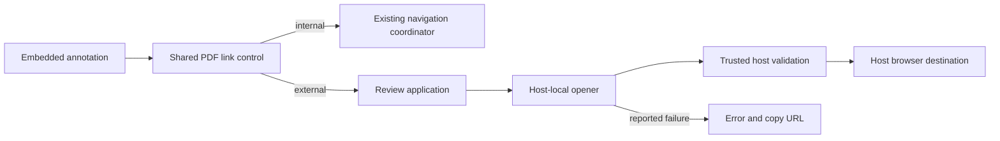

# Embedded PDF Web Links - Plan

## Goal Capsule

- **Objective:** Readers can follow embedded web hyperlinks from a Placekeeper PDF without copying the URL or losing their reading position.
- **Product authority:** The confirmed Product Contract below governs behavior across desktop, VS Code, Chrome, and Codex.
- **Open blockers:** None. Host integration and verification details remain for planning.

---

## Product Contract

### Summary

Make embedded PDF web hyperlinks clickable in both the Main view and Reference Tabs.
Each host handles the destination according to R5–R7, while the PDF remains available at its current reading position.

### Key Decisions

- **Embedded links only.** Governs R1. (session-settled: user-directed — chosen over detecting printed URLs: the user accepted omitting URL detection and its line-break complexity.)
- **Host-controlled opening.** Governs R5–R7. (session-settled: user-approved — chosen over forcing an in-app destination in Codex: the verified host interface leaves destination selection to host preference and presentation.)
- **Direct activation with recovery on failure.** Governs R2–R4, R9. The user confirmed this interaction scope after seeing the proposed behavior and boundaries.

### Requirements

**Link eligibility and interaction**

- R1. Eligible links are embedded PDF hyperlinks with valid HTTP or HTTPS destinations; printed URLs and other protocol targets are not enabled by this feature.
- R2. Eligible links shall work through pointer click and keyboard activation in both the Main view and Reference Tabs.
- R3. Hovering or keyboard-focusing an eligible link shall reveal its actual destination URL.
- R4. Placekeeper shall open a link only after deliberate activation, without adding its own confirmation step.

**Host destinations**

- R5. The desktop app and VS Code extension shall open eligible destinations in the OS default browser.
- R6. Chrome shall open eligible destinations in another browser tab, preserving the PDF tab.
- R7. Codex shall delegate opening to its host and honor the host's browser preference and presentation constraints, including external routing when the host requires it.

**Continuity and failure**

- R8. Opening an external link shall preserve the originating PDF's reading position and leave existing internal-reference navigation behavior unchanged.
- R9. If the host reports failure or cannot accept the opening request, Placekeeper shall retain the PDF view and offer a brief error with a way to copy the destination URL.

### Acceptance Examples

- AE1. **Desktop and VS Code.** Given an eligible embedded link, clicking it opens the OS default browser; returning to Placekeeper reveals the same reading position. Repeat for each host and both PDF surfaces. **Covers R1, R2, R5, R8.**
- AE2. **Chrome.** Activating an eligible link opens another browser tab and leaves the PDF tab at its prior position. **Covers R2, R6, R8.**
- AE3. **Codex.** With the in-app browser enabled and selected by the host in a supporting presentation, activation opens there. With external routing selected or required by the host presentation, activation follows that routing instead. The PDF stays at its prior position. **Covers R2, R7, R8.**
- AE4. **Destination inspection and keyboard use.** Hover or keyboard focus reveals the embedded destination, even when the visible PDF text differs from that URL. Focus alone opens nothing; keyboard activation opens it without a Placekeeper confirmation. Repeat in the Main view and a Reference Tab. **Covers R2–R4.**
- AE5. **Opening failure.** A rejected or unavailable host opener leaves the PDF usable at its current position and displays a brief error with a working copy-URL action. **Covers R8, R9.**
- AE6. **Eligibility boundary.** Printed web addresses without hyperlink annotations do not become clickable. Malformed destinations and email, file, application, or executable-action targets cause no external opening through this feature. **Covers R1, R4.**
- AE7. **Internal links.** Following an existing same-document reference continues to use Placekeeper's existing internal navigation behavior. **Covers R8.**
- AE8. **Passive viewing.** Loading, rendering, scrolling past, or focusing an external hyperlink does not open its destination. **Covers R4.**

### Scope Boundaries

Eligibility exclusions are governed by R1. This work adds no URL detection, OCR, link editing, or separate Placekeeper browser-choice setting.
It does not add a web-page viewer inside a Reference Tab or redesign internal PDF navigation.

### Dependencies and Assumptions

The current shared link classifier accepts same-document navigation and rejects external URI actions.
This feature intentionally extends that boundary for the eligible links in R1; older blanket external-link rejection expectations must be reconciled with R1 and R4.

Read-only inspection of the installed Codex desktop bundle, version 26.1029.61003, found a host link-opening capability and routing to either its browser panel or an external browser.
The standard request exposes a URL, without a destination override.
The inspected modal presentation forces external routing; ordinary presentation uses the host's routing preferences.
This establishes a viable host path for R7, not an end-to-end Placekeeper click test or a guarantee about future Codex versions.

R9 concerns failures observable by Placekeeper when handing off the URL.
It does not require detecting whether a destination page later loads successfully in another browser.

### Outstanding Questions

**Deferred to Planning**

- Determine the host opening interfaces, failure signals, and capability checks needed for R5–R7 and R9.
- Determine how destination previews and keyboard activation fit the existing PDF interaction controls without disrupting selection or internal navigation.
- Define actual-host verification for AE1–AE5, including Codex's supported presentations and browser preferences.

### Sources and Research

- `apps/web/src/pdf/PdfLinkControl.tsx:155` and `apps/web/src/pdf/pdf-navigation-target.ts:185`: shared link classification and current rejection boundary.
- `apps/web/src/pdf/PdfWorkspace.tsx:244` and `apps/web/src/pdf/ReferencePdfViewport.tsx:231`: both surfaces use the shared link renderer.
- `apps/web/src/host/runtime.ts:47` and `apps/web/src/host/session-contracts.ts:69`: current shared host contracts lack an external URL opener.
- `apps/electron/src/main.ts:191` and `apps/electron/src/update-check.ts:48`: existing Electron external opening for validated update URLs.
- `docs/plans/2026-08-09-002-feat-reference-navigation-workspace-plan.md`: earlier same-document navigation and external-action rejection requirements; R1 and R4 define this feature's change to that boundary.
- Installed Codex bundle inspection on 2026-11-05: MCP host capability and opener in packaged asset `696092.b8f9b89872.js`; link request schema in `94020.8dbe1c7757.js`; shared browser dispatch in module `Ot7V`; native routing function `HY` and browser-target resolver in the early-bootstrap bundles. These observations are version-specific; host behavior needs runtime qualification during implementation.

## Planning Contract

### Approach

Use the existing shared PDF annotation control for both surfaces. Add a distinct external-link event and a host-local opening capability; never send browser-opening requests through the review service. Ship as one cohesive change because the UI and host contracts must agree.

### Key Technical Decisions

- KTD1. A shared core validator accepts absolute HTTP/S URLs, rejects malformed syntax and other schemes, and returns the canonical URL. Validate in the renderer and again at each privileged opener. Preserve query and fragment.
- KTD2. External activation bypasses internal navigation and checks current document generation and surface availability before dispatch. Host failure is transient UI state with copy and dismiss actions; it must not change reference/history state.
- KTD3. Each host owns its opener: Electron authenticated shell IPC, VS Code correlated host-only webview request, Chrome extension callback using tabs.create, Codex injected App.openLink callback after checking openLinks. Generic browser/static views use a synchronous, noopener browser handoff. Never infer browser failure from a null noopener return.
- KTD4. Use the shared tooltip component for URL previews on hover and focus, while preserving the existing control's event isolation and keyboard semantics.

### High-Level Technical Design

These sketches describe boundaries, not prescribed implementation signatures.



```text
Activation protocol: deliberate click/key -> validate annotation -> verify source generation/surface
  -> invoke host opener -> host validates URL and authority -> acknowledge or reject.
URL decisions: non-URI -> existing internal classification; URI invalid/non-web -> unavailable;
  URI valid HTTP/S -> external event; stale source -> ignore; host failure -> recovery.
Lifecycle: idle -> opening -> idle on acknowledgment, or recoverable error on rejection;
  document replacement invalidates stale completion; copy/dismiss leaves PDF state intact.
Host API: one URL input; asynchronous acknowledgment/rejection; no destination override,
  service RPC method, model tool, or persisted state. Browser handoff happens before awaiting.
```

### Assumptions and Risks

Host acknowledgment cannot prove that a destination loaded. Codex routing remains host-controlled per R7. No new Chrome permission or SDK upgrade is required. Keep the VS Code generic URL/path rejection intact; a dedicated local message must retain panel/session/replay protections. Browser popup behavior requires actual click verification. No background opening or retries.

## Implementation Units

### U1 — Validate and classify embedded web links

Covers R1, R4; depends on none. Add a shared core HTTP/S validator and a separate PDF URI classifier/event. Preserve same-document classification. Tests cover HTTPS/HTTP query and fragment, malformed and relative strings, whitespace/control-character tricks, email/file/javascript/application schemes, Launch and RemoteGoto, plus unchanged internal targets.

### U2 — Implement host-local opening

Covers R5–R7, R9; depends on U1. Extend HostRuntime and implement each adapter per KTD3. Own the Electron preload/main shell contract, VS Code dedicated correlated request and trusted callback, Chrome injected callback, and Codex shell callback. Reject unauthorized, stale, malformed, denied, and unsupported requests without broadening service RPC. Tests cover one dispatch per accepted URL, zero for invalid URLs, false/rejected/unsupported responses, and existing bridge identity/disposal protections.

### U3 — Wire activation, preview, and recovery

Covers R2–R4, R8–R9; depends on U1–U2. Update PdfLinkControl and ProductionReviewApp with KTD2/KTD4 behavior. Both shared surfaces use the same path. Show a brief error with an always-selectable destination URL, a copy action, clipboard failure feedback, and dismissal. Tests cover pointer and keyboard activation, hover/focus URL preview, no passive opening, stale-source rejection, a selectable URL after clipboard denial, and failure recovery without internal navigation/history changes.

### U4 — Qualify hosts and document behavior

Covers R1–R9 and AE1–AE8; depends on U3. Update embedded-link fixture and focused acceptance tests, preserving rejected non-web actions. Register tests in central suites as needed and update user documentation of host routing. Run browser acceptance for both surfaces, URL inspection, new tab/no opener, failure/copy, and existing internal navigation. Qualify actual Electron, VS Code, Chrome, and Codex paths where installed hosts permit it. Record exact untested host/presentation cases; do not present mocks as actual-host proof.

## Verification Contract

- Unit evidence: shared validator/classifier, control events, runtime adapters, trusted host dispatch and failure, source guards and recovery.
- Integration evidence: type checking and applicable centralized host suites; real shell bridge qualification for Codex where available.
- Browser evidence: deliberate pointer/key opens exactly once; focus/render opens nothing; preview shows destination; originating PDF retains position; recovery copies URL; internal links remain functional.
- Host matrix: Electron and VS Code OS browser; Chrome new tab; Codex host-selected in-app/external presentation. Record environment constraints and observed outcomes separately from simulated tests.
- Review the final diff for URL validation at privileged boundaries and absence of generic RPC relaxation.

## Definition of Done

All U1–U4 behavior is implemented; relevant automated checks pass; review findings are resolved or recorded; actual-host evidence and any remaining qualification limits are explicit. The change is committed, pushed, and available as an open PR with CI disposition under the authorized lfg workflow. Merge is outside this run.
