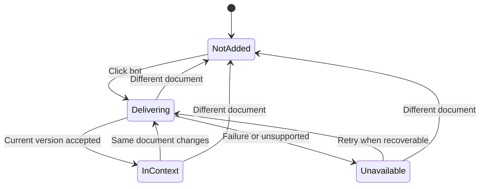
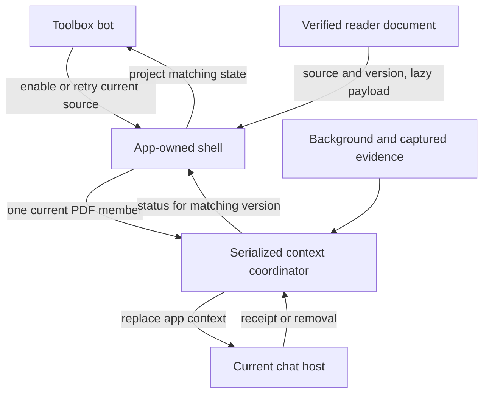

# Document in Context - Plan

## Goal Capsule

**Objective:** A reader can ask the chat about the arguments, equations, and figures in a PDF open in Placekeeper without selecting passages or uploading the document separately.

**Means:** Use the toolbox bot button to supply the document to the host's existing PDF-reading capabilities.

**Product authority:** The confirmed Product Contract below governs this feature. Broader extension improvements and a separate document-reading system are not active scope.

**Execution profile:** One change on existing PR #158. Start the native check in U1 alongside implementation of the capability-checked embedded route. Missing native access limits verification; it does not change what the host acceptance indicator means.

**Stop condition:** If native evidence shows that the selected route cannot support full-paper reading, report the limitation before substituting another workflow or claiming completion. Missing access to a host means its coverage remains unverified.

---

## Product Contract

### Summary

The toolbox bot button will let a reader put the open PDF into chat context and see whether the current version has been accepted.
After the first click, changes to that document will update automatically; a different document will require a fresh click.
The chat will use its existing reading capabilities to answer questions about the supplied PDF.

### Problem Frame

A reader discussing a paper needs access to evidence beyond selected passages: arguments across sections, equations, and figures.
A connection indicator or a visible attachment does not establish that the assistant can read that evidence.
The desired outcome is a continuous reading-and-discussion workflow with an honest indication of document availability.

### Key Decisions

- **Use the existing bot button.** Governs R1, R3, R4; combines the context action with its status instead of adding a separate attachment control. (session-settled: user-directed — chosen over immediate automatic attachment and assistant-triggered retrieval: the reader wants the toolbox status indicator to provide the action.)
- **Automatically follow changes to the chosen document.** Governs R5. (session-settled: user-directed — chosen over click-to-update: the reader wants subsequent versions synchronized automatically.)
- **Require a fresh click for another document.** Governs R6. (session-settled: user-directed — chosen over following every document opened in the panel: the initial action applies to the chosen document.)
- **Reuse host reading capabilities.** Governs R2, R10; the successful small-PDF probe supports pursuing a handoff before building separate reading tools.

### Actors

- **Reader:** Opens a PDF, enables its context, and asks questions in chat.
- **Placekeeper:** Supplies the chosen document and presents the current delivery state.
- **Chat host and assistant:** Accept the document and use available reading tools to answer questions.

### Requirements

**Entry and reading**

- R1. Clicking the toolbox bot button when the current document is not in context initiates full-document delivery to the current chat.
- R2. The delivered document must support the host's existing PDF-reading capabilities for text and visual evidence, without requiring passage selection or a separate upload.
- R3. Delivery must not send a chat message.
- R4. Once the host accepts the current document version, the bot button shows green and exposes the exact status text **“Document in context”** on hover or keyboard focus; acceptance does not claim the assistant has read it.

**Currentness and document boundaries**

- R5. After the initial click, changes to that same document automatically update the supplied PDF while the review remains connected to the chat.
- R6. Opening a different document requires a fresh click before supplying that document, even in the same panel.
- R7. A pending update must have a distinguishable working state and must not show the current document as successfully in context.
- R8. A successful receipt for an older version or a previously open document must not establish green status for the current version.
- R9. Updates apply to future context and do not imply that earlier messages or answers have been revised.

**Failure and recovery**

- R10. If delivery is unsupported, fails, or cannot accommodate the document, the button must clearly indicate that the current document is not in context and explain the limitation.
- R11. Clicking the bot button in a recoverable failure state retries delivery of the current document.
- R12. Lightweight review context alone must not satisfy the full-document status in R4.

### Key Flows

The existing toolbox bot button is the sole entry point for this feature; status appears on that button and through hover or focus text. Its placement remains in the toolbox.

- F1. **First use:** The reader opens a PDF, clicks the bot button, observes delivery progress, then sees the accepted state and asks a question normally. **Covers R1–R4, R7.**
- F2. **Same-document update:** A changed version triggers automatic delivery; the working state persists until that current version is accepted. **Covers R5, R7–R9.**
- F3. **Different document:** The panel displays the new PDF with context not enabled for it; a fresh click starts F1. **Covers R6, R8.**
- F4. **Failure:** The button explains why the current document is unavailable to the chat; a recoverable failure offers retry through the same button. **Covers R10–R12.**

The state diagram summarizes these flows; the R-IDs govern the behavior.



### Acceptance Examples

- AE1. **Given** a document not yet supplied, **when** the reader clicks the bot button and delivery succeeds, **then** no message is sent and hover or focus shows “Document in context.” **Covers R1, R3, R4.**
- AE2. **Given** a successfully supplied paper, **when** it is recompiled, **then** Placekeeper sends the new version automatically and shows progress until the current version is accepted. **Covers R5, R7.**
- AE3. **Given** delivery of an older version is pending, **when** the PDF changes again and the older receipt arrives, **then** that receipt cannot mark the latest document green. **Covers R7, R8.**
- AE4. **Given** one paper is in context, **when** a different paper opens in the panel, **then** the second paper is not delivered until a fresh click; a late receipt for the first paper cannot change its status. **Covers R6, R8.**
- AE5. **Given** a failed update, **when** the reader inspects the bot button, **then** the failure is visible rather than the success state of the previous version, and a retry targets the current document. **Covers R7, R10, R11.**
- AE6. **Given** only review metadata was accepted, **then** the full-document success indicator remains off. **Covers R12.**
- AE7. **Given** a document update succeeds, **then** earlier assistant answers remain historical and the new document is available for subsequent questions. **Covers R9.**

### Success Criteria

Qualification must demonstrate actual reading of both text and figures from supplied PDF content, rather than only an attachment or acceptance receipt.
Use representative full papers in the intended Codex and ChatGPT hosts, including questions about an argument across sections, an equation, and a figure.
The assistant must obtain its evidence through the handoff, without opening a hidden local fixture or an answer key.

### Scope Boundaries

- This feature supplies the PDF to existing host reading capabilities; a separate retrieval, indexing, or document-answering system is deferred.
- Styling follows existing Placekeeper conventions; redesigning the toolbox is outside scope.
- The feature does not retroactively correct answers, per R9, or promise removal of document information already present in chat history.
- General connection lifecycle improvements outside the delivery and status behavior above remain separate work.

### Dependencies and Assumptions

The 2026-11-06 native Codex probe delivered an embedded PDF as base64 resource content in a fresh turn.
Decoding and rendering only those received bytes allowed the assistant to identify the experiment code, seedling count, relative bar heights, and marker shape and color across two pages.
The resource-link route exposed metadata but did not provide readable PDF contents in that test.

This establishes a small-document path in the tested Codex host, not automatic PDF ingestion, acceptable full-paper context costs, or ChatGPT support.
R4 describes a host acceptance signal; the qualification criteria separately establish whether the chosen delivery route is useful for reading.

### Outstanding Questions

All items below are **Deferred to Planning**:

- Which supported delivery route provides full-paper access in each intended host, with acceptable size and context costs?
- How does the host replace the app's supplied document context, and what currentness evidence is available after reconnect or panel remount?
- Which existing document identity and version signals distinguish a changed paper from a different document?
- Which document-size or host limitations need to be surfaced under R10? If qualification makes the confirmed experience infeasible, return to the product decision rather than silently substituting a separate reader.

### Sources and Research

- User-confirmed scope and bot-button decisions, 2026-11-06.
- Machine-local, best-effort probe evidence: `/tmp/compound-engineering-503/ce-prototype/2026-11-06-pdf-handoff/`, especially `status.md` and `01-native-handoff/README.md`. Embedded PDF bytes established small-document readability. The server resource link did not establish reading access; the original host file link was not tested. These temporary files may disappear; their absence does not block planning, and this Product Contract governs disagreements.

---

## Planning Contract

**Product Contract preservation:** Product behavior and IDs unchanged; the prototype citation distinguishes the probe result from production qualification.

### Key Technical Decisions

- KTD1. **Qualify document delivery separately from receipt handling.** Governs R2, R4, R10. The native Codex probe put a 1,935-byte PDF into model-visible context as 2,580 base64 characters. Rendering the received bytes established small-document readability but required manual recovery of those bytes. A repository paper excerpt alone is 932,687 bytes (1,243,584 base64 characters). The pinned SDK exposes distinct embedded resource and resource-link capabilities; neither advertises a PDF decoding contract or size ceiling. Use the documented embedded resource on hosts that advertise it and provide model-context updates. Send the complete admitted PDF and surface a declined update; do not invent an application cap or claim a generic file upload limit applies. U1 attempts native qualification of that route. Also try an original host file link when accessible, since it could avoid literal base64. Keep it out of production unless independently qualified for reading and version replacement on the actual source admission path.
- KTD2. **Use one publisher and one managed PDF slot per app invocation.** Governs R3, R4, R7–R9, R12. The host replaces this app instance's context on each update, so extend `ExtensionContextCoordinator` rather than adding a second writer. Compose the one current PDF group with background context, captured selections and annotations, and foreign content/structured data. Correlate a nonempty host update receipt to the submitted PDF version and publication attempt. Metadata-only receipts cannot acknowledge a PDF. Keep the current PDF as a single versioned member, with compact content fingerprints for comparison and receipt history. Review metadata can share a replacement payload but must not trigger another PDF preparation or demote a still-current PDF. On switch, invalidation, or failed replacement, omit the stale member from the next update and reconcile removal through the same writer. If the host is unreachable, report unavailable; removal from past chat turns is outside the contract.
- KTD3. **Separate consent from delivery authority.** Governs R5 and R6. Retain the reader's choice in the active app invocation using the authenticated Review Session and stable source file ID from the ready reader. The broker keeps its file ID through local and imported-host replacements. Resolve the session from the admitted presentation, not a filename or path supplied by the assistant. Do not use a title, generation, digest, renderer epoch, grant, or runtime ID alone to decide that two documents are the same. Within a source, use the verified document generation and digest to identify the bytes. Scope async work to the current mount, grant, connection, source and version; check the authenticated presentation with its existing watermark request before a PDF submission and recheck local currency when a receipt arrives. The context-published marker is bookkeeping and cannot authorize a PDF. Retain consent across authenticated continuation of the same source, invalidate success when currency is unknown, and republish only after currentness is re-established. A new invocation starts without consent. If it sees a lingering managed PDF block in the host state, remove it without adopting it. Explicit host removal cancels the PDF choice and cannot be undone by a late echo.
- KTD4. **Keep PDF data at the verified reader boundary.** In the Codex runtime the reader already receives verified bytes through `viewerAssets.documentBytes`. Add a lazy, version-scoped read seam rather than copying bytes into lightweight snapshots or adding an ambient file endpoint. The optional host link investigation uses only a URI admitted by the host adapter and matched to the displayed version. A future production link must bind to the exact admitted PDF version for the life of that member and carry an app-owned marker preserved by host reconciliation. A mutable URI with an app-read ETag does not provide that binding, and a raw URI cannot distinguish a managed member from a foreign link to the same file. Keep PDF bytes, URI credentials, and content out of logs and diagnostics. Treat embedded document content as untrusted evidence.
- KTD5. **Use the toolbox's existing bot treatment with distinct app-owned behavior.** Governs R1, R3, R4 (session-settled: user-directed — chosen over immediate automatic attachment and assistant-triggered retrieval: the reader wants the toolbox status indicator to provide the action). Use a native keyboard-operable control and the shared tooltip behavior, with the existing icon, dimensions, color roles and reduced-motion conventions. Keep the passive task-bound status and the contextual selection/annotation capture actions separate. Preserve focus and explanation on nonactionable states, and guard their activation. When delivery resolves while the control retains keyboard focus, expose its new status without requiring the reader to leave and refocus.

### High-Level Technical Design



```mermaid
sequenceDiagram
    participant Reader as Reader
    participant Shell as App shell
    participant Publisher as Context coordinator
    participant Host as Chat host
    Reader->>Shell: Click on document A
    Shell->>Publisher: Current A1 payload
    Publisher->>Host: Replace context with A1
    Note over Shell: A2 becomes current; A1 cannot mark it green
    Shell->>Publisher: Supersede A1 with A2
    Host-->>Publisher: A1 receipt, ignored for current status
    Publisher->>Host: Replace context with A2
    Host-->>Publisher: A2 receipt
    Publisher-->>Shell: A2 accepted
    Note over Shell: Switch to B clears consent
    Shell->>Publisher: Remove PDF member
```

### Assumptions and Open Questions

- U1 owns the remaining external facts: which host and entrypoint can read a whole paper, what delivery method it used, and any observable size or context limit. Until then both proposed routes are candidates, including original host file links. No current source establishes automatic PDF ingestion or a universal full-paper size limit for this extension.
- Qualification can proceed independently of UI and publisher mechanics. Native ChatGPT coverage may be inaccessible. Record each host and entrypoint as passed, failed, or unverified. Capability advertisement and exact acceptance govern status; only native reading evidence establishes qualification.
- One source may be admitted under new transport credentials during a rebuild or reconnect. Confirm the exact continuity signal in U3 and cover both continuation and explicit different-source activation. If source continuity cannot be established, show no current status and do not silently transfer consent.

### Sources and Research

- OpenAI's [Plugin Extensions guide](https://developers.openai.com/plugins/build/extensions) and linked [model-context specification](https://github.com/openai/mcp-extensions/blob/main/docs/spec.md#uiupdate-model-context-extensions) establish the host capability, replacement and receipt contract used in KTD1–KTD2. The pinned packages are `@openai/mcp-extensions` 0.2.1 and `@modelcontextprotocol/ext-apps` 1.7.5.
- `docs/solutions/architecture-patterns/task-scoped-prompt-refreshed-live-pdf-context.md` documents the existing publisher's removal and remount behavior. `docs/solutions/design-patterns/truthful-compact-agent-context-status.md` and `docs/solutions/conventions/native-control-tooltip-contract.md` govern truthful compact status and control disclosure.
- Prototype sources (temporary, machine-local): `/tmp/compound-engineering-503/ce-prototype/2026-11-06-pdf-handoff/status.md` records the outcomes; `/tmp/compound-engineering-503/ce-prototype/2026-11-06-pdf-handoff/01-native-handoff/app.ts` contains the three resource variants. Its original host file mode requires a file entrypoint and matches only the disposable fixture digest. Reuse the pattern with an authorized full-paper fixture, not its fixed test credentials or URI.

---

## Implementation Units

### U1. Qualify full-paper reading in the native hosts

**Goal:** Attempt native reading and update checks on representative full papers and document the limits of the evidence.

**Requirements:** R2, R4, R9, R10 and Product Contract Success Criteria.

**Dependencies:** None.

**Files:** Extend the temporary probe if available; capture scoped results in `docs/testing/chatgpt-extension-qualification.md`. Add Codex observations to the same evidence record so host differences remain explicit.

**Approach:**

1. In a fresh native conversation test a complete representative paper with separate argument, equation and visual questions. Test the embedded binary variant. If the file entrypoint can supply an original host file URI, investigate it in a separate fresh conversation. Use a fixture and answer key withheld from the answering assistant; opening the original in its filesystem or using a previous answer does not establish handoff.
2. Record the host and build, entrypoint, capability flags, raw size, transmitted size, actual model-visible representation and reading path, receipts, and answer accuracy. Distinguish trusted local file admission, opaque host-file admission, and the conversation picker. For a host file entrypoint, run a control before attachment. If the chat can already answer from that file, classify the reading result as inconclusive for the handoff. Run a same-source replacement with a distinct blind answer to expose stale resolution. For a link candidate, also ask after mutating the host file but before the reader verifies the replacement; the old member must not reveal the unadmitted new bytes. Repeat on the intended second host when accessible.
3. Record which combinations passed, any measured bounds and why others remain unverified or failed. An omitted or truncated payload, unaffordable literal context, accepted-but-unreadable link, or stale version is a failed result. A test blocked by account or host access is unverified, not a pass. If the selected route is proven unsuitable for representative complete papers, report that evidence per the Goal Capsule. Missing UI access is a coverage limitation.

**Test scenarios:**

- A new turn answers an across-sections question, an equation question, and a question about an actual figure using only the supplied complete PDF.
- Covers AE7. A new version changes an answer; a subsequent question uses that version, and prior answers stay historical.
- A host that declines or cannot carry the document does not acquire a supported route merely because it acknowledged the update.

**Verification:** Review the native evidence against KTD1 and the Product Contract Success Criteria. No SDK mock substitutes for this unit.

### U2. Define and publish the current PDF member

**Goal:** Implement the shared contract and serialized replacement path independently of the control.

**Requirements:** R3–R10, R12; F2–F4.

**Dependencies:** None. Build the publisher and status contract while U1 is attempted.

**Files:** `apps/web/src/host/document-in-context.ts` (new shared contract), `apps/web/src/host/extension-context-coordinator.ts`, `apps/web/test/extension-context-coordinator.test.ts`.

**Approach:** Define an invocation-local PDF member with a source key, generation/digest, and prepared embedded PDF resource block. Expose set/clear and PDF-specific state observation separate from background publication; scope every completion to the exact member and attempt under KTD2. Publish interface types early so U3 and U4 can build in parallel. Keep PDF-specific failure distinct from lighter review context, including a best-effort replacement without the failed PDF when necessary to keep existing groups functional.

**Patterns to follow:** The coordinator's captured attachment receipt, explicit removal, foreign-state preservation, and remount reconciliation.

**Test scenarios:**

- Covers AE6. Background plus captured attachments produce no PDF success until an exact submission containing the PDF receives a receipt.
- Covers AE3. An older pending receipt arrives after a newer PDF is queued; the newest submission is the only one that can become current.
- A failed, empty, or superseded receipt does not restore stale green. A replacement preserves captured and foreign members.
- An authoritative removal during a pending update invalidates its success; a stale echo cannot re-add it. Fresh initialization does not adopt an old PDF block.

**Verification:** Coordinator tests prove the host payload and receipt fences, not native PDF reading.

### U3. Wire the admitted reader and lifecycle to publication

**Goal:** Connect the correct PDF version and the user's consent to the existing app-owned invocation.

**Requirements:** R1–R3, R5–R8, R10–R12; F1–F4.

**Dependencies:** U2's shared contract. U1 supplies native observations, if available.

**Files:** `apps/codex-mcp/src/extension-shell.ts`, `apps/web/src/host/review-agent-bridge.ts`, `apps/web/src/app/ProductionReviewApp.tsx`, `apps/codex-mcp/test/extension-shell.test.ts`, `apps/web/test/production-review-app.test.tsx`. The optional host-link probe does not require production adapter changes.

**Approach:**

1. Extend the app-owned bridge with a document-context controller: the reader reports its current verified source/version and a guarded lazy payload accessor; the controller exposes status subscription and activate/retry for that exact displayed version. Use the existing bridge to avoid expanding the mount signature or passing binary data through lightweight context.
2. Derive and retain source choice in the shell. Invalidate publication on verified generation change, replacement, disconnect, or terminal teardown; restore from same-source authenticated continuation only per KTD3. Use embedded delivery and gate on host capability per KTD1. Bound encoding and receipt bookkeeping to the latest payload and the one in-flight write; surface host rejection.
3. Project controller state to the current reader immediately on source/version change, including before a new payload becomes readable. Pass the app-owned control props into the existing chrome slot, using the U4 component contract. No global URL or path-based authority.

**Patterns to follow:** `ExtensionShell.#addContext` grant/epoch guard, reader readiness and snapshot currentness in `ProductionReviewApp`, and the digest-verifying materializer in `apps/web/src/host/codex-runtime.ts`.

**Test scenarios:**

- Covers AE1. Opening a PDF alone publishes lightweight review context only. Clicking produces an embedded PDF submission and never calls a message API.
- Covers AE2. Same-source generation replacement updates automatically; review-only edits do not regenerate the PDF.
- Covers AE4. Different source activation in the same panel clears consent; even a same-named replacement and a late prior receipt cannot cause delivery or green.
- Covers AE5. Missing or rejected bytes fail closed, and retry prepares the newest version. Reconnect and late reader callbacks cannot access an old grant.
- An unsupported host exposes an explanation and preserves the reader and existing captured-context actions.

**Verification:** Shell tests exercise the mocked host and grant changes; mounted reader tests prove the projection uses the displayed version. Neither proves native PDF ingestion.

### U4. Present the status in the toolbox

**Goal:** Fit the control into Placekeeper's current visual and interaction conventions.

**Requirements:** R1, R4, R7, R10–R12.

**Dependencies:** U2's shared status/action interface. U3 wires that interface to the reader.

**Files:** `apps/web/src/review/ReviewShell.tsx`, `apps/web/src/review/ReviewChrome.tsx`, `apps/web/src/review/DocumentContextButton.tsx` (new), `apps/web/src/app/neutral-context-status.css`, `apps/web/test/document-context-button.test.tsx` (new).

**Approach:** Add the app-owned projection to the existing context slot and its sizing probe. Use `ReviewTooltipButton` and the existing robot icon and status tokens. The component takes only state and an action, without PDF or host dependencies. Use the exact accepted text from R4 and concise distinct copy for idle, progress, unsupported and retryable failure.

**Patterns to follow:** `CodexContextStatus` for visual footprint and currentness, `ReviewTooltipButton` for keyboard/pointer behavior, and existing reduced-motion status styles.

**Test scenarios:**

- Covers AE1. Enter from idle calls the same action as pointer activation. Pending then accepted status appears on the same focused bot, and pointer hover exposes the same exact accepted copy.
- Pending and permanent unavailability remain inspectable and do not invoke delivery; retryable failure can invoke it once. State is meaningful without color.
- The app-owned bot uses one chrome slot across states, including narrow layout. The passive task-bound variant stays passive.

**Verification:** Component tests cover semantics; a mounted browser check covers pointer delay, keyboard focus, footprint, and reduced motion.

---

## Verification Contract

- Local: run `pnpm test:codex-native`, `pnpm test:web`, `pnpm typecheck`, and `pnpm build:codex-mcp`. Verify the exact new test paths are included by the relevant suite selection, or run them explicitly. These checks cover transport composition, lifecycle and UI without claiming native reading.
- Browser: check the existing toolbox placement in light and dark themes and at a narrow width. Exercise click, focus, delivery progress, accepted copy and retry without displacing controls or changing the passive task-bound status.
- Native: where accessible, check the production bundle delivers the representation exercised by U1 and repeat the reading and update flow there. Record any inaccessible host or source class explicitly as unverified. A receipt alone meets the status transition requirement, never the reading qualification.

---

## Definition of Done

- The existing PR contains the implementation and verification, with the actual U1 results and any host or document limitations stated separately from local checks.
- The embedded route supplies the complete admitted PDF on a capable host. Implementation review may proceed with explicit verification limits. Full product qualification remains outstanding until the Product Contract Success Criteria are observed in both intended hosts. Users can see whether their current PDF is in context, have same-source changes followed, and must click again for a different PDF.
- The toolbox still follows Placekeeper's visual and keyboard conventions. Captured review context, lightweight context, and task-bound status retain their distinct behavior.
- No stale or metadata-only receipt can set the full-document status. Unsupported, declined, and oversized documents remain visibly unavailable without sending chat messages.
